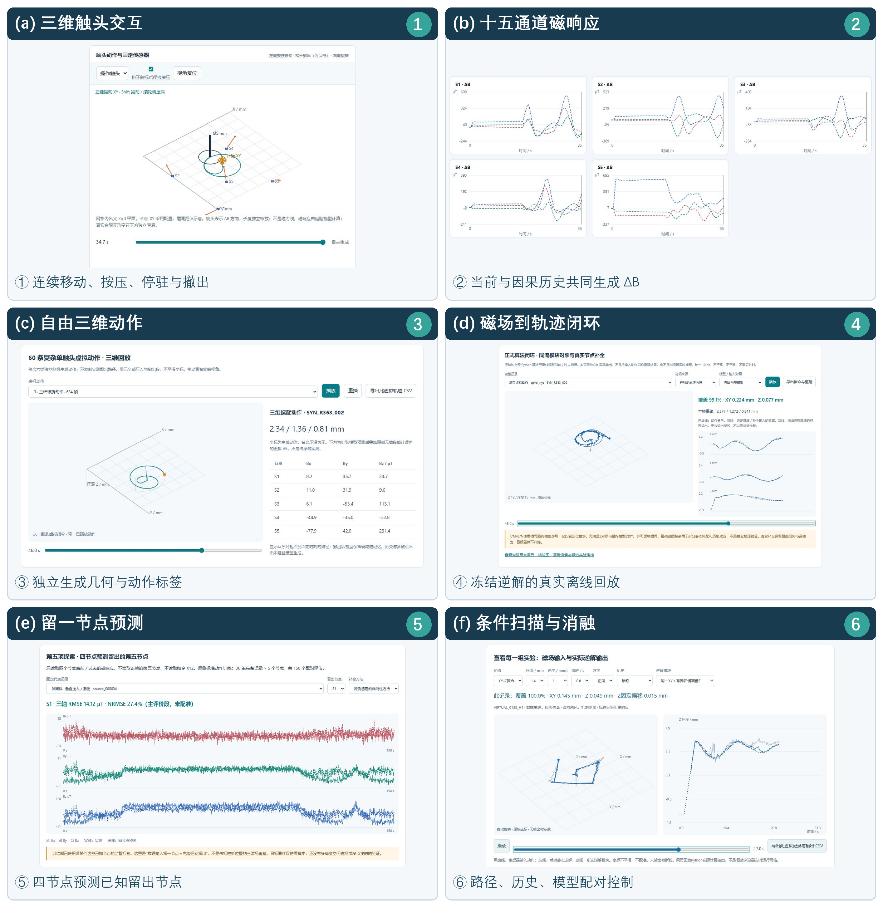
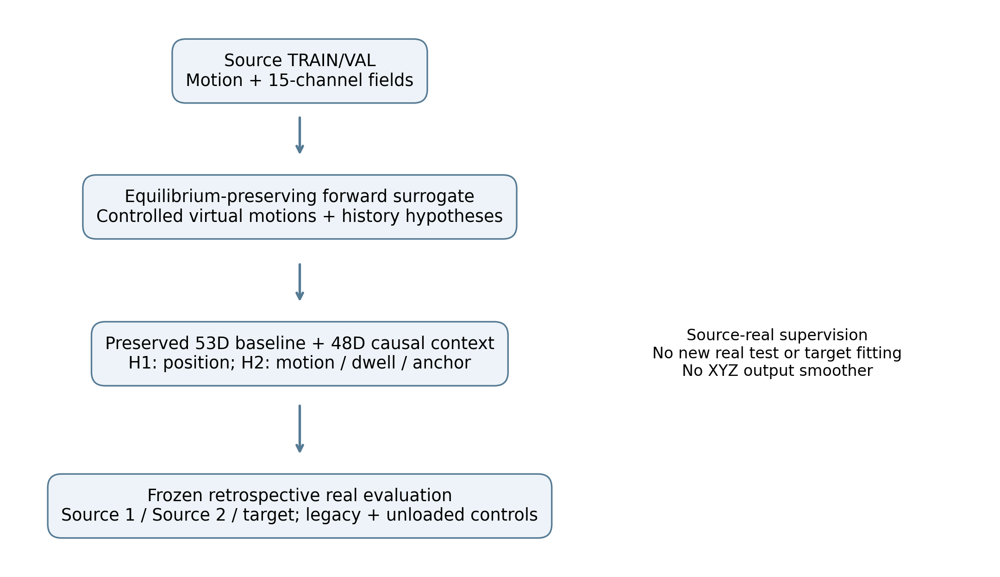
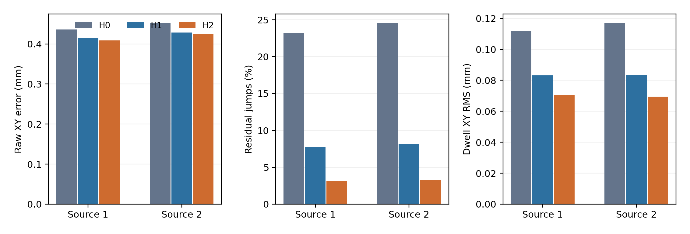
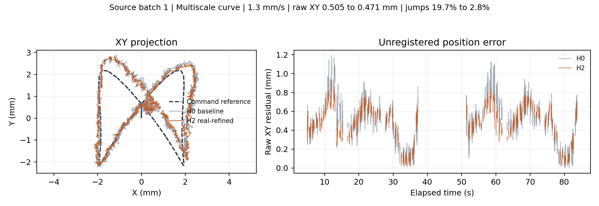
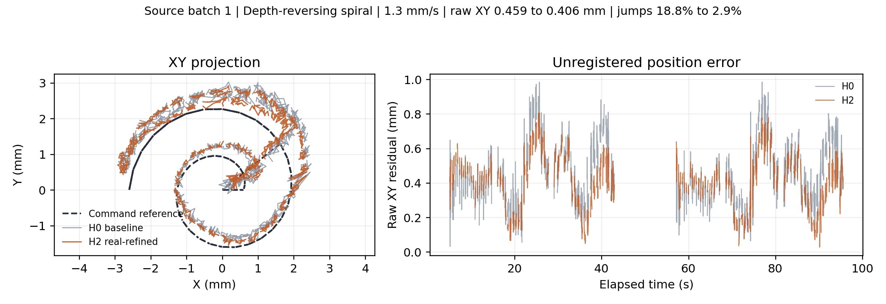
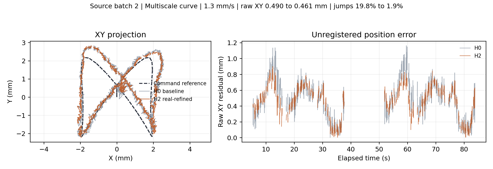
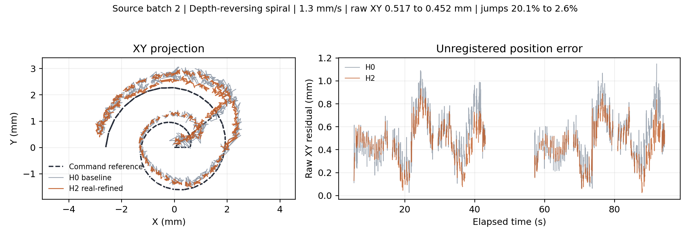

# 仿真启发的因果历史与运动约束学习：柔性磁触觉轨迹重建的稳定性与定位优化

**摘要** 柔性磁触觉的连续轨迹重建同时受到空间编码、材料历史和磁观测扰动影响，单纯增加训练样本或使输出更平稳并不保证定位改善。本文建立由源侧实测动作与十五通道磁流拟合的分轴动态正向代理及交互仿真平台，以受控虚拟动作探索历史表征，再将发现转化为源侧真实训练的平面残差头。保持充分训练基线的原因果历史、归一化、深度和输出许可，追加三尺度指数平均残差；新连接以零权重初始化，严格保持原函数。两个配对候选分别使用位置监督及位置、运动增量、可靠停驻、静态锚点联合监督。在未参与训练或检查点选择的36条复杂真实轨迹上，保持实际无载基线、采样时间和状态生命周期进行冻结因果回放。联合约束候选在源器件两批将原始XY误差由0.436/0.452 mm降至0.408/0.424 mm，同时减少残差跳变86.5%/86.5%、停驻XY波动36.8%/40.6%；另一磁层配置的目标器件仅作冻结迁移检查：跳变和波动分别降低60.0%与28.9%，但居中XY从0.478升至0.484 mm；完整目标对照保留在补充材料。结果支持仿真启发、真实监督修正的稳定性与定位协同方向，而不支持所有器件与旧动作均提升。全部控制及负结果保留；该代理不是完整物理数字孪生，控制指令参考不是独立触点真值。

**关键词** 柔性磁触觉；动态仿真；因果历史；运动约束学习；轨迹重建；可复现评价

## 一 引言

柔性磁层的接触形变改变固定霍尔节点的磁响应。当前位置之外，压入、切向运动、反转及先前停驻形成的历史也会影响读数，使相同位置不必对应相同磁场。仅以规则圆、径向或纯法向动作学习逆映射，难以覆盖这些联合状态；输出跳变和停驻坐标波动不仅妨碍直观观察，也会影响基于轨迹的控制与动作理解。

仿真的研究价值不只在于扩大样本量。连续正向模型可以固定位置和采样时序、分别改变到达历史、速度及停驻，帮助研究者把混合现象转化为受控问题。联动的触头运动、节点向量、磁通道曲线与独立逆解显示，还可直观区分“动作停止”和“磁响应平衡”。这一平台适合发现训练覆盖薄弱处与提出可检验表征，但虚拟内的成功不能替代真实验证。

软磁触觉已有力学与磁场联合设计建模[1]和基于材料点的响应仿真[2]；触觉仿真到实物学习也有光学传感研究基础[3]。不同传感机理、材料条件与接触几何不能被视作同一精度保证。本文采用任务级经验状态空间代理：预测已知触头下五节点的磁流，不宣称恢复唯一全体积形变、任意触头接触或磁场。模拟标签来自输入动作，而非逆网络预测，避免把原逆解误差循环作为监督真值。

前期虚拟扩集和历史读出在真实记录上显示，稳定性收益可与定位偏差并存。本文进一步回答：能否把仿真启发的历史信息接入已有充分训练系统，并通过源侧真实位置和运动监督保护定位，而不追加XYZ输出平滑？贡献为：保持静态平衡的分轴动态代理及可运行平台；保留原逆解函数与历史的因果特征扩展；同数据、初始化、结构和停止规则下的运动约束对照；以及新复杂轨迹、旧能力和无载控制的完整冻结真实评价。真实修正候选不是虚拟权重继续微调；仿真提供表征方向，两个候选均从原真实基线初始化并用源侧真实数据训练。

## 二 动态正向代理的理论

### A 位置与形变记忆的耦合

令触头指令坐标为q，潜在形变历史状态为s，五节点观测算子为S。实际观测可概括为式（1）。其中B是随接触和历史变化的空间磁场，B0是确认无载时的基线，噪声包含采样扰动及未建模因素。名义Z为正表示压入，不能在极浅动作中直接等同于实际接触深度。

$$\Delta\mathbf b_t=\mathcal S\{\mathbf B(\mathbf r;q_t,s_t)\}-\mathbf b_0+\boldsymbol\epsilon_t,\qquad q_t=(X_t,Y_t,Z_t).\tag{1}$$

同一位置可以对应不同历史状态，因而产生不同磁响应。其局部一阶变化可写为位置与历史的两个贡献。静态逆解把第二项也解释为位移时，就可能形成方向相关误差、反转拖尾或错误分支。因果历史估计的作用是区分这两种贡献，而不是依据轨迹模板预测未来坐标。

$$\delta\mathbf b_t\simeq J_q\delta q_t+J_s\delta s_t+\boldsymbol\epsilon_t.\tag{2}$$

这构成柔性磁触觉的位置与形变记忆耦合逆问题的条件可观测性。若在一个有效局部工作分支内，可容许的历史不确定性在磁观测空间张成子空间H，则排除H后的位置雅可比必须保留三个独立方向。式（3）给出局部一阶可分判据；实际可分辨还要求最小奇异值与目标分辨位移之积超过有效磁噪声。本文以此解释状态约束的作用，不把该判据作为已覆盖全工作域的唯一性定理。

$$\operatorname{rank}(P_{H^\perp}J_q)=3,\qquad \sigma_{\min}(P_{H^\perp}J_q)>0.\tag{3}$$

这里H表示受因果状态约束的有效历史不确定性，不能把后文全部660个经验状态坐标视作十五通道瞬时观测可独立辨识的物理自由度。真实系统依赖历史约束、静态磁图和输出许可共同缩小可行解集合。工作域外、信号接近噪声或位置与历史影响高度重叠时，应保留不确定状态。

### B 非线性空间编码

空间特征由十个低阶项和一百个三维高斯基函数组成。低阶项采用归一化坐标x=X/6、y=Y/6、d=max(Z,0)/3，依次为1、x、y、d、x²、xy、y²、xd、yd、d²。高斯中心在X与Y的-6、-3、0、3、6 mm以及Z的0.6、1.4、2.2、3.0 mm上构成网格。

$$r_j(q)=\exp\!\left[-\frac12\sum_{a\in\{X,Y,Z\}}\left(\frac{q_a-c_{j,a}}{\sigma_a}\right)^2\right],\qquad\boldsymbol\sigma=(2.5,2.5,0.65)\ {\rm mm}.\tag{4}$$

全部110维特征再乘压深因子。该构造令名义抬离输入的静态增量为零，同时允许历史残余继续存在。0.2 mm是经验特征尺度，不是已辨识的接触阈值或材料常数。高斯空间编码表示连续位置附近的平滑响应变化；它不要求XYZ与磁场呈线性关系。

$$\phi(q)=\frac{Z^+}{Z^++0.2}\,[p(q),r_1(q),\ldots,r_{100}(q)]^{\mathsf T},\qquad Z^+=\max(Z,0).\tag{5}$$

### C 对称分轴历史与静态平衡

令上一位置为q(t-1)，当前位置为q(t)，构造混合位置a=(X(t),Y(t),Z(t-1))和c=(X(t-1),Y(t-1),Z(t))。对横移先行与法向先行两条特征变化路径取平均，得到式（6）。两项的和严格等于全部特征增量；纯Z运动的横向增量为零，纯XY运动的法向增量为零。复合运动的交叉影响由两个顺序共同分配，避免任意规定更新顺序。

$$\delta_{xy,t}=\frac12[\phi(a_t)-\phi(q_{t-1})+\phi(q_t)-\phi(c_t)],\qquad\delta_{z,t}=\phi(q_t)-\phi(q_{t-1})-\delta_{xy,t}.\tag{6}$$

每一分轴增量激励三个指数衰减状态，时间尺度为0.3、1.0和4.0 s。状态只读取当前和过去的动作。遇到确认基线重置、未知坐标或大于0.5 s的断档时清零，不推测未知的前置历史。

$$h_{a,k,t}=\rho_{k,t}(h_{a,k,t-1}+\delta_{a,t}),\quad\rho_{k,t}=e^{-\Delta t/\tau_k},\quad a\in\{xy,z\}.\tag{7}$$

在停驻阶段，特征增量为零，状态按指数衰减；长时间停驻后，模型返回固定静态响应。运动反向则改变激励符号，使到达同位置的不同过程保留不同响应。式（8）的空间响应与历史响应因此能分别承担平衡值与暂态变化，动态拟合不会任意移动已经冻结的静态底座。这是模型能够协调静态与动态的结构原因。指数模态是可识别的响应代理，不代表已测得三个真实硅胶松弛常数。

$$\widehat{\Delta\mathbf b}_t=C_0^{\mathsf T}\phi(q_t)+\sum_{k=1}^{3}\left[C_{xy,k}^{\mathsf T}h_{xy,k,t}+C_{z,k}^{\mathsf T}h_{z,k,t}\right].\tag{8}$$

系数具有对磁响应线性、对动作非线性的结构。先冻结110乘15的静态系数，再拟合660乘15的历史系数。特征按源侧加权二阶矩缩放，以岭回归约束估计。完整动作而非帧数决定每条动态记录的总权重，过渡边界帧权重减半。时间尺度、是否分轴和岭强度均仅由源侧验证记录选择。

$$\widehat C=\arg\min_C\sum_iw_i\|H_iC-(\Delta\mathbf b_i-C_0^{\mathsf T}\phi_i)\|_2^2+\lambda\|D_\phi C\|_F^2.\tag{9}$$

Dφ为训练期冻结的特征尺度矩阵。实际选定历史岭强度为0.01；特征尺度下限为0.02。源侧验证同时要求纯Z和网格误差不超过静态参考的110%，并保留静态回退候选。

### D 虚拟数据如何改变重建能力

生成新的动作序列，实质上扩大了位置与历史状态的联合分布，而不只是增加已有圆轨迹的重复次数。不同的曲率、速度、反转和停驻，使相似位置搭配不同历史状态，给逆向网络提供辨别空间变化与持续响应的训练约束。网络仍学习当前与过去磁观测到坐标的映射，并不接收生成动作作为在线输入。

但虚拟数据的数量不能消除生成器偏差。设D为固定分支内局部Lipschitz的逆解器，则同路径真实与模拟输入之间有式（10）的条件性误差界。它说明模拟误差会被逆问题的局部敏感性放大；磁场NRMSE较小或平均重建误差接近，都不足以证明逐点复刻。

$$\|D(\widetilde{\mathbf b}_{\le t})-q_t\|\le\|D(\mathbf b_{\le t})-q_t\|+L_D\|\widetilde{\mathbf b}_{\le t}-\mathbf b_{\le t}\|.\tag{10}$$

该界只适用于同一有效输出分支及固定长度的因果输入窗口；拒绝输出或切换离散分支时，必须另计覆盖与失败事件。本文据此将仿真价值分为响应预测、机制复现、新运动学习和真实迁移四个可检验层次，不把模拟内收益直接解释为硬件精度提升。

## 三 仿真平台与虚拟数据

### A 实测来源与连续仿真接口

正向代理的输入来自三轴加载平台上保存的完整动作与十五通道磁流。柔性磁层下方的五个MLX90393节点采用四角加偏置中心的布局，经CH341接口读取；上位机同步归档指令事件、无载基线和配置快照。装置结构和运行现场参见项目的[系统结构与实物媒体资料](https://github.com/googo2025/MagTouch-RA-3d-trajectory-recon/tree/main/media)。本文将完成正向拟合和真实修正训练的磁层装配称为“源器件”；另一个以独立磁层配置记录的装配称为“目标器件”。两者使用相同标称五节点布局、MLX90393采集设置、硅胶材料版本及直径5 mm柱体、直径3 mm顶部平面、边缘R1的圆角平头触头；源/目标配置档案分别为5×5-had-239与5×5-had-Yellow，接触参考Z分别记录为23.360001与23.059999 mm。磁片规格、层厚及间距在现存档案中未完整补录，因此不能将器件差异唯一归因为某项材料或几何参数。源器件两批是同一装配的重复采集；目标器件未参与模型拟合、归一化或选择，用于有限的冻结迁移检验。触头、磁层和安装条件以各条记录的元数据为准；控制指令重建的名义动作不是编码器位置。本文聚焦把这些已有源侧记录转化为可持续驱动的动态代理，准确数据范围见附录A。

**图 1.** 仿真平台的六功能运行界面拼图。①三维交互允许连续移动、按压和撤出；②显示五节点十五通道磁响应；③生成独立自由三维动作；④将虚拟磁流送入冻结逆解并回放实际计算结果；⑤四节点预测已知留出节点；⑥按压深、速度、停驻、历史及逆解模块进行配对消融。分区均来自真实运行截图，标注和分割用于识别功能，示例数值不作为本文结果统计。节点矢量不是磁力线或有限元位移场，网页中的生成动作也不冒充逆解输出。

平台支持手动连续移动XY、调整压深、压入保持与撤出，也支持自动路径回放和带来源标识的数据导出。五个节点的三轴读数可随动作更新，轨迹与坐标时序可同步检查。正式算法的完整Python回放输出独立保存，网页展示其结果，不把输入路径冒充重建路径。有限元查看器接收外部网格与位移数据，尚未用于本文数据生成。

### B 虚拟实验组织与数据扩集

**图 2.** 源侧数据支撑动态代理与因果表征发现，随后由源侧真实监督训练H1/H2，并冻结评价全部新复杂及控制记录。生成器不读取逆解输出；目标器件与新测试不参与拟合。仿真启发不等于候选由虚拟权重初始化。

虚拟扩集采用空间贝塞尔曲线、惯性随机游走、自由三维路点和多尺度曲线四种构造，每条完整路径使用独立几何种子。它们不是实测轨迹的拷贝。接触动作的名义生成包络为X和Y各-5至5 mm，Z为0.45至2.4 mm，速度为0.5至2 mm/s，停驻为0至2.5 s，以10 Hz采样，并保留压入与撤出段。源侧拟合实际压深包络约为0.40至2.30 mm，因此上缘生成条件不是已经验证的物理覆盖保证。

训练集合按预设的100、500和1000条前缀扩展。独立虚拟测试包含64条完整路径，与训练几何种子不重叠。源侧无载记录估计通道噪声并加入生成响应；本组实验没有域随机化，不把固定经验生成器产生的1000条路径当作1000个独立器件。

## 四 仿真启发的真实监督重建

### A 保留原历史并扩展因果上下文

充分训练基线不是瞬时磁场网络：其53维输入含候选坐标3维、修正磁特征16维、二秩慢状态及0.1/0.4 s历史差各16维，平面残差头为53-64-64-2的tanh网络。深度、状态及输出许可构成完整因果链。本文不把新增历史说成首次引入时间信息。

令z(t)为原16维修正磁特征，以实际时间间隔计算三组EMA及当前减EMA残差。新增48维与原53维拼接，经训练集冻结标准化进入101-64-64-2网络，共10818个参数。原53维均值和尺度逐元素保留，新48维只由源侧TRAIN计算，尺度下限0.25；不存在测试归一化。网络输出平面修正r，完整平面候选为底座g加r。

$$m_{k,t}=\rho_{k,t}m_{k,t-1}+(1-\rho_{k,t})z_t,\quad v_{k,t}=z_t-m_{k,t},\quad\rho_{k,t}=e^{-\Delta t/\tau_k}.\tag{11}$$

$$u_t=[u^{(0)}_t,v_{1,t},v_{2,t},v_{3,t}],\qquad\widehat q^{xy}_t=g_t+N_\theta(u_t).\tag{12}$$

时间尺度为0.3、1.0、4.0 s，与代理提供的研究线索一致，并非已识别材料常数。重置遵循原XY输入有效性、B0、流重置、非递增时间及大于0.25 s断档。复制原全部参数，并在首层追加48个全零权重行；全部11415训练样本初始化输出与原模型差为0，硬件替身完整链的160帧中XYZ差也为0。该软件检查不称实机验证。H1和H2具有相同新增容量，H0与二者的比较不是单一历史信息消融。

### B 同数据配对目标与真实监督边界

沿用源侧32整Trial训练和3整Trial验证，不跨Trial随机拆帧。基线7782样本含7217动态与565静态锚点；候选另加入3633个源TRAIN停驻样本，共11415。停驻筛选要求有效磁流、有限名义XYZ、日志EST时段、深度至少0.45 mm、无运动及边界、停驻龄0.2-1.5 s，候选补充行每4行取1。已作废与其他触头域不混入。名义极浅位置不作接触真值。

位置残差监督为参考XY减底座g，每轴截断至±3 mm；动态、补停驻、静态锚点的总损失质量分别为0.8、0.1、0.1。H1只采用此位置项及L2。H2再匹配预测位置增量与参考运动增量，对可靠停驻子集追加同一增量约束，并约束静态残差。运动对来自同Trial、同EST段、连续有效行，0<dt≤0.25 s且避开指令边界；8833个运动对、3439个合格停驻对分别按集合均值加权。

$$\mathcal L_1=0.8\mathbb E_D\|r_\theta-y\|^2+0.1\mathbb E_H\|r_\theta-y\|^2+0.1\mathbb E_A\|r_\theta\|^2+\frac{0.001}{2}\sum_l\|W_l\|_F^2.\tag{13}$$

$$\mathcal L_2=\mathcal L_1+0.25\mathbb E_P\|\Delta\widehat q^{xy}-\Delta q^{xy}_{\rm ref}\|^2+0.25\mathbb E_{P_H}\|\Delta\widehat q^{xy}-\Delta q^{xy}_{\rm ref}\|^2+0.25\mathbb E_A\|r_\theta\|^2.\tag{14}$$

三个约束系数均预设为0.25，仅在源侧规则验证上执行选择。增量项比较真实参考运动，而非惩罚所有输出变化为零；停驻项只施加于合格段。H1/H2数据、初始参数、标准化、结构与优化器相同，差异为显式目标项。两者只更新完整链的XY特征和网络；原Z与许可权重不改，但其候选坐标耦合必须评价。

### C 优化完成、选择规则与数据角色

Adam采用seed 7、float64、批量256、β1=0.9、β2=0.999、ε=10的负8次方；L2项为0.001/2乘各权重平方和。每epoch无放回打乱并完整遍历11415样本，45次更新；预设2000轮上限。初始LR 0.0002，每50轮源VAL目标未达相对0.0001改善则减半，最低0.000001；最低LR再50平台轮停止，上限截断不算完成。本次两组均按平台规则停止。

检查点目标是三条源VAL的原始XY误差、0.1倍残差步长RMS、0.1倍停驻RMS之和的等权均值，再加0.1倍静态锚点残差RMS。可接受权重还须满足VAL平均原始XY≤基线+0.005 mm、每Trial≤基线+0.02 mm、锚点RMS≤基线+0.02 mm。初始化检查点也可选，防止强行选择变差模型；本次最佳轮均非零。停止规则表示完成预设优化协议，不声称非凸全局最优。

| 模型 | 样本 | 完整轮数 | 最佳轮 | 更新 | 末LR |
|---|---|---|---|---|---|
| H1 | 11415 | 1015 | 146 | 45675 | 0.000001 |
| H2 | 11415 | 854 | 269 | 38430 | 0.000001 |

**表 I.** 训练实绩。H0为已充分训练的原系统，不重复续训；两新增候选均发生8次LR下降，在最低LR完成50轮平台后停止。最佳轮由源VAL选择，末轮不是部署权重；完整日志、检查点与归一化哈希见溯源索引。

### D 冻结真实回放与配对统计

主要测试为源器件两批和一个未适配目标器件的36条复杂真实Trial：六种几何家族各两档速度0.7/1.3 mm/s，每批12条。另有每批旧圆、纯Z、前后无载4条控制，共48条。轨迹未进入候选TRAIN、VAL、归一化或检查点选择；记录此前被其他研究查看，故为回顾性冻结评价，不冒称新的前瞻盲测。源重复批不是第三个器件。

以实际原始磁组时间、15维B0、控制前缀及状态重置回放完整算法，不重采样、不事后时间配准、不添加XYZ输出滤波。原基线使用已独立核验并SHA冻结的原生输出；候选六次有限回放在读取测试前冻结，144份逐模型逐Trial流由独立统计实现复算。独立统计不是独立物理真值。

精度和跳变用三模型共同有效移动帧，停驻波动另用同停驻共有帧；拒绝不记为零误差，各模型自身覆盖及无载输出另报。e为预测减参考；XY/XYZ为欧氏距离均值，Z为MAE。相邻共有有效帧不跨拒绝或大于0.25 s断档，跳变阈值为0.2 mm。去平移以每Trial一个常向量诊断坐标偏置，不作在线校准，不改原始数据。

$$J=\frac{100}{|P|}\sum_{t\in P}\mathbf{1}\{\|e^{xy}_t-e^{xy}_{t-1}\|>0.2\ {\rm mm}\}.\tag{15}$$

$$b=\frac{1}{|I|}\sum_{t\in I}e^{xy}_t,\qquad E_{xy}^{\rm centered}=\frac{1}{|I|}\sum_{t\in I}\|e^{xy}_t-b\|.\tag{16}$$

停驻RMS先减去各连续停驻块的输出均值，块至少3帧且持续1 s；先块均值、再Trial均值、最后12 Trial等权。名义参考来自指令和EST，不是编码器、光学触点或接触力计量。统计单位为完整Trial；六几何各两速度成簇，提供六家族配对重采样10000次的描述区间及64种符号置换，不把高频帧当独立重复。单一种子及非随机几何选择限制总体推断。

## 五 实验结果

### A 仿真可信范围与方向发现

源器件同路径真实/虚拟重建XYZ误差为0.286/0.257 mm，但对应输出平均仍相差0.348 mm；源侧磁场NRMSE约25.10%。仿真因此用于提出可检验的历史表征，而不被视为逐点物理真值。较早的1000条虚拟扩集模型曾在目标器件既有七条接触记录上将原始共同帧XY误差从0.73968降至0.62990 mm（14.84%）；它与本文真实修正候选不是同一模型，也不是本文核心统计的组成部分。其他成功与失败的虚拟候选均列入补充证据。

### B 核心结果：真实修正后定位与稳定性兼顾

| 批次 | 模型 | XY mm | 居中XY mm | XYZ mm | Z MAE mm |
|---|---|---|---|---|---|
| 源器件批1 | H0 | 0.436 | 0.215 | 0.480 | 0.165 |
| 源器件批1 | H1 | 0.415 | 0.190 | 0.459 | 0.163 |
| 源器件批1 | H2 | 0.408 | 0.195 | 0.454 | 0.164 |
| 源器件批2 | H0 | 0.452 | 0.224 | 0.487 | 0.156 |
| 源器件批2 | H1 | 0.429 | 0.196 | 0.464 | 0.153 |
| 源器件批2 | H2 | 0.424 | 0.204 | 0.460 | 0.155 |

**表 II.** 两批源器件全部24条新复杂轨迹的Trial等权定位；每批含六种几何、两档速度。H0为充分训练完整基线，H1加入多尺度历史并用真实位置监督，H2在相同数据和历史上增加运动、可靠停驻及静态锚点目标。原始XY/XYZ无配准；居中XY为每Trial事后固定平移诊断，不是可部署修正。批2是同器件重复采集，而不是新的独立器件。

H2使两批原始XY从0.436/0.452降为0.408/0.424 mm，分别改善6.36%/6.29%；原始XYZ改善5.44%/5.47%，居中XY改善9.23%/9.30%。两批原始XY合计22/24条Trial改善，居中XY为24/24。源侧六几何聚类的成对原始XY差描述区间分别为[-0.0414,-0.0143]和[-0.0412,-0.0182] mm；它们不是跨器件总体置信区间。H1源侧居中XY优于H2，但下列稳定性收益低于H2，不合并两模型的最佳成绩。

| 批次 | 模型 | 跳变率 | 停驻RMS mm | 自身覆盖 | 拒绝帧 |
|---|---|---|---|---|---|
| 源器件批1 | H0 | 23.23% | 0.11195 | 99.895% | 11 |
| 源器件批1 | H1 | 7.77% | 0.08314 | 99.895% | 11 |
| 源器件批1 | H2 | 3.13% | 0.07075 | 99.895% | 11 |
| 源器件批2 | H0 | 24.56% | 0.11706 | 99.907% | 11 |
| 源器件批2 | H1 | 8.21% | 0.08343 | 99.890% | 13 |
| 源器件批2 | H2 | 3.31% | 0.06950 | 99.890% | 13 |

**表 III.** 三模型共同有效移动帧上的残差跳变率（相邻有效帧XY残差变化>0.2 mm）、共同停驻块的去均值XY RMS，以及每模型自身移动覆盖和拒绝帧。全部移动计分域的全零XYZ输出为0；拒绝帧不计作零误差。

H2使两批跳变率从23.23%/24.56%降至3.13%/3.31%，相对降低86.52%/86.51%；停驻XY RMS从0.11195/0.11706降至0.07075/0.06950 mm，相对降低36.80%/40.63%。两批24/24条Trial的跳变和停驻波动均降低。覆盖在批1保持99.895%，批2为99.907%至99.890%；结果不是通过大量拒绝输出得到的。上述统计全部来自冻结的新轨迹原生因果回放、实际B0和时间间隔，属于回顾性评估，不冒称前瞻盲测；命令推算参考不等于独立测得的触点真值。

**图 3.** 两批源侧全部12条Trial各自等权汇总的原始XY、跳变率和停驻RMS。固定H0/H1/H2，不筛选有利轨迹；误差条的统计单位为整Trial，图中未用逐帧样本冒充独立重复。

为展示轨迹形状与误差时序，从冻结结果中事后选择两种不同几何、同一1.3 mm/s速度，并在两批重复各取对应Trial，形成四个配对示例。选择要求两批同几何的H2原始XY与跳变均优于H0；图示不用于总体收益估计，全部24条的结果仍由表II/III给出。曲线用原始坐标与采样时间，缺失帧保持断开，不作平移对齐、滤波或补点。

**图 4.** 源批1的多尺度曲线，速度1.3 mm/s；左为命令参考与H0/H2原始XY，右为未配准XY误差随时间。事后选出的示例，不能替代两批完整统计。

**图 5.** 源批1的变深反向螺旋，速度1.3 mm/s；左为命令参考与H0/H2原始XY，右为未配准XY误差随时间。事后选出的示例，不能替代两批完整统计。

**图 6.** 源批2的多尺度曲线，速度1.3 mm/s；左为命令参考与H0/H2原始XY，右为未配准XY误差随时间。事后选出的示例，不能替代两批完整统计。

**图 7.** 源批2的变深反向螺旋，速度1.3 mm/s；左为命令参考与H0/H2原始XY，右为未配准XY误差随时间。事后选出的示例，不能替代两批完整统计。

**B节小结与边界。** 源侧两批在同一冻结模型上同时获得原始定位和动态稳定性收益，且未增加XYZ输出平滑。输出许可仍需独立核验：两段无载控制均为零输出；源批1安全抬离参考7581帧中，H0/H1/H2分别有9/10/9帧在无外部抬离提示下输出，源批2的7704帧均为零；不能写成误输出已消失。旧圆轨迹在源侧改善，但源侧纯Z控制有局部退化，旧能力并非无代价。源侧XY投影增益约为1，未发现统一压缩运动幅值的证据；尖锐反转合格事件为0，故响应延迟不可估计，而不是零。完整旧动作、许可、幅值、训练曲线和逐Trial数据保留在补充材料。

目标器件使用另一磁层配置、相同标称触头与五节点布局；它从未参与生成器或候选的拟合与选参，仅用于冻结后的有限迁移检查。其12条新复杂轨迹上，H2跳变和停驻波动分别减少60.0%与28.9%，原始XY为0.521至0.512 mm，但居中XY从0.478增至0.484 mm；不把它写成明确跨器件定位泛化。目标器件完整对照及旧动作代价均见补充表。

## 六 讨论

### A 仿真如何产生可验证的改进方向

历史表征不等同于对XYZ输出做低通。新增残差保留当前磁特征，同时显式描述它相对多个历史平均的偏离，使网络可以对同位置不同到达过程采用不同修正。前期虚拟读出提示这种上下文可能改善连续性；真实训练随后约束其位置关系，联合运动目标限制对真实运动幅度的任意压缩。这里的闭环是“代理支持方向探索-真实源侧训练-冻结真实新轨迹评价”，不是证明代理逐点复制实物，也不是虚拟权重直接迁移后全面成功。

H1/H2匹配对照表明，同样历史特征下增加运动与停驻约束进一步减少跳变和波动，并改善原始平均定位；但H1在源侧去平移形状误差上更优。不同目标具有不同权衡，不能把H1最优形状值与H2最优稳定性值拼成一套模型。原基线已具有历史，新维数、补停驻监督及容量也有贡献，尚未隔离每个新增时间尺度的独立因果作用。

### B 稳定性并不等价于正确位置

固定偏置不改变残差步增量，也被停驻块去均值消除，却可增加原始定位误差。平方误差的偏置-散布恒等式说明，波动下降可与偏置上升并存；它不直接分解本文的欧氏距离均值。条件均值回归[5]也可能在输入混叠时平均不同运动，降低尖峰而损失幅值。噪声训练与导数正则的理论联系[4]是竞争性解释，不能由平稳曲线直接证明。

$$\mathbb E\|e\|^2=\|\mathbb E e\|^2+\operatorname{tr}\operatorname{Cov}(e).\tag{17}$$

本次源侧原始及去偏移XY均下降，故不是只靠平移制造改善。目标器件去偏移小幅退化、旧圆与纯Z的局部代价说明空间及历史分布仍有限。必须区分坐标原点、15维B0、磁增益和历史失配；事后减一个输出常向量不等于完成物理校准。相同比例的跳变下降和精度增加不能相减成总收益。

### C 对机制与训练数据的约束性解释

三条源VAL另作冻结条件雅可比诊断：只扰动原16维TRAIN标准化当前修正特征，固定候选、慢状态和全部历史输入。有限差分核验最大差1.08乘10的负10次方；H0/H1/H2的Trial等权Frobenius均值为1.827/1.882/1.908 mm。当前特征头的条件增益没有变小，因此不能把此次稳定收益简单写成“网络局部响应变钝”。这不是完整因果磁噪声传递实验，不能据此证明唯一机制。

源侧XY投影增益均接近1，H2目标增益也未更小，反对单一全局幅值压缩解释。尖锐反转条件本次没有合格事件，仍无法排除局部时滞；不能声称“无延迟”。真实数据组织宜覆盖位置×历史×速度，并保留静态锚点、可靠停驻和相反运动，避免只增加近似路径。运动约束应匹配可信参考增量而非压制所有变化；有边界或到达时间不可靠的段不得作保持真值。

### D 证据范围与复现

本研究只有一个优化种子、两个器件和六个非随机新几何家族。重复源批提高重复性证据但不增加独立器件数；描述性区间不代表跨器件、跨种子或随机新动作置信。所有记录均已有检查历史，不称前瞻盲测。对未知触头、多点、倾斜或滚动的能力仍需对应几何和共同形变验证，不能相加单点响应或借用未完成的有限元成果。

完整补充保留全部虚拟扩集规模、针对性扩集、去噪、动作识别、停驻假设及逐Trial负结果。正式生产模型、UI和硬件不改。可运行网站是静态交互前端；Python训练、完整因果回放与有限元计算不由GitHub Pages执行。数据、版本映射、SHA、环境和复算入口随独立资料包提供；未上传材料不宣称已公开。

## 七 结论

本文将动态正向代理、交互仿真、因果表征探索和源侧真实监督连接为可复算研究流程。最重要结果是：在不新增XYZ输出平滑、保留充分训练基线完整链的条件下，运动约束历史候选在源器件两批新复杂轨迹上同时改善原始与去偏移定位、跳变和停驻波动；跳变减少约86.5%，停驻波动减少36.8%-40.6%，原始XY降低约6.3%。目标器件也有明确稳定性收益，定位变化较小且去偏移略有代价。

这一结果支持仿真用于发现有价值表征并指导真实训练，而非要求所有候选、所有场景都优于基线。旧能力退化、有限覆盖变化、参考测量边界和未可估计延迟仍保留。仿真提供方向，真实数据决定适用域；稳定性与定位需联合评价，不能互相替代。

## 参考文献

[1] G. de Boer, N. Raske, H. Wang, J. Kow, A. Alazmani, M. Ghajari, P. Culmer, and R. Hewson. Design Optimisation of a Magnetic Field Based Soft Tactile Sensor. Sensors, 17, 2539, 2017. DOI 10.3390/s17112539.

[2] X. Lin, G. Lin, R. Liu, A. Wang, and Y. Lou. MPM-based simulation and bounded-error compression of material points for magnetic tactile sensors. Frontiers in Robotics and AI, 2026. DOI 10.3389/frobt.2026.1817251.

[3] C. Sferrazza and R. D'Andrea. Sim to real for high resolution optical tactile sensing From images to three dimensional contact force distributions. arXiv 2012.11295, version 3, 2021. https://arxiv.org/abs/2012.11295.

[4] C. M. Bishop. Training with Noise is Equivalent to Tikhonov Regularization. Neural Computation, 7(1), 108-116, 1995. https://www.microsoft.com/en-us/research/publication/training-with-noise-is-equivalent-to-tikhonov-regularization/.

[5] J. Lehtinen, J. Munkberg, J. Hasselgren, S. Laine, T. Karras, M. Aittala, and T. Aila. Noise2Noise: Learning Image Restoration without Clean Data. Proceedings of the 35th International Conference on Machine Learning, PMLR 80, 2965-2974, 2018. https://arxiv.org/abs/1803.04189.
