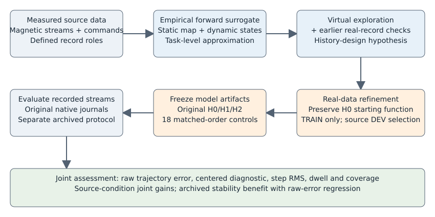
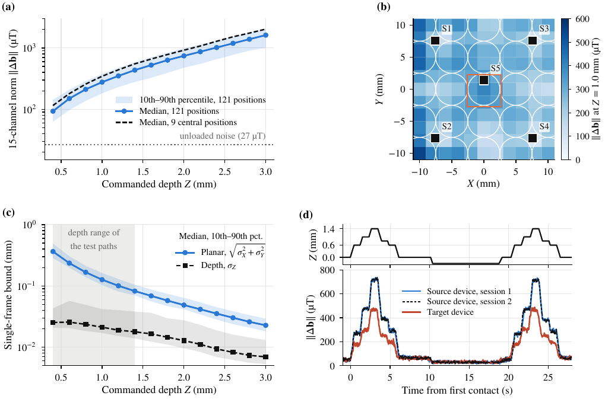
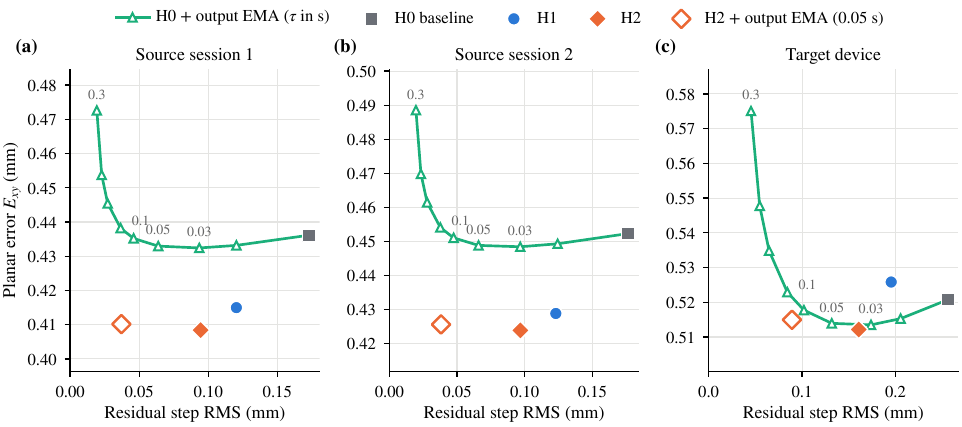
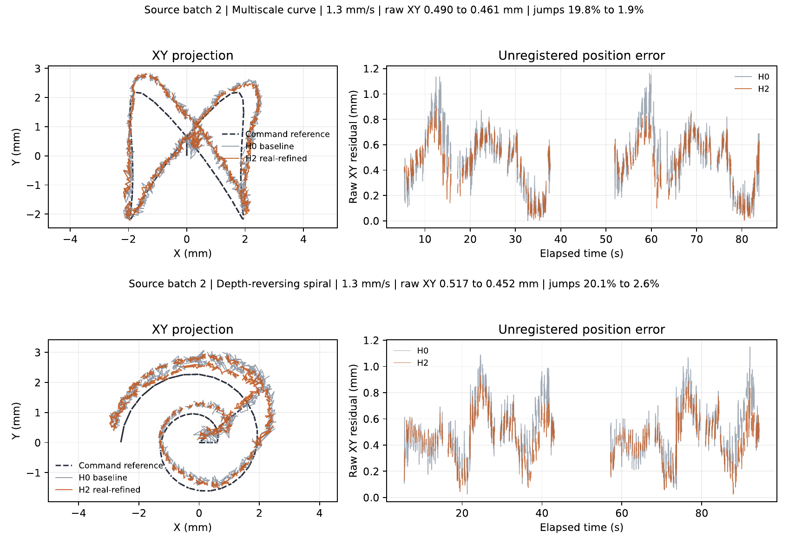
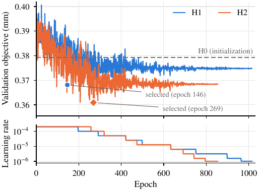
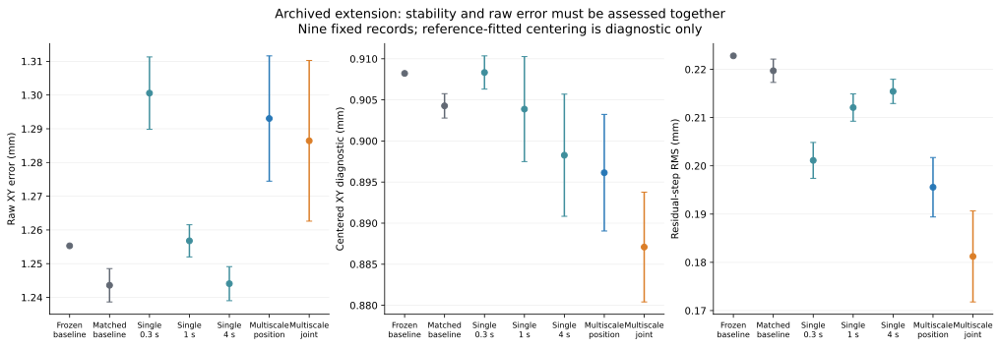

# Simulation-Guided History Refinement for Command-Referenced Magnetic Tactile Trajectory Reconstruction

Liming Qian¹*, Jiaqi Li² and Feng Guo³

¹ Department of Mechanical Engineering, Nantong Institute of Technology, Nantong 226002, Jiangsu, China; 20160031@ntit.edu.cn  
² School of Mechanical Engineering, Nantong University, Nantong 226001, Jiangsu, China; 17656673638@163.com  
³ Department of Mechanical Engineering, Nantong Institute of Technology, Nantong 226002, Jiangsu, China; 20160001@ntit.edu.cn  
* Correspondence: 20160031@ntit.edu.cn

**Abstract.** Soft magnetic tactile trajectory reconstruction depends on both current contact motion and deformation history. We investigated whether an empirical dynamic simulator could inform useful refinements of an existing real-trained reconstruction chain. Controlled virtual exploration and real-record observations motivated a multiscale causal history expansion, initialized to preserve the baseline function and subsequently trained with real data only. The original frozen evaluation used 36 complex trajectories and 12 controls. In two source-device sessions, the selected joint-objective model reduced mean command-referenced planar error from 0.436 to 0.408 mm and from 0.452 to 0.424 mm, with approximately 45% lower residual-step RMS. Eighteen new matched runs compared continued baseline optimization, three single timescales, multiscale features and joint objectives over three training-order seeds from one initialization. Additional data and optimization alone did not reproduce the large stability benefit. A fixed-protocol extension to nine archived acquisitions excluded from fitting and checkpoint selection retained stability improvements but increased raw planar error: for the original joint model, 1.255 to 1.293 mm, while step RMS decreased from 0.223 to 0.176 mm. These findings support simulator-assisted representation design with real-data verification and demonstrate a condition-dependent accuracy-stability trade-off. The original evaluation is retrospective; the extension does not certify old online-state parity. Command-derived references, unmeasured physical uncertainty, common initialization and missing dedicated directional-hold and latency experiments limit stronger interpretations.

**Keywords:** magnetic tactile sensing; empirical dynamic simulator; causal history; real-supervised refinement; command-referenced trajectory reconstruction; temporal stability

## 1. Introduction

Soft and flexible tactile sensors give robots, prostheses and wearable devices access to where and how they touch their environment, and they are a prerequisite for dexterous manipulation [1, 2, 3]. Piezoresistive, capacitive, piezoelectric, optical and magnetic transduction have all been used in such skins [1, 2]. Magnetic sensing is attractive for soft skins because it splits the transducer into two parts: permanent magnets or magnetized particles are embedded in an elastomer, and a few Hall-effect magnetometers underneath measure the change in field when the elastomer deforms [4, 5, 6, 7]. No wiring crosses the soft layer, the skin can be replaced [8, 9], and a small number of magnetometers can resolve contact positions much more finely than their own spacing [10, 11, 12, 13, 14]. What such a device can resolve is set jointly by its structure (magnet layout, elastomer, and the gap between magnets and magnetometers) and by the processing that maps the measured field to a contact position.

Most reported localization accuracies are static: the indenter is pressed at one location, the field is read, and the location is decoded. In practical use, however, the contact point moves. The contact position must then be reconstructed frame by frame while the elastomer is being sheared, compressed and released, and the response of a soft elastomer depends on its recent deformation history [15]. For a magnetic skin this means that the field measured at a given indenter position varies with the direction and speed of approach and with the time spent there. A decoder that maps the instantaneous field to a position treats this history-dependent part of the field as displacement. In the five-magnetometer sensor studied here [16], this produces two visible defects in reconstructed trajectories: frame-to-frame jitter of one to two tenths of a millimeter, and position errors that vary with the motion pattern. Both limit the use of the reconstructed trajectory for contour following or sliding-contact control [17].

The history dependence can be addressed in the material, with a less viscoelastic elastomer, or in the readout. This paper takes the second route for an existing device. Within the readout, more training data of the same kind do not necessarily remove the problem, because circles, radial strokes and normal presses cover only a thin slice of the joint distribution of position and history. A simulator could fill this gap: with a forward model that predicts the sensor output for an arbitrary indenter motion, one can hold a position fixed and vary only the way it is approached, or generate motions that a calibration campaign did not include. Physics-based and data-driven simulators have been used in this way for optical and electrode-based tactile sensors [18, 19, 20, 21, 22] and, more recently, for magnetic ones [23, 24, 25, 26]. Yet a simulator of a soft magnetic skin is itself an approximation, and a decoder trained on its output inherits its errors. Whether simulation should supply training data, pretrained weights or only design decisions is therefore an empirical question.

### 1.1 Soft Magnetic Tactile Sensing

Hall-effect soft sensors were developed first as single taxels and small arrays for robot hands [4, 5, 6]. Wang *et al.* [7] gave a design methodology that links magnet, elastomer and magnetometer placement to tri-axis sensitivity, and de Boer *et al.* [23] optimized such a design with coupled mechanical and magnetic models. Continuous skins followed. Hellebrekers *et al.* embedded magnetic particles in silicone and regressed contact location and force with neural networks [10, 11]; Mohammadi *et al.* [27] resolved contact locations through a continuous deformable medium; Yan *et al.* [12] used a sinusoidally magnetized film to decouple normal and shear force and to localize contacts much more finely than the magnetometer pitch; Sun and Martius [13] derived design rules for such super-resolution; and Hu *et al.* [14] extended magnetic skins to large areas and multiple contacts. ReSkin and AnySkin [8, 9] addressed replaceability and the variation between skin instances, and Yang *et al.* [28] treated inconsistency of the magnetic source explicitly. The companion study to this paper [16] compared magnet layouts for a five-magnetometer interface and reported static and command-referenced trajectory accuracy for the layout used here.

These studies establish spatial encoding and motivate explicit evaluation of motion history. The present work examines a history-aware refinement of an existing reconstruction chain, with output filtering as a control. The original comparison measures the complete refinement. We supplement it with matched continued optimization, single-timescale controls and three training-order seeds, while retaining the distinction between a useful history expansion and an independently identified physical compensation mechanism.

Table 1 places representative localization results side by side. Sensing areas, contact types and position references differ between the studies, so the values indicate orders of magnitude and are not directly comparable. The entries also show what is usually evaluated: indentations at fixed locations. The last row anticipates the results of this paper, which concern continuous trajectories.

**Table 1.** Reported contact localization with soft magnetic tactile sensors. The studies differ in sensing area, contact type and position reference; values are as reported by the respective authors.

| **Study** | **Sensing elements** | **Sensing area** | **Contacts evaluated** | **Reported localization** |
| --- | --- | --- | --- | --- |
| Hellebrekers et al. [11] | magnetometers under a magnetic elastomer; neural network | 40 mm $\times$ 40 mm | indentations | mean absolute error 1.15, 1.16 and 0.25 mm in $X$, $Y$ and $Z$ (silicone) |
| Yan et al. [12] | Hall sensors under a sinusoidally magnetized film; deep learning | 18 mm $\times$ 18 mm | indentations | about 0.1 mm per axis (60-fold super-resolution) |
| Mohammadi et al. [27] | two Hall sensors, three magnets | 40 mm $\times$ 20 mm base | classification into up to 25 cells | more than 92% of cells correct |
| Hu et al. [14] | 16 Hall sensors | 48,400 mm2 | indentations; rolling-ball trajectories demonstrated | 1.2 mm average error |
| Companion study [16] | five magnetometers, $5\times5$ magnet array | 20 mm $\times$ 20 mm | 441 static contacts on a 1-mm grid | 0.288 mm mean planar error |
| This work | same sensor | central 5 mm $\times$ 5 mm (test paths) | continuous 3-D trajectories at 0.7 and 1.3 mm/s, command-referenced | 0.41–0.42 mm mean planar error; about 0.20 mm after removing a per-trial offset |

### 1.2 History Dependence in Soft Sensors

Hysteresis and creep are general properties of elastomer-based sensors [15]. Two families of compensation exist. Model-based approaches fit an explicit hysteresis operator, for example, a generalized Prandtl–Ishlinskii model for the response of a tactile sensor [29]. Learning-based approaches let a recurrent network absorb the history: long short-term memory networks [30] have been used to characterize microfluidic soft sensors with pronounced hysteresis [31] and to estimate the state of soft actuators from embedded sensors [32]. For sliding contacts on optical tactile sensors, shear caused by the motion itself distorts the tactile image, and invariance to it has been learned from data [17].

Our approach sits between the two families. The history is represented by a small set of fixed exponential states, as in a Prony-series description of linear viscoelasticity [15] or a fixed-pole linear dynamic model [33], and a feed-forward network learns how to use them. The states are causal, are reset explicitly when the record is interrupted, and can be added to a trained network without changing its output, which a recurrent replacement of the network would not allow. A different and much simpler way to reduce jitter is to filter the output coordinates [34, 35]. Filtering is the natural control for any claim of improved stability and is used as such in Section 3.

### 1.3 Tactile Simulation and Sim-to-Real Transfer

Simulators for optical tactile sensors render tactile images from contact geometry [18, 19], and finite-element models have generated training data for optical [21] and electrode-based [20] sensors, with the remaining gap to hardware closed by learned latent projections [20], mechanically matched synthetic data [21] or image translation [22]. For magnetic sensors, forward models couple elastomer mechanics with a magnetostatic model [23] or simulate the elastomer with the material point method [24]; sim-to-real policy transfer with magnetic skins has been reported for in-hand manipulation and insertion [26, 25]. When the simulator cannot be made accurate, domain and dynamics randomization widen the training distribution instead [36, 37, 38].

In the simulation-based studies discussed above, simulated observations are used as training data. In the present study, we instead fitted an empirical forward surrogate to the measured magnetic response of the device. Its predictions retained substantial field error on unseen motions (Section 2.2), so we used virtual experiments to motivate the choice of causal history features rather than to supply position supervision for the final models. We appended those features to an existing real-trained network by copying its original weights and setting the weights of the added inputs to zero. This function-preserving expansion, motivated by the Net2Net knowledge-transfer principle [39], preserves the original output at initialization; Net2Net is an initialization principle, not a separate training model. The expanded network was then refined with real measurements only (Section 2.3.2).

### 1.4 Aim and Contributions of This Work

We investigated whether simulation could identify a useful representation for refining an existing real-trained reconstruction chain. We fitted an empirical dynamic forward surrogate, explored candidate history representations and transferred the resulting input design, rather than virtual data or weights, to the real-data model. The final refinements retained the original chain and were trained with source-device real supervision. We evaluated their command-referenced trajectory discrepancy and output stability jointly, including constant-translation diagnostics, coverage and an output-filter control. Existing-device characterization provides context for the recorded signals; demonstrating a new sensor structure or independently measured spatial resolution was not the research objective.

A recurring difficulty in this kind of study is that a “more stable” output is easy to obtain and easy to misread: any low-pass filter reduces jitter. We therefore evaluated accuracy and smoothness jointly, reported a threshold-free smoothness measure alongside the original jump-rate metric, and compared the learned model with a causal output filter of matched smoothness applied to the baseline. This control was designed after the main results were known and is labeled as post hoc throughout.

The contributions concern the following task-specific research chain.

1.  An empirical axis-separated forward surrogate that preserves a fixed static equilibrium map and supports controlled virtual motions and an interactive simulator. Its response states are phenomenological and do not identify material constants or a unique physical deformation field.

2.  A function-preserving extension of an existing history-aware planar readout, followed by real-data refinement. A matched comparison of two objectives examines the additional motion-increment, qualified-dwell and static-anchor constraints as one package; it does not isolate each loss term or the independent effect of the history representation.

3.  Complete-chain evaluation on the original source and target streams, supplemented by matched continued-training controls and a fixed-protocol archived extension. Raw and constant-translation diagnostic errors, stability, coverage and regressions are reported together. A post hoc matched-smoothness output-filter comparison limits the interpretation of stability improvements.

#### 1.4.1 Study Scope and Reference

The evaluated quantity is command-referenced reconstruction error: discrepancy between the model output and a trajectory reconstructed from logged stage commands and estimated travel times. It is not independently measured contact-position error. An improvement in this quantity does not establish the same improvement in physical localization accuracy, because unmeasured positioning and synchronization errors may interact with the model output. Raw errors are retained alongside a per-record constant-translation diagnostic; the latter is not an online calibration or an independent reference.

The original evaluation records did not enter final-model fitting, normalization or checkpoint selection, but had informed earlier representation studies. Their evaluation remains retrospective. Two source sessions share one mounting, and the historical training and evaluation indenters differ (Section 2.1.4). The revision adds matched computations from a common initialization and a fixed-protocol analysis of nine archived acquisitions excluded from this study's fitting and checkpoint selection. These acquisitions are not a sealed blind test or newly collected hardware experiments. The missing old inference-operation journals require a separately specified causal reconstruction protocol. These distinctions delimit the claims throughout the paper.

Sections 2 and 3 describe the methods and results, respectively; Section 4 discusses the simulator's role, the accuracy-stability trade-off and the remaining uncertainty; Section 5 concludes.

## 2. Materials and Methods

### 2.1 Sensor Design, Characterization and Data

#### 2.1.1 Sensor Structure and Materials

Figure 1 shows the sensor and the test rig, and Table 2 lists their parameters. The sensor is a layered stack (Figure 1e). A printed circuit board at the bottom carries five MLX90393 tri-axis Hall-effect magnetometers [40]: the four outer nodes S1–S4 form a square with a side of 15.188 mm, and S5 lies near its center at $(0,\,1.406)$ mm (Figure 1d). Above the board lies a silicone isolation layer with a nominal thickness of 4.5 mm, which sets the distance between the magnets and the magnetometers. On top of it, a magnetic layer carries 25 axially magnetized disc magnets, 5 mm in diameter and 1 mm thick, on a $5\times5$ grid with a 5-mm pitch and with alternating polarity between neighbors, embedded in silicone. The compliant material is C0005, a two-part platinum-cure silicone (supplier data: Shore C 5, mixing ratio 1:1, tensile strength 1.20 MPa, tear strength 6.30 N/mm, elongation at break 900%). The composite specimen has a footprint of $46\times56$ mm, and the readout board sits in a 3-D-printed holder. Figure 1d also marks the static calibration grid, the envelope of the dynamic training records and the region covered by the test trajectories (Table 3).

The magnet layout was selected in the companion study [16], which compared a concentric-ring array of discs, the checkerboard array used here and a striped magnetic sheet with two isolation thicknesses on the same readout. On unseen static contacts, the checkerboard array gave the lowest mean planar error (0.534 mm against 0.714–1.189 mm for the other configurations). In this stack, the magnet grid sets the sensing area, the magnet strength and the gap to the magnetometers set the field available for sensing, and the silicone sets the compliance and the history dependence of the response. The layer thicknesses and the resulting magnet-to-magnetometer gaps of the assemblies used here are design values and were not measured.

Two magnetic-layer assemblies were used. The *source device* (profile `had-239`) provided all data for calibration, surrogate fitting and training. The *target device* (profile `had-Yelow`, spelled as in the records) is a separately built magnetic layer of the same nominal design; magnetometer layout, acquisition settings and silicone material are the same, and all three test sessions used the same indenter. Because the magnet grade is not stated and the layer thicknesses were not measured, the differences between the two devices cannot be attributed to a specific parameter. The median 15-channel signal norm during scored contact was 377 µT and 372 µT in the two source sessions and 239 µT on the target device; that is, the target device produced about 37% less signal for the same commanded motions against the same noise floor (see also Section 3.1).

#### 2.1.2 Readout and Test Rig

Each node follows the circuit of Figure 1c. The MLX90393 is read over the I2C lines SDA and SCL, which have 10-k$\Omega$ pull-up resistors; the CS pin is tied to the 3.3-V supply to select I2C mode, both supply pins are decoupled by 100-nF capacitors, and the unconnected pins and the exposed pad are grounded. The address nets A0 and A1 set the two least-significant bits of the I2C address, and the five nodes S1–S5 respond at 0x0C–0x10. The bus is read through a CH341 USB bridge. A frame consists of the 15 field components, $\mathbf{b}_t\in\mathbb{R}^{15}$, with a host timestamp. The requested frame period was 20 ms.

The test records were acquired with a rigid 3-D-printed indenter with a nominal diameter of 5 mm, a 3-mm flat tip and a 1-mm edge radius (dimensions from the design file, not measured). The records used for calibration, surrogate fitting and training were acquired earlier with a different indenter, whose geometry is not documented in the records (Section 2.1.4). The indenter is carried by the Cartesian motion system of a desktop 3-D printer (JGAURORA A5S) whose print head was detached (Figure 1b). The sensor in its holder sits on the build plate, and its cable runs to the USB bridge and the host computer. The host software sends each move as a position command with a feed rate and logs the time at which the command is dispatched together with the expected travel time (distance divided by commanded speed). No encoder or external position measurement is available.

**Figure 1.** Sensor and measurement system. (a) Connections between host, stage, indenter, magnetic layer, magnetometers and USB bridge. Arrows distinguish commands, mechanical contact and magnetic-data flow; software timestamps do not imply hardware synchronization. (b) Test rig, with an enlarged view of the indenter and sensor. (c) Circuit of one magnetometer node. (d) Nominal top-view geometry (mm). (e) Schematic cross section, with separate sensor-frame axes beside the indenter; positive <em>Z</em> denotes indentation depth. The coordinate ranges are the calibrated and evaluated domains, not independently measured positioning limits. Schematics are not to scale.

**Table 2.** Sensor and acquisition parameters.

| Item | Value |
| --- | --- |
| Magnetometers | $5\times$ MLX90393, tri-axis (15 channels) |
| Positions (mm) | S1 $(-7.594,\,7.594)$, S2 $(-7.594,\,-7.594)$, S3 $(7.594,\,7.594)$, S4 $(7.594,\,-7.594)$, S5 $(0,\,1.406)$ |
| Interface | I2C at 400 kHz through a CH341 USB bridge |
| Device settings | gain code 7, HALLCONF 0xC, RES 0, DIG_FILT 0, OSR 0, temperature compensation off |
| Conversion$^{\mathrm a}$ | 0.161 µT/LSB ($x$, $y$), 0.294 µT/LSB ($z$) |
| Frame timing | 20-ms period requested; mean rate 34–36 Hz, median interval 29.9 ms |
| Unloaded noise | standard deviation 5.0–10.2 µT per channel (median 5.7 µT; $z$ channels 8.6–10.2 µT); 27 µT in the 15-channel norm |
| Magnetic layer | 25 axially magnetized discs, 5-mm diameter, 1 mm thick, $5\times5$ grid at 5-mm pitch, alternating polarity; surface field 1800 G (0.18 T, supplier data), grade not specified [16] |
| Isolation layer | silicone, nominally 4.5 mm thick (design value, not a measured magnet-to-magnetometer gap) [16] |
| Elastomer | C0005 two-part platinum-cure silicone; supplier data: Shore C 5, tensile strength 1.20 MPa, tear strength 6.30 N/mm, elongation 900% [16] |
| Specimen | $46\times56$ mm footprint; readout board in a 3-D-printed holder [16] |
| Indenter | test records: rigid, 3-D printed; nominally 5-mm diameter, 3-mm flat, 1-mm edge radius. Calibration and training records: a different indenter (Section 2.1.4) |
| Motion | Cartesian stage of a JGAURORA A5S 3-D printer |

$^{\mathrm a}$Sensitivity table of the 2015 datasheet revision, as implemented in the driver. The table of a 2023 revision, also contained in the driver, gives 0.150 and 0.242 µT/LSB for the same setting; if it applies, the field values in this paper are about 7% ($x$, $y$) and 21% ($z$) too high. Calibration and inference use the same conversion, so positions are not affected. LSB: least-significant bit.

#### 2.1.3 Coordinates, Baseline and Reference

The sensor coordinate frame has its origin at the center of the four outer magnetometers. The $X$ and $Y$ axes are in the sensor plane, and $Z\ge0$ is the commanded indentation depth below a contact reference height that is set once per device (stage coordinates 23.360 mm for the source and 23.060 mm for the target device). Before each record the indenter is held clear of the surface, and an unloaded baseline $\mathbf{b}_0\in\mathbb{R}^{15}$ is taken as the per-channel median of the unloaded frames. Each component of $\mathbf{b}_0$, $\mathbf{b}_t$ and $\Delta\mathbf b_t$ is expressed in microtesla ($\mu$T), using the conversion in Table 2. All processing uses the field change $\Delta\mathbf b_t=\mathbf{b}_t-\mathbf{b}_0$.

The reference position $q_t=(X_t,Y_t,Z_t)$ of a frame is obtained from the logged commands alone: within a move, the position is interpolated linearly between the start and target coordinates over the logged travel time, starting at the dispatch time, and it is held at the target until the next move. Acceleration ramps, communication latency and stage compliance are not modeled, and no time offset between the command and sensor clocks is fitted. All errors in this paper are therefore *command-referenced*: they include any error of the stage and of this timing model. A shallow commanded depth is also not a measurement of actual contact, since the true surface height varies over the elastomer.

#### 2.1.4 Datasets and Their Roles

Table 3 summarizes the data. Calibration and refinement records preceded acquisition of the evaluation records. The latter did not enter parameter fitting, normalization or checkpoint selection of the compared models. They had, however, been inspected in earlier representation studies; they are retrospective evaluation records rather than an untouched prospective test set (Section 2.4). Acquisition dates and original record identifiers are retained in the provenance records.

**Table 3.** Datasets and their roles.

| Set | Device | Content | Role |
| --- | --- | --- | --- |
| Static atlas | Source | 1694 contacts: $11\times11$ grid, 2-mm pitch, 14 depths from 0.4 to 3.0 mm | static inverse map of H0 (frozen) |
| Surrogate records | Source | 24 dynamic and 3 static records for fitting, 10 for validation | forward surrogate (Section 2.2) |
| Refinement TRAIN | Source | 32 records: 15 circle, 7 compound $XY$–$Z$, 6 radial, 2 grid, 2 normal press | training of H1 and H2 |
| Refinement VAL | Source | 3 records: grid, radial, circle | learning-rate schedule, checkpoint selection |
| Test, source session 1 | Source | 12 complex trajectories and 4 controls | frozen evaluation |
| Test, source session 2 | Source | same paths, 30 min later, same mounting | repeatability |
| Test, target | Target | same paths | transfer without adaptation |

The 35 refinement records total 43.7 min of motion. They were split by whole records into 32 for training and 3 for validation; frames were never split at random.

A *trial* is one record. The test set consists of six families of 3-D paths that do not occur in the training data: a spatial Bézier curve, a path with inertial (smooth random) turns, a stop-and-return path with dwells, a multiscale curve, a spiral with depth reversals and a three-lobe $XYZ$ figure. Each was run at 0.7 and 1.3 mm/s, giving 12 trajectories per session; each record contains two consecutive executions of the path and lasts 80–195 s. The scored part of the test trajectories covers $X\in[-2.60,\,2.70]$ mm, $Y\in[-2.70,\,2.27]$ mm and $Z\in[0.40,\,1.40]$ mm (Figure 1d). Each session also contains four control records: a planar circle and a normal press of the kinds used in training, and unloaded records before and after the session. The same 16-record plan was run first on the target device and then twice on the reinstalled source assembly. These sessions followed the earlier use of the source assembly with the training indenter. We refer to the three runs as sessions: the target session and source sessions 1 and 2. The two source sessions share one mounting and are 30 min apart; session 2 therefore measures short-term repeatability. It is neither a second device nor a second installation.

The test records were acquired with a different indenter from all records used to build and train the models. The earlier records, which include the static atlas, the surrogate records, the refinement records and the control records of that earlier session discussed in Section 4, carry the indenter labels `flat_d6mm` and subsequently `final_5mm_touch_VERIFY_PHYSICALLY`; the test records carry `original_D5_topD3_R1`, the indenter described in Section 2.1. The frozen protocol treated these labels as names of one indenter, which they are not. The test therefore also includes a change of indenter, to which no model was adapted.

Acquisition was complete in all three runs (about 56,000 frames each). The frozen protocol replays the frames that the online decoder received during the experiment. On the source device these were all of the frames. On the target device the input queue of the online decoder dropped 26.5% of the frames of the 12 complex-trajectory records, so the models saw an effective rate of 25 Hz with 27% of the intervals longer than 45 ms (2.5–3.0% on the source device). The complete target streams were recorded but were not replayed in this study; the consequences are examined in Section 3.4.

#### 2.1.5 Characterization Procedure

The sensor was characterized with data that were also used for, or recorded alongside, the reconstruction study; no records were acquired for the characterization alone. *Static response.* The static atlas of the source device (Table 3) was recorded with the earlier indenter. At each of the 121 positions of the $11\times11$ grid and each of the 14 depths from 0.4 to 3.0 mm, the indenter was pressed and held, and the field change is the median over a 160-ms window of the hold relative to a 160-ms unloaded baseline. *Noise.* The per-channel noise $\sigma_c$ ($c=1,\ldots,15$) is the standard deviation of the field over the pooled unloaded records of the two source test sessions (5.3–9.8 µT). *Quasi-static press.* The normal-press control record of each test session (Section 2.1.4) presses the test indenter twice at the center of the sensor, with 0.75-s dwells at 0.6, 1.0 and 1.4 mm on loading and at 0.8 and 0.6 mm on unloading; each dwell is summarized by the median field norm over its last 0.3 s.

*Theoretical noise bounds.* For a single frame with mean field change $\boldsymbol{\mu}(q)$ and independent Gaussian noise of covariance $\Sigma=\operatorname{diag}(\sigma_1^2,\ldots,\sigma_{15}^2)$, the Fisher information about the contact position $q=(X,Y,Z)$ is $F(q)=J(q)^{\mathsf T}\Sigma^{-1}J(q)$ with $J=\partial\boldsymbol{\mu}/\partial q\in\mathbb{R}^{15\times3}$, and the covariance of any unbiased position estimate is bounded below by $F^{-1}$, the Cramér–Rao bound (CRB) [41]. We report the planar bound $\delta_{xy}=\bigl([F^{-1}]_{XX}+[F^{-1}]_{YY}\bigr)^{1/2}$ and the depth bound $\delta_{z}=[F^{-1}]_{ZZ}^{1/2}$, in which all three coordinates are unknown. $J$ was estimated from the atlas by central differences over $\pm2$ mm in $X$ and $Y$ and over the 0.2-mm depth levels in $Z$, at the 81 interior grid positions (within 8 mm of the center in $X$ and $Y$). These are model-based lower bounds on the standard deviation of a locally unbiased estimator under the assumed mean response and noise covariance. They are not measured spatial resolution, observed decoder error or a bound for a biased history-dependent estimator. They assume a locally linear response and Gaussian, uncorrelated noise and were computed with the atlas indenter rather than the test indenter. Finite differences on the 2-mm lateral grid can either under- or overestimate local gradients, so their effect on the bound has no established conservative direction. No independent resolution experiment was performed.

### 2.2 Dynamic Forward Surrogate and Simulator

#### 2.2.1 Position and Deformation Memory

Let $q_t=(X_t,Y_t,Z_t)$ be the indenter position, $s_t$ the unobserved deformation state of the elastomer and $\mathcal{S}$ the sampling of the field $\mathbf{B}$ at the five magnetometers. The measured field change is
$$
\Delta\mathbf b_t=\mathcal{S}\{\mathbf{B}(\,\cdot\,;q_t,s_t)\}-\mathbf{b}_0+\boldsymbol{\epsilon}_t ,\tag{1}
$$
where $\boldsymbol{\epsilon}_t$ collects sensor noise and unmodeled effects. To first order, a small change $\delta\mathbf{b}_t$ in the field has a position part and a history part,
$$
\delta\mathbf{b}_t\simeq J_q\,\delta q_t+J_s\,\delta s_t+\delta\boldsymbol{\epsilon}_t ,\tag{2}
$$
where $J_q$ and $J_s$ are the Jacobians of the sampled field with respect to position and deformation state. A static decoder attributes the second term to displacement. Position can be separated from history only where the position Jacobian keeps three independent directions after the directions spanned by admissible history variations, $\mathcal{H}=\operatorname{range}(J_s)$, have been removed by the orthogonal projector $P_{\mathcal{H}^{\perp}}$:
$$
\mathop{\mathrm{rank}}\!\left(P_{\mathcal{H}^{\perp}}J_q\right)=3 .\tag{3}
$$
In practice the smallest singular value of $P_{\mathcal{H}^{\perp}}J_q$ times the displacement to be resolved must also exceed the noise. Equation (3) is a local condition that motivates constraining the history state causally; it is not a global uniqueness result for the workspace.

#### 2.2.2 Spatial Features

The surrogate predicts the 15 channels for a given indenter motion. It does not model the deformation field or the magnetization and is valid only for the indenter with which it was fitted. Its spatial part uses 110 features: 10 polynomial terms $p(q)$ up to second order in the normalized coordinates $(X/6,\,Y/6,\,Z^{+}/3)$, with $Z^{+}=\max(Z,0)$ and lengths in millimeters, and 100 Gaussian radial basis functions [42]
$$
r_j(q)=\exp\!\left[-\frac12\sum_{a\in\{X,Y,Z\}}\left(\frac{q_a-c_{j,a}}{\sigma_a}\right)^{2}\right]\tag{4}
$$
with centers $c_j$ on the grid $X,Y\in\{-6,-3,0,3,6\}$ mm, $Z\in\{0.6,1.4,2.2,3.0\}$ mm and widths $\boldsymbol{\sigma}=(2.5,\,2.5,\,0.65)$ mm. All features are multiplied by a depth factor,
$$
\phi(q)=\frac{Z^{+}}{Z^{+}+0.2}\,\bigl[p(q),\,r_1(q),\ldots,r_{100}(q)\bigr]^{\mathsf T},\tag{5}
$$
so that the static response vanishes when the indenter is at the nominal surface. The 0.2-mm constant is an empirical shape parameter, not a contact threshold.

#### 2.2.3 Axis-Separated Memory States

Lateral sliding and normal indentation load the elastomer differently, so their histories are tracked separately. Between two frames the feature change is split symmetrically into a tangential and a normal part. With the intermediate points $q'_t=(X_t,Y_t,Z_{t-1})$ and $q''_t=(X_{t-1},Y_{t-1},Z_t)$,
$$
\begin{aligned}
\delta_{xy,t}&=\tfrac12\bigl[\phi(q'_t)-\phi(q_{t-1})+\phi(q_t)-\phi(q''_t)\bigr],\nonumber\\
\delta_{z,t}&=\phi(q_t)-\phi(q_{t-1})-\delta_{xy,t}.
\end{aligned}\tag{6}
$$
The two parts sum to the total feature change; a purely lateral move has $\delta_{z,t}=0$ and a purely normal move has $\delta_{xy,t}=0$. Each part drives three leaky states with time constants $\tau_k\in\{0.3,\,1,\,4\}$ s,
$$
h_{a,k,t}=\rho_{k,t}\,\bigl(h_{a,k,t-1}+\delta_{a,t}\bigr),\qquad \rho_{k,t}=e^{-\Delta t_t/\tau_k},\tag{7}
$$
where $a\in\{xy,z\}$ and $\Delta t_t$ is the actual frame interval. The states are cleared after a new baseline, an unknown position or a gap longer than 0.5 s. The prediction is
$$
\widehat{\Delta\mathbf b}_t=C_0^{\mathsf T}\phi(q_t)+\sum_{k=1}^{3}\Bigl[C_{xy,k}^{\mathsf T}h_{xy,k,t}+C_{z,k}^{\mathsf T}h_{z,k,t}\Bigr].\tag{8}
$$
During a dwell the increments are zero and the states decay, so the prediction relaxes to the static map $C_0^{\mathsf T}\phi(q)$ regardless of the path taken; a reversal changes the sign of the drive. The structure is that of a Prony series for linear viscoelastic relaxation [15], applied to field features rather than to stress. The three time constants are components of a response surrogate. They were selected by validation and should not be read as measured relaxation times of the silicone.

#### 2.2.4 Fitting and Selection

The model is linear in its coefficients. The static map $C_0\in\mathbb{R}^{110\times15}$ was fitted first and frozen. The $660\times15$ history coefficients $C=[C_{xy,k};C_{z,k}]$ were then obtained by weighted ridge regression [43] on the residual,
$$
\widehat C=\arg\min_C\sum_i w_i\bigl\|H_i^{\mathsf T}C-(\Delta\mathbf b_i-C_0^{\mathsf T}\phi_i)\bigr\|_2^{2}+\lambda\,\|D_\phi C\|_F^{2},\tag{9}
$$
where $H_i$ stacks the six states of frame $i$, $D_\phi$ scales each feature by its weighted root-mean-square (RMS) value on the fitting data (with a floor of 0.02), every record carries the same total weight and frames at motion boundaries carry half weight. Fitting used 24 dynamic and 3 static source records; 10 further source records were used to select the model class (joint or axis-separated history), the set of time constants and $\lambda$. A candidate was eligible only if its error on the normal-press and grid validation families stayed within 110% of that of the static map, so that the dynamic terms could not be bought with a worse equilibrium.

Fidelity is reported as the normalized root-mean-square error (NRMSE): the RMS prediction error over all scored frames and channels divided by the RMS of the measured $\Delta\mathbf b$ over the same frames. Figure 2a gives the validation result on the 10 validation records for the static map, the best joint-history model and the selected axis-separated model. The static map alone has a family-averaged NRMSE of 25.9%. The best joint-history model reaches 21.9% but is ineligible under the 110% family-wise validation rule stated above: the static grid NRMSE is 37.8%, giving a grid ceiling of approximately $1.10\times37.8\%=41.6\%$, whereas the joint-history grid NRMSE is 42.2%. This ceiling is an internal model-selection guard, not a hardware accuracy specification. The selected axis-separated model ($\lambda=0.01$) reaches 15.4%; the largest gains are on the radial (34.8% to 18.7%), grid (37.8% to 17.1%) and compound (32.3% to 21.7%) families, and the normal press is unchanged within the limit (7.8% to 8.3%).

**Figure 2.** Forward surrogate. (a) Field NRMSE on the validation records by motion family. (b) Measured and predicted field change on a held-out complex 3-D record. (c) History dependence of the predicted field at one position.

On records that took no part in fitting or selection, the error is higher: on 10 such source records (three grid, three complex 3-D paths and one each of normal press, radial, circle and compound motion) the NRMSE falls from 36.4% (static) to 25.3% (Figure 2b shows three of the 15 channels on one complex 3-D record, for which the NRMSE is 37.4% for the static map and 29.4% for the surrogate), and on 20 target-device records from 65.9% to 54.9%. On new source motions, a quarter of the RMS signal amplitude (about 6–7% of the signal energy) thus remains unexplained, and the surrogate does not describe the target device. When a frozen copy of the reconstruction chain was run on matched real and surrogate-generated streams of the same source motions (seven records, every fourth frame, about 10 Hz), the mean 3-D reconstruction errors were similar (0.286 and 0.257 mm), but the two reconstructed trajectories differed from each other by 0.348 mm on average: agreement of summary errors does not imply pointwise agreement. For the target device the same comparison gave 0.781 mm on real and 0.263 mm on surrogate-generated streams. These numbers bound what the surrogate may be used for.

#### 2.2.5 What the Surrogate Is Used For

If a decoder $D$ is locally Lipschitz with constant $L_D$ on a window of past observations $\mathbf{b}_{\le t}$, its error on a simulated stream $\widetilde{\mathbf b}_{\le t}$ obeys
$$
\bigl\|D(\widetilde{\mathbf b}_{\le t})-q_t\bigr\|\le\bigl\|D(\mathbf b_{\le t})-q_t\bigr\|+L_D\,\bigl\|\widetilde{\mathbf b}_{\le t}-\mathbf b_{\le t}\bigr\| .\tag{10}
$$
Equation (10) is an upper bound, conditional on a finite local sensitivity $L_D$; it supplies no lower bound on position error. We did not estimate $L_D$, and a large field mismatch can lie in directions to which the decoder is insensitive. The observed field NRMSE therefore cannot establish a necessary position error or a minimum attainable localization accuracy. Instead, the matched real–surrogate reconstruction discrepancy reported above and the unsuccessful transfer experiments in Section 4.3 provide the empirical reasons for restricting the surrogate to the following uses.

*1) Controlled experiments on history.* Figure 2c shows, for the frozen surrogate, the norm of the difference between the predicted field and the static response at $(0,0,1.4)$ mm after the indenter has arrived there at 1 mm/s from 3 mm away in three lateral directions, and after a normal press from a depth of 0.45 mm at the same location. On arrival from a lateral direction the field differs from the static response by 110–122 µT, against a static response norm of 649 µT and a noise norm of 27 µT; after a purely normal press from 0.45 to 1.4 mm at the same location, the difference is 34 µT. Arrivals from $-X$ and $+X$ differ from each other by 217 µT on arrival, 158 µT after 1 s, 87 µT after 4 s and 33 µT after 8 s. According to the surrogate, the history part of the field is therefore several times the noise for seconds after a lateral move.

*2) An interactive simulator.* The surrogate runs in a browser (Figure 13 in Appendix B). In the main view the user moves and presses a virtual indenter, or replays a recorded path, and sees the field-change vectors at the five magnetometers (Figure 13a) and the 15 channels (Figure 13b) evolve, including the relaxation after the motion stops. The arrows give the direction of the predicted field change at each magnetometer; they are neither field lines nor displacements. In the channel view the prediction (dashed) is drawn over the measured response (solid) of a selected record. A library of 60 generated free 3-D motions in six classes can be replayed with the predicted field at each magnetometer (Figure 13c). The virtual streams were passed offline to the frozen reconstruction chain, and the simulator replays the computed trajectory next to the commanded one, so that a generated motion is never shown as if it were a reconstruction (Figure 13d). Two further views support checks of the model itself: the response of one magnetometer is predicted from the current and past responses of the other four (Figure 13e), and precomputed virtual experiments, in which motion type, depth, speed, dwell, direction and history strength are set independently, show the output of successive stages of the reconstruction chain (Figure 13f). For training experiments, path generators produce spatial Bézier curves, inertial random walks, free 3-D waypoint paths and multiscale curves with independent random seeds, in $X,Y\in[-5,5]$ mm, $Z\in[0.45,2.4]$ mm, at 0.5–2 mm/s with dwells of up to 2.5 s, sampled at 10 Hz. Sequences can be exported with their provenance. The values visible in Figure 13 belong to the examples shown and do not enter the statistics of this paper, and the interface labels of Figures 13c–13f were translated into English for the figure.

*3) Trying representations before spending real data.* Three small readout networks of identical architecture (60–32–3; inputs that a variant did not use were set to zero) were trained on surrogate-generated data alone: 32 generated paths, no real frames. They mapped the field directly to position, without the static atlas or the output gating of the full chain (Section 2.3.1), and differed only in their temporal context. The first saw the current field only; the second also saw the field minus its exponential average at 0.3 s; the third saw the current field and the residuals at 0.3, 1 and 4 s. On 64 unseen virtual paths the three were almost equally accurate (mean 3-D error 0.303, 0.288 and 0.301 mm). When the networks were run frozen on the real source-device trajectories of Section 2.1, their measured accuracy was poor: mean planar errors of 0.947, 1.029 and 0.914 mm, against 0.431 mm for the real-trained baseline on the same scoring domain (which, unlike that of Section 2.4.2, includes dwell frames). Their *relative* behavior was nevertheless informative. The frame-to-frame jump rate defined in Section 2.4.2 fell from 50.4% (current field) to 22.8% (one timescale) and 9.9% (three timescales), and the dwell fluctuation from 0.177 to 0.123 and 0.098 mm; the second source session and the target device showed the same ordering. A multi-timescale context thus stabilized the output on real data even though the position mapping learned from virtual data did not transfer, and even though the virtual test alone would not have singled it out.

Further simulation-side candidates, most of which did not help on real data, are listed in Section 4.3. Together, these observations fixed the design of Section 2.3: keep the real-trained chain, add a multi-timescale causal context with the surrogate’s time constants, and supervise it with real data only.

### 2.3 Real-Supervised Causal History Refinement

Figure 3 shows how the surrogate, the baseline and the refined models relate. The forward surrogate and the simulator are fitted to source-device records and used for virtual experiments, which motivated the multi-timescale history context (Section 2.2.5). The refined models H1 and H2 start from the frozen baseline H0 and are trained on real source records only; no virtual data or weights are transferred. All three models are then frozen and replayed causally on records excluded from parameter fitting and checkpoint selection; earlier study exposure makes this a retrospective evaluation (Section 2.4). Simulation thus contributes a design decision, and all parameters of the compared models are fitted to real source-device data.

**Figure 3.** Study design. An empirical surrogate, virtual exploration and earlier real-record checks motivate the history context. Real-data training and development-set selection precede model freezing. The original retrospective native-journal evaluation and the separately fixed archived-extension protocol are distinguished.

#### 2.3.1 Baseline Reconstruction Chain (H0)

The baseline is the complete online reconstruction chain that existed before this study. Its historical source-side optimization completed 1023 epochs for the planar head and 754 epochs for the depth module, both stopping at the minimum-learning-rate plateau; it was not an undertrained reference. These frozen weights were reused rather than repeating that historical training. The chain is causal, uses native irregular frame timing and already contains short-term history. Its stages are as follows (Figure 4).

*Feature.* The field change is converted to a 16-dimensional feature that separates direction from amplitude,
$$
\mathbf{f}_t=\Bigl[\,\Delta\mathbf b_t/\|\Delta\mathbf b_t\|,\ \tfrac12\ln\bigl(\|\Delta\mathbf b_t\|/a_0\bigr)\Bigr],\tag{11}
$$
with $a_0=539.5$ µT, the median amplitude of the static atlas.

*Static atlas.* The features of the 1694 static calibration contacts are interpolated trilinearly on their $11\times11\times14$ lattice. A measured feature is inverted by a nearest-neighbor search over candidates on a 1-mm lateral grid at the 14 calibrated depths, followed by two damped Gauss–Newton steps.

*Slow memory.* A rank-two state tracks the component of the feature residual that the local position Jacobian cannot explain. It is updated as a leaky average with a retention of 0.8 per 0.1 s (time constant about 0.45 s), and its contribution is subtracted from the feature before the atlas is inverted again. The two memory directions were estimated beforehand from the training records.

*Branch guard.* If the inverted position is more than 1 mm away from the previous one, a local solution continued from the previous position is computed as well, and the one with the lower combination of field cost and travel penalty is kept. The result is the guarded candidate $g_t$.

*Planar residual head.* A fully connected network with layers 53–64–64–2 and $\tanh$ activations predicts a planar correction to $g_t$. Its 53 inputs are the scaled candidate $g_t$ (3), the memory-corrected feature $z_t\in\mathbb{R}^{16}$, the memory state (2), and the differences between $z_t$ and its values about 0.1 s and 0.4 s earlier ($2\times16$).

*Depth and output validity.* Depth is re-estimated by a separate module that searches the atlas cost along $Z$ at the corrected planar position, with a continuity term and learned priors. A contact-response detector and bounds on the workspace decide whether a frame yields an output; frames without an output are rejected, not reported as zero. All of these parameters are frozen and identical for the three models.

All histories are cleared when the gap between frames exceeds 0.25 s, when time does not increase, or when the baseline or stream changes. Ablating the chain on seven earlier source records (every fourth frame, about 10 Hz) shows where its accuracy comes from: the mean planar error is 0.876 mm for atlas inversion alone, 0.689 mm with the slow memory, 0.689 mm with the branch guard and 0.254 mm with the planar head (0.258 mm for the complete chain, whose depth error is lower). H0 is thus a strong, history-aware baseline, and any gain reported below is a gain over it.

**Figure 4.** Reconstruction chain. Gray: frozen stages shared by all models. Orange: history residuals added in H1 and H2.

#### 2.3.2 Function-Preserving History Expansion

The refinement adds a longer causal context to the planar head. For each of the three surrogate time constants $\tau_k\in\{0.3,1,4\}$ s, an exponential moving average (EMA) of the memory-corrected feature is maintained with the actual frame interval,
$$
m_{k,t}=\rho_{k,t}\,m_{k,t-1}+(1-\rho_{k,t})\,z_t,\qquad v_{k,t}=z_t-m_{k,t},\tag{12}
$$
with $\rho_{k,t}$ as in (7). At a reset, $m_{k,t}=z_t$ and the residuals $v_{k,t}$ are zero. The residuals describe how far the current feature has departed from its recent past on three timescales, which is the information that the memory states of the surrogate carry. Unlike the surrogate states, they are computed from measurements and require no position input. The 48 residuals are appended to the original inputs $u^{(0)}_t$:
$$
u_t=\bigl[u^{(0)}_t,\,v_{1,t},\,v_{2,t},\,v_{3,t}\bigr]\in\mathbb{R}^{101},\qquad \widehat q^{\,xy}_t=g^{xy}_t+N_\theta(u_t).\tag{13}
$$

The expanded network $N_\theta$ (101–64–64–2; 10,818 parameters) is initialized from H0 in the manner of Net2Net [39]: all existing weights are copied, the 48 new rows of the first-layer weight matrix are set to zero, and the normalization of the original 53 inputs is kept unchanged. The new inputs are standardized with statistics from the training records only (scale floor 0.25). At initialization the expanded network equals H0 exactly; this was verified on all 11,415 training samples and in a complete-chain software test. Training therefore starts from the baseline solution; subsequent changes are selected on source validation data and are not guaranteed to improve unseen records. Only the planar residual head is trained (Figure 4); the depth module, the gating and the slow memory are not modified, although the depth estimate can change through its dependence on the planar position.

#### 2.3.3 Training Objectives

The training target of the head is the residual $y_t=q^{xy}_t-g^{xy}_t$, clipped to $\pm3$ mm per axis. The refinement combines dynamic and dwell samples from the 32 training records with static calibration anchors. The three groups are: the 7217 dynamic frames on which H0 was trained ($\mathcal{D}$; every fourth scored frame, mostly during motion), 3633 additional frames during qualified dwells ($\mathcal{W}$) and 565 static calibration anchors ($\mathcal{A}$). A dwell frame qualifies if the commanded depth is at least 0.45 mm, the indenter has been at rest for 0.2–1.5 s and no command boundary is involved; every fourth such frame is kept. The dwell frames were not part of the training set of H0.

Two models with identical architecture, data, initialization and optimizer are trained. H1 uses position supervision only:
$$
\begin{aligned}
\mathcal{L}_1={}&0.8\,\mathbb{E}_{\mathcal D}\|r_\theta-y\|^{2}+0.1\,\mathbb{E}_{\mathcal W}\|r_\theta-y\|^{2}\nonumber\\
&+0.1\,\mathbb{E}_{\mathcal A}\|r_\theta\|^{2}+\frac{\beta}{2}\sum_l\|W_l\|_F^{2},
\end{aligned}\tag{14}
$$
where $r_\theta=N_\theta(u)$, $\beta=10^{-3}$ and the anchor term asks for zero correction on static calibration contacts, which the atlas already reproduces. H2 adds two motion-increment terms and a second anchor term:
$$
\begin{aligned}
\mathcal{L}_2={}&\mathcal{L}_1+0.25\,\mathbb{E}_{\mathcal P}\bigl\|\Delta\widehat q^{\,xy}-\Delta q^{xy}\bigr\|^{2}\nonumber\\
&+0.25\,\mathbb{E}_{\mathcal P_W}\bigl\|\Delta\widehat q^{\,xy}-\Delta q^{xy}\bigr\|^{2}+0.25\,\mathbb{E}_{\mathcal A}\|r_\theta\|^{2}.
\end{aligned}\tag{15}
$$
Here $\Delta$ denotes the difference between a training frame and the valid frame immediately before it in the same record and command segment, at most 0.25 s earlier. The set $\mathcal{P}$ contains the 8833 training frames that have such a predecessor, with both frames at least 0.45 mm deep and away from command boundaries, and $\mathcal{P}_W\subset\mathcal{P}$ the 3439 of them that lie in qualified dwells; dwell pairs thus enter both increment terms. The increment terms ask the frame-to-frame change in the output to equal that of the reference. They do not penalize motion as such: a model that attenuated true movement would be penalized as much as one that jittered. During dwells the reference increment is zero and the term penalizes fluctuation, but only on frames that qualify as settled. The three additional weights were set to 0.25 in advance and were not tuned.

#### 2.3.4 Optimization and Model Selection

Table 4 summarizes the protocol. Both models were trained with Adam [44] in double precision with one fixed seed. The learning rate was halved whenever the validation objective had not improved by a relative $10^{-4}$ for 50 epochs, down to $10^{-6}$, and training stopped after 50 further epochs without improvement [45]. Both runs ended by this rule before the ceiling of 2000 epochs.

The validation objective is computed on the three validation records from the output of the planar head alone, without replaying the complete chain. It is the mean planar error plus 0.1 times each of the residual step RMS (Section 2.4.2), the fluctuation about the block mean during qualified dwells, and the RMS correction on the static anchors. A checkpoint was admissible only if the mean validation planar error was at most 0.005 mm above that of H0, no validation record was more than 0.02 mm worse, and the anchor RMS was at most 0.02 mm higher. The initial checkpoint, which is H0, was admissible, so the procedure could have returned the baseline unchanged. It did not: the selected checkpoints lowered the validation objective from 0.3792 mm to 0.3681 mm (H1) and 0.3609 mm (H2).

Figure 11 (Appendix B) shows that selection mattered; both runs start from H0, marked by the dashed line. The validation objective reached its minimum early (epochs 146 and 269) and then rose again while training continued, ending above the selected value (0.3748 and 0.3684 mm); only 10.0% and 3.2% of the epochs were admissible. With three validation records the selection is noisy, and the validation gain was not uniform: the planar error of H2 on the three records changed from 0.288, 0.296 and 0.438 mm to 0.297, 0.294 and 0.420 mm.

**Table 4.** Training protocol and outcome.

|  | H1 | H2 |
| --- | --- | --- |
| Objective | $\mathcal{L}_1$ (14) | $\mathcal{L}_2$ (15) |
| Training samples | 11,415 (Section 2.3.3) |  |
| Network | 101–64–64–2, $\tanh$, 10,818 parameters |  |
| Initialization | H0 weights; 48 new input rows zero |  |
| Optimizer | Adam, $\beta_1=0.9$, $\beta_2=0.999$, $\epsilon=10^{-8}$ |  |
| Batch size (nominal); updates per epoch | 256; 45 |  |
| Learning rate | $2\times10^{-4}$, halved on plateau to $10^{-6}$ |  |
| Seed; precision | 7; 64-bit floating point |  |
| Epochs run | 1015 | 854 |
| Selected epoch | 146 | 269 |
| Parameter updates | 45,675 | 38,430 |
| Learning-rate reductions | 8 | 8 |
| Validation objective (mm)$^{\mathrm a}$ | 0.3681 | 0.3609 |
| Anchor correction RMS (mm)$^{\mathrm b}$ | 0.137 | 0.081 |

$^{\mathrm a}$H0: 0.3792 mm. $^{\mathrm b}$H0: 0.181 mm.

The sensor hardware, static atlas and baseline chain are inherited from the companion study [16]. The present work concerns the empirical axis-separated surrogate, simulator-informed history design, function-preserving expansion, real-supervised objectives and their evaluation. Fixed exponential states and function-preserving transfer follow prior ideas [15, 33, 39]. The original H0-H1-H2 comparison changes data, capacity and optimization together. Section 2.5 addresses the data and additional-optimization differences with new matched controls; it does not establish the necessity of simulation or superiority to recurrent networks.

#### 2.3.5 What the Historical Comparisons Identify

Historical baseline optimization and matched additional refinement answer different questions. H0 was already trained to the prescribed plateau, but the original study did not continue it on the enlarged dwell sample pool. The original H1-H2 comparison shares architecture, sample pool and initialization and changes an objective package; it does not isolate its individual loss terms. Table 5 preserves these historical factors, while Section 2.5 specifies the newly completed matched experiments. The old results are not relabeled as if these controls had existed when the models were first developed.

**Table 5.** Factors in the original three-model comparison. The additional matched controls are specified in Section 2.5.

| Factor | H0 | H1 | H2 |
| --- | --- | --- | --- |
| Planar-head input dimension | 53 | 101 | 101 |
| Original dynamic samples | 7217 | 7217 | 7217 |
| Additional qualified-dwell samples | 0 | 3633 | 3633 |
| Static anchors | 565 | 565 | 565 |
| Initialization for this study | frozen historical model | copied H0; new inputs zero | identical to H1 |
| Additional optimization in this study | none | matched refinement protocol | matched refinement protocol |
| Refinement objective | historical baseline | $\mathcal L_1$ | $\mathcal L_2$ |
| Training seeds evaluated | historical reference | 7 only | 7 only |

The new controls reduce the data and additional-optimization confounding. Expanded inputs still increase capacity, the three seeds share one initialization, and the objective terms have not been ablated separately. The time constants are design choices, not identified material properties or established global optima.

### 2.4 Evaluation Protocol

#### 2.4.1 Frozen Causal Replay

The parameters of H0, H1 and H2 were frozen and hashed before the final complete-chain evaluation. Each record was then replayed frame by frame with the recorded baseline $\mathbf{b}_0$, native timestamps and original reset events, using the same input stream for all three models. Nothing was resampled or time-aligned, and no output filter was added to these three primary outputs. Under identical inputs, baselines, timing and state lifecycles, this is the same causal inference procedure used online; it is not a separate acausal reconstruction. Causal online equivalence does not make the data prospectively independent or the command-derived reference an independently measured contact position.

The test records are new to the models but not to the study. They had been used earlier to assess simulation-side candidates (Section 4.3), including the virtual readouts of Section 2.2.5 that motivated the history context. No parameter, normalization constant or checkpoint of H0, H1 or H2 depends on them, but the decision to try a multi-timescale context was made with knowledge of how such a context behaved on these records. The evaluation is therefore retrospective and frozen, not prospective and blind.

#### 2.4.2 Scoring Domain and Metrics

With $\widehat q_t$ the output and $q_t$ the reference, let $e_t=\widehat q_t-q_t$. For the complex trajectories, a frame is scored if the command log marks it as part of a waypoint move, the reference depth is at least 0.4 mm and all three models produce an output (the common-valid set $\mathcal{I}$). Using one frame set for all models prevents a model from gaining by rejecting difficult frames; the fraction of scorable frames for which each model on its own produces an output is reported as its coverage.

*Accuracy.* The planar error is $E_{xy}=|\mathcal{I}|^{-1}\sum_{t\in\mathcal{I}}\|e^{xy}_t\|$; $E_{xyz}$ is defined likewise, and the depth error is the mean absolute error (MAE) of $e^{z}_t$. We also report the 95th percentile of $\|e^{xy}_t\|$ within a trial.

*Centered error.* To separate a constant offset from the rest of the error, the mean error vector of a trial, $\bar e=|\mathcal{I}|^{-1}\sum_{t\in\mathcal{I}}e^{xy}_t$, is removed:
$$
E^{\mathrm c}_{xy}=\frac{1}{|\mathcal{I}|}\sum_{t\in\mathcal{I}}\bigl\|e^{xy}_t-\bar e\bigr\| .\tag{16}
$$
This is a diagnostic computed after the fact. It is not a correction that could be applied online.

*Frame-to-frame smoothness.* Let $\mathcal{Q}$ be the pairs of consecutive common-valid frames that are at most 0.25 s apart, and $d_t=\|e^{xy}_t-e^{xy}_{t-1}\|$ the change in the planar residual across a pair. Because the reference moves by only about 0.04 mm between frames at the highest speed and the median frame interval, $d_t$ measures output fluctuation that the motion does not explain. The *jump rate* is the percentage of pairs whose residual changes by more than a fixed threshold,
$$
J=\frac{100}{|\mathcal{Q}|}\sum_{t\in\mathcal{Q}}\mathbf{1}\{d_t>0.2\ \text{mm}\},\tag{17}
$$
and was the smoothness metric of the frozen protocol. Since such a rate is sensitive to where the threshold lies relative to the noise, we add the threshold-free *residual step RMS*, $\bigl(|\mathcal{Q}|^{-1}\sum_{t\in\mathcal{Q}}d_t^{2}\bigr)^{1/2}$, and use it as the primary smoothness measure.

*Dwell fluctuation (dwell RMS).* For each block of at least three consecutive frames spanning at least 1 s during which the reference is at rest, the RMS distance of the planar output from its block mean is computed; blocks are averaged within a trial (48 blocks per session).

Every metric is computed per trial and then averaged over the 12 trials of a session with equal weight, so that long records do not dominate.

#### 2.4.3 Statistics

The unit of analysis is the trial. Frames within a trial are strongly dependent, and the two speeds of a path family share their geometry. Paired differences between models are therefore summarized with a cluster bootstrap over the six families [46, 47] (10,000 resamples, 95% percentile interval) and an exact sign-flip permutation test on the six family means [48]. With six clusters the test has 64 possible outcomes, and the smallest attainable two-sided $p$-value is $2/64=0.031$, which is reached only when all six families change in the same direction. The $p$-values are reported for each metric without correction for multiplicity and should be read descriptively. The two source sessions and the target run are analyzed separately. One training seed and six hand-designed path families do not support inference to other seeds, devices or motion distributions.

#### 2.4.4 Post Hoc Controls

The analyses in this subsection were not part of the frozen protocol. They were designed after the main results were known and were computed from the same frozen per-frame outputs.

*Output-filter control.* To test whether the refinement does more than smooth, the planar output of H0 was passed through a causal first-order filter, an EMA of the output,
$$
\tilde q^{\,xy}_t=\tilde q^{\,xy}_{t-1}+\bigl(1-e^{-\Delta t_t/\tau}\bigr)\bigl(\widehat q^{\,xy}_t-\tilde q^{\,xy}_{t-1}\bigr),\tag{18}
$$
which was restarted after a rejected frame or a gap longer than 0.25 s. This is the simplest stabilizer a practitioner would try [35]; it adds a lag of about $\tau$. The time constant was swept from 0.02 to 0.3 s on the test data themselves, which favors the control. Two settings are tabulated: $\tau=0.03$ s (denoted H0+EMA0.03), at which the filtered baseline has the same residual step RMS as H2 on the source device, and $\tau=0.05$ s (H0+EMA0.05), a stronger filter with almost the same planar error. The same filter with $\tau=0.05$ s was also applied to H2 (H2+EMA0.05) to test whether the two can be combined.

*Sensitivity.* The jump rate was recomputed for thresholds from 0.05 to 0.4 mm. Because the stream replayed for the target device has many long frame intervals, the jump rate was also recomputed on the subset of pairs with intervals of 20–45 ms.

*Independent recomputation.* All metrics were recomputed from the per-frame outputs with a second, independently written implementation; it reproduced the frozen per-trial values and bootstrap intervals to the reported precision. In addition, the complete chains of H1 and H2 were re-executed from the frozen parameters and the raw frame streams, and the outputs were compared with the stored ones (Section 3.6).

#### 2.4.5 Use of Generative AI

Generative AI tools were used in this study. Codex (OpenAI) was used to write and revise parts of the project code. Claude (Anthropic) was used to recompute the reported statistics from the frozen per-frame outputs, to implement and run the post hoc controls of Section 2.4.4, to redraw figures, and to draft and edit the text. The tools did not generate experimental data: all results are computed from the recorded magnetic streams and stage commands. The authors reviewed the code and its outputs.

### 2.5 Matched Continued-Training and Timescale Controls

To test whether the original gains could be explained by additional dwell supervision and further optimization, six configurations were trained with each of three seeds (7, 17 and 27): (i) the original 53-input head continued with the position objective, (ii-iv) the same chain with one 16-dimensional residual at 0.3, 1 or 4 s, (v) the three-timescale 101-input head with the position objective, and (vi) the same multiscale head with the joint objective. All 18 runs started from the same frozen, real-trained H0 function. The three seeds changed training order; they did not create independent random initial networks. Unused timescale blocks were excluded from the effective input. Single-timescale and multiscale heads therefore differ in capacity as well as context.

All configurations used the same 32 whole training records, three whole development records and enlarged pool of 11,415 samples: 7,217 dynamic samples, 3,633 qualified dwells and 565 static anchors. The original 53-input normalization was preserved; added-input normalization used training data only. The source development objective, admissibility guards, Adam in float64, 45 updates per complete epoch, initial learning rate of 0.0002, halving after 50 plateau epochs, minimum learning rate of 0.000001 and final 50-epoch stopping rule were identical. A maximum of 2,000 epochs was a budget ceiling rather than evidence of convergence. All runs closed under the prescribed plateau rule. Checkpoints were selected on the three source development records, not on the original complex evaluation trajectories or archived extension.

The new position and joint runs were repeated on CPU to match the new baseline and single-timescale runs. They are reported separately from the original two frozen refinement models. Their sample orders were paired by seed; their selected training ages could differ under the common development rule. No test-based seed or checkpoint selection was performed. Summaries report the mean and sample standard deviation across the three order seeds; these standard deviations describe this limited execution variation rather than independent-initialization or device-population uncertainty.

The 18 models were frozen before 54 full original-journal model-by-batch replays, with the original 48 records retained (36 complex trajectories and 12 controls). The historical H0 output was retained as the reference after the native-stream parity check. Each reported contrast uses its common-valid frames, and own-output coverage is reported separately. The comparisons address matched extra-data refinement, the tested single versus multiple timescales, and the added objective package. They do not include a GRU/LSTM replacement, a broader scaled-triplet timescale search or an individual-loss-term factorial ablation.

### 2.6 Fixed-Protocol Archived Extension

#### 2.6.1 Record Eligibility and Separation from Fitting

An archive audit identified nine complete acquisitions with the nominal rounded-flat indenter and source magnetic-layer profile. They comprise four circle scans (two at 2 mm/s, one at 10 mm/s and one at 20 mm/s), one grid sequence at 20 mm/s, three cross scans (one at 2 mm/s and two at 1 mm/s), and one compound sequence at 1 mm/s. These are nominal command speeds; actual velocity was not independently measured. The records were acquired before the new matched computations and were not used for this study's parameter fitting, normalization or checkpoint selection. The input set, 21 frozen model artifacts (the original three and the 18 matched runs) and protocol were fixed before the first extension score. There was no subsequent tuning or model, seed, threshold or baseline-window selection using these results. Their wider researcher-exposure history is not certified as a sealed blind test.

Eligibility was determined from the saved input records before prediction, rather than from successful reconstruction. All nine complete eligible action sequences were retained. Partial or input-ineligible acquisitions were accounted for in the eligibility manifest and were not converted into complete evaluation sequences. In total, the retained inputs contain 51,597 native magnetic groups after the first explicit baseline request and 41 pre-action unloaded capture windows. Those unloaded windows support baseline handling; they are not the requested controlled directional-contact holds.

#### 2.6.2 Causal Ordering and Baseline Reconstruction

Unlike the original three batches, these acquisitions have no complete original inference-operation journal. We therefore specified a new archive-reconstruction protocol using saved raw trigger and availability times, command events and stage hints. Operations were ordered by availability; deterministic ties placed stage hints before baseline requests and raw groups. Every logged pre-action baseline window invoked the original confirmed-baseline capture for 0.35 s, after a completed-lift hint. Qualification established at least five valid groups spanning the window before the next commanded move. Prefix groups before the first explicit baseline request were counted and omitted; no initial baseline or unknown history was invented.

The archived metadata did not establish that these baseline requests had been applied to the old online model. This is consequently a prespecified causal counterfactual reconstruction, not a certification of the old online state or call order. The native model code and its automatic baseline, reset and output-permission rules were retained. Each model began afresh for each complete sequence. Predicted timestamps had to be actual raw-group timestamps; no resampling, fitted time shift, output registration, interpolation or additional XYZ filter was allowed. Model-dependent endogenous baseline changes were checked and reported rather than forced equal.

#### 2.6.3 Scoring and Interpretation

The original command-reference construction and mode-specific scoring rules were retained for circle, grid and compound sequences. Cross scans used their recorded cross-action phases and commanded movement. Primary frames required finite command coordinates, raw-input validity and nominal depth in the original supported range; the lateral support was within ±10 mm and depth within 0.4-3.0 mm, with the fixed numerical boundary allowance. All 14,606 primary reference frames and nine record denominators were retained. Error was conditional on an emitted valid output, with coverage and zero-output counts explicitly reported. Pairwise comparisons used common-valid outputs; adjacent-pair statistics still required a gap of at most 0.25 s. Dwell fluctuation used contiguous command-stationary blocks spanning at least 1 s, yielding 43 qualifying blocks for the original frozen models.

Raw magnetic validity was checked after restoring integer sensor indices, exactly as in the native inference reader; its archived JSON representation is not itself an alternative input-validity definition. The revision package retains the original outputs, the validity audit and the effective statistical version. The paper uses the corrected validity accounting without changing model predictions, thresholds or eligible records.

Records were averaged with equal weight, not pooled by frame count. The ordinary dwells and cross-direction commands do not constitute a dedicated multi-direction, same-position long-hold experiment. A command reversal does not supply an independently measured reversal time; no physical response-delay estimate is inferred. The original and archived domains and replay policies are reported separately, so their absolute errors are not interpreted as a same-condition before-and-after experiment.

## 3. Results

### 3.1 Sensor Characterization

*Static response.* The median 15-channel norm of the field change rose from 93 µT at a depth of 0.4 mm to 277 µT at 1.0 mm and 1621 µT at 3.0 mm (Figure 5a; 10th–90th percentiles over the 121 positions 63–142, 182–377 and 1005–2045 µT). The response grew faster than linearly with depth, and it was larger at the nine central positions, within 2 mm of the center in $X$ and $Y$ (115, 346 and 2033 µT). The median norm of the unloaded noise was 27 µT (per-channel standard deviation 5.0–10.2 µT in the individual unloaded records, highest in the $z$ channels; Table 2), so even at the shallowest calibrated depth the response was about three times the noise norm. Across the calibrated area the response at 1.0 mm varied by a factor of 5.6 (100–556 µT; Figure 5b), with a pattern set by the magnet grid and the positions of the magnetometers.

*Theoretical noise bounds.* The planar bound $\delta_{xy}$ fell from 0.36 mm at 0.4 mm depth to 0.13 mm at 1.0 mm, 0.08 mm at 1.4 mm and 0.02 mm at 3.0 mm (medians over the 81 interior positions; Figure 5c), and it was slightly lower in the central region (0.33, 0.12 and 0.07 mm at 0.4, 1.0 and 1.4 mm within 4 mm of the center in $X$ and $Y$). The depth bound $\delta_z$ was 0.007–0.026 mm at all depths. Under the assumed response and noise model, the estimated depth standard-deviation bound is 3 to 14 times smaller than the planar bound. The planar bounds of 0.08–0.36 mm in the 0.4–1.4 mm depth range are theoretical values and do not establish achieved resolution or accuracy. With the depth treated as known, the planar bound is 0.22 mm at 0.6 mm and 0.15 mm at 0.8 mm, the same order as the bound of 0.136 mm that the companion study reported for this layout from the normalized response at 0.5 and 0.8 mm on a different specimen and with a different indenter [16]. The dwell RMS of the baseline H0 on the source device (0.11–0.12 mm; Section 3.2) lies within the range of the bound, whereas its mean planar error (0.44–0.45 mm) is 2.6–5.5 times the bound between 0.8 and 1.4 mm depth. These quantities have different estimands: the bound concerns the standard deviation of a locally unbiased single-frame estimator, whereas dwell RMS measures the output of a causal chain and the mean trajectory error includes bias and reference uncertainty. Their numerical proximity is descriptive and does not apportion the measured error into noise and history components.

*Repeatability, hysteresis and device-to-device variation.* In the normal-press controls with the test indenter (Figure 5d), the loading dwells at 0.6, 1.0 and 1.4 mm gave 272, 479 and 721 µT in source session 1. The two presses of a record agreed within 2.5% at these depths, and session 2, recorded 30 min later on the same mounting, reproduced session 1 within 2.5%. At the same commanded depth of 0.6 mm, the field on unloading (after the dwell at 0.8 mm) was 3–11% higher than on loading in all six presses of the three records, and it was less repeatable (up to 7.8% between presses). This is a direct measurement of the history dependence that the rest of the paper addresses: the same commanded indenter position gives a different recorded field depending on how it was reached. The target device gave 33–38% less field than the source device at every dwell, consistent with its lower signal during the test trajectories (Section 2.1.1); a static atlas recorded on one assembly therefore does not describe the other.

**Figure 5.** Sensor characterization. (a) Static response against commanded depth (source device, static atlas). (b) Response at 1.0 mm over the calibrated area; squares: magnetometers; circles: magnets; orange: region of the test trajectories. (c) Estimated single-frame Cramér–Rao standard-deviation bounds under the assumed response and noise model; these are not measured resolution. (d) Normal presses at the center with the test indenter: commanded depth (lifted positions clipped at −0.3 mm) and field response in the two source sessions and on the target device.

### 3.2 Source Device: Accuracy and Smoothness

Table 6 lists the trial-averaged results, Figure 6 the individual trials and Table 7 the paired statistics. In Figure 6 each gray line connects the values of one trial, the black bars mark the means over the 12 trials, and the jump rate is shown at the 0.2-mm threshold of the original protocol. The per-trial values are given in Appendix A.

**Table 6.** Trial-averaged results on the 12 complex trajectories of each session (lengths in mm). The rows with an output filter are post hoc controls.

| Session | Model | $E_{xy}$ | $E_{xy}$, 95th pct. | $E^{\mathrm c}_{xy}$ | $E_{xyz}$ | $Z$ MAE | Step RMS | Jump rate (%) | Dwell RMS | Coverage (%) |
| --- | --- | --- | --- | --- | --- | --- | --- | --- | --- | --- |
|  | H0 | 0.436 | 0.715 | 0.215 | 0.480 | 0.165 | 0.173 | 23.23 | 0.112 | 99.90 |
|  | H1 | 0.415 | 0.647 | 0.190 | 0.459 | 0.163 | 0.120 | 7.77 | 0.083 | 99.90 |
|  | H2 | 0.408 | 0.627 | 0.195 | 0.454 | 0.164 | 0.094 | 3.13 | 0.071 | 99.90 |
|  | H0+EMA0.03 | 0.432 | 0.694 | 0.205 | 0.476 | 0.165 | 0.094 | 2.82 | 0.080 | – |
|  | H0+EMA0.05 | 0.433 | 0.692 | 0.206 | 0.477 | 0.165 | 0.064 | 0.43 | 0.068 | – |
|  | H2+EMA0.05 | 0.410 | 0.620 | 0.199 | 0.455 | 0.164 | 0.037 | 0.06 | 0.054 | – |
|  | H0 | 0.452 | 0.750 | 0.224 | 0.487 | 0.156 | 0.176 | 24.56 | 0.117 | 99.91 |
|  | H1 | 0.429 | 0.674 | 0.196 | 0.464 | 0.153 | 0.123 | 8.21 | 0.083 | 99.89 |
|  | H2 | 0.424 | 0.656 | 0.204 | 0.460 | 0.155 | 0.097 | 3.31 | 0.070 | 99.89 |
|  | H0+EMA0.03 | 0.448 | 0.731 | 0.214 | 0.483 | 0.156 | 0.097 | 3.21 | 0.082 | – |
|  | H0+EMA0.05 | 0.449 | 0.729 | 0.215 | 0.483 | 0.156 | 0.066 | 0.46 | 0.069 | – |
|  | H2+EMA0.05 | 0.426 | 0.653 | 0.208 | 0.462 | 0.155 | 0.038 | 0.05 | 0.051 | – |
|  | H0 | 0.521 | 0.982 | 0.478 | 0.565 | 0.172 | 0.256 | 46.32 | 0.160 | 98.49 |
|  | H1 | 0.526 | 1.015 | 0.488 | 0.570 | 0.172 | 0.195 | 28.87 | 0.130 | 98.48 |
|  | H2 | 0.512 | 0.985 | 0.484 | 0.557 | 0.170 | 0.161 | 18.54 | 0.113 | 98.47 |
|  | H0+EMA0.03 | 0.514 | 0.971 | 0.472 | 0.558 | 0.172 | 0.174 | 22.48 | 0.131 | – |
|  | H0+EMA0.05 | 0.514 | 0.974 | 0.474 | 0.559 | 0.172 | 0.132 | 11.45 | 0.115 | – |
|  | H2+EMA0.05 | 0.515 | 0.994 | 0.489 | 0.560 | 0.170 | 0.089 | 3.36 | 0.093 | – |

H0: baseline chain. H1: history expansion with position loss. H2: history expansion with motion-aware loss. EMA$\tau$: causal first-order filter with time constant $\tau$ (s) on the planar output (18). $E^{\mathrm c}_{xy}$: planar error after removing the mean error vector of each trial (diagnostic). Step RMS and jump rate (threshold 0.2 mm) refer to the frame-to-frame change in the planar residual. Coverage is not listed for filtered outputs because the filter does not change which frames are valid.

**Figure 6.** Per-trial results of the three models in the two source sessions and on the target device. (a) Planar error. (b) Residual step RMS. (c) Jump rate. (d) Dwell RMS.

*Accuracy.* H2 lowered the mean planar error from 0.436 to 0.408 mm in session 1 and from 0.452 to 0.424 mm in session 2 ($-6.4\%$ and $-6.3\%$). The error decreased in 23 of the 24 trials and in all six path families in both sessions. The tail improved more than the mean: the 95th-percentile error fell by 12.3% and 12.6%. The centered error fell by 9.2% and 9.3%. The depth error did not change (0.165 to 0.164 mm and 0.156 to 0.155 mm), as expected from a refinement that acts on the planar head, and the 3-D error followed the planar one ($-5.4\%$, $-5.5\%$).

*Smoothness.* The residual step RMS fell by 45% (0.173 to 0.094 mm and 0.176 to 0.097 mm), and the dwell RMS by 36.8% and 40.6% (0.112 to 0.071 mm and 0.117 to 0.070 mm). The jump rate at the 0.2-mm threshold of the original protocol fell from 23.2% to 3.1% and from 24.6% to 3.3%. Each of these measures improved in all 24 trials.

*Coverage.* The gain was not obtained by rejecting frames: of 21,183 scorable frames in session 1 each model rejected 11, and of 20,807 in session 2 the models rejected 11, 13 and 13 (the coverage in Table 6 is averaged over trials).

*Effect of the objective.* H1, trained with the position loss only, achieved most of the accuracy gain (planar error $-4.9\%$ and $-5.2\%$) and the lowest centered error ($-11.8\%$ and $-12.5\%$), but less smoothing (step RMS $-30\%$). Relative to H1, the motion-aware terms of H2 reduced the step RMS by a further 21% and the dwell RMS by 15–17% (all six families, both sessions), changed the planar error by $-1.6\%$ and $-1.2\%$ ($p=0.09$ and $0.16$) and *increased* the centered error by 2.9% and 3.6% ($p=0.19$ and $0.09$). The motion-aware objective therefore buys smoothness; it does not clearly buy accuracy, and no single model is best on every measure.

*Repeatability.* For the three models, all values of session 2 lie within about 6% of those of session 1, and the relative changes between models agree to within one percentage point, except for the dwell RMS (36.8% and 40.6%). The two sessions share one mounting (Section 2.1), so this agreement shows short-term repeatability only.

**Table 7.** Paired comparisons over the 12 complex trajectories of each session, clustered by path family.

| Comparison | Metric | Control | H2 | Change (%) | 95% CI of difference | $p$ | Trials improved | Families improved |
| --- | --- | --- | --- | --- | --- | --- | --- | --- |
|  | $E_{xy}$ (mm) | 0.436 | 0.408 | $-6.4$ | $[-0.041,\,-0.014]$ | 0.031 | 11/12 | 6/6 |
|  | $E_{xy}$, 95th pct. (mm) | 0.715 | 0.627 | $-12.3$ | $[-0.117,\,-0.059]$ | 0.031 | 12/12 | 6/6 |
|  | $E^{\mathrm c}_{xy}$ (mm) | 0.215 | 0.195 | $-9.2$ | $[-0.027,\,-0.013]$ | 0.031 | 12/12 | 6/6 |
|  | Step RMS (mm) | 0.173 | 0.094 | $-45.3$ | $[-0.086,\,-0.071]$ | 0.031 | 12/12 | 6/6 |
|  | Jump rate (%) | 23.23 | 3.13 | $-86.5$ | $[-23.02,\,-17.23]$ | 0.031 | 12/12 | 6/6 |
|  | Dwell RMS (mm) | 0.112 | 0.071 | $-36.8$ | $[-0.050,\,-0.033]$ | 0.031 | 12/12 | 6/6 |
|  | $E_{xy}$ (mm) | 0.452 | 0.424 | $-6.3$ | $[-0.041,\,-0.018]$ | 0.031 | 12/12 | 6/6 |
|  | $E_{xy}$, 95th pct. (mm) | 0.750 | 0.656 | $-12.6$ | $[-0.124,\,-0.066]$ | 0.031 | 12/12 | 6/6 |
|  | $E^{\mathrm c}_{xy}$ (mm) | 0.224 | 0.204 | $-9.3$ | $[-0.026,\,-0.016]$ | 0.031 | 12/12 | 6/6 |
|  | Step RMS (mm) | 0.176 | 0.097 | $-45.1$ | $[-0.086,\,-0.074]$ | 0.031 | 12/12 | 6/6 |
|  | Jump rate (%) | 24.56 | 3.31 | $-86.5$ | $[-23.83,\,-18.70]$ | 0.031 | 12/12 | 6/6 |
|  | Dwell RMS (mm) | 0.117 | 0.070 | $-40.6$ | $[-0.055,\,-0.040]$ | 0.031 | 12/12 | 6/6 |
|  | $E_{xy}$ (mm) | 0.521 | 0.512 | $-1.7$ | $[-0.025,\,+0.008]$ | 0.344 | 8/12 | 4/6 |
|  | $E_{xy}$, 95th pct. (mm) | 0.982 | 0.985 | $+0.2$ | $[-0.032,\,+0.025]$ | 0.969 | 5/12 | 2/6 |
|  | $E^{\mathrm c}_{xy}$ (mm) | 0.478 | 0.484 | $+1.3$ | $[-0.014,\,+0.029]$ | 0.625 | 5/12 | 3/6 |
|  | Step RMS (mm) | 0.256 | 0.161 | $-37.3$ | $[-0.102,\,-0.088]$ | 0.031 | 12/12 | 6/6 |
|  | Jump rate (%) | 46.32 | 18.54 | $-60.0$ | $[-29.80,\,-25.88]$ | 0.031 | 12/12 | 6/6 |
|  | Dwell RMS (mm) | 0.160 | 0.113 | $-28.9$ | $[-0.057,\,-0.037]$ | 0.031 | 12/12 | 6/6 |
|  | $E_{xy}$ (mm) | 0.432 | 0.408 | $-5.6$ | $[-0.038,\,-0.010]$ | 0.062 | 11/12 | 5/6 |
|  | $E_{xy}$, 95th pct. (mm) | 0.694 | 0.627 | $-9.7$ | $[-0.102,\,-0.035]$ | 0.031 | 11/12 | 6/6 |
|  | $E^{\mathrm c}_{xy}$ (mm) | 0.205 | 0.195 | $-4.8$ | $[-0.016,\,-0.003]$ | 0.062 | 10/12 | 5/6 |
|  | Step RMS (mm) | 0.094 | 0.094 | $+1.0$ | $[-0.002,\,+0.004]$ | 0.500 | 3/12 | 1/6 |
|  | Jump rate (%) | 2.82 | 3.13 | $+10.9$ | $[-0.25,\,+0.80]$ | 0.344 | 4/12 | 2/6 |
|  | Dwell RMS (mm) | 0.080 | 0.071 | $-11.6$ | $[-0.013,\,-0.006]$ | 0.031 | 11/12 | 6/6 |
|  | $E_{xy}$ (mm) | 0.448 | 0.424 | $-5.5$ | $[-0.038,\,-0.015]$ | 0.031 | 12/12 | 6/6 |
|  | $E_{xy}$, 95th pct. (mm) | 0.731 | 0.656 | $-10.2$ | $[-0.116,\,-0.040]$ | 0.031 | 12/12 | 6/6 |
|  | $E^{\mathrm c}_{xy}$ (mm) | 0.214 | 0.204 | $-5.0$ | $[-0.015,\,-0.006]$ | 0.031 | 11/12 | 6/6 |
|  | Step RMS (mm) | 0.097 | 0.097 | $+0.1$ | $[-0.002,\,+0.003]$ | 0.938 | 8/12 | 4/6 |
|  | Jump rate (%) | 3.21 | 3.31 | $+3.3$ | $[-0.61,\,+0.80]$ | 0.781 | 5/12 | 2/6 |
|  | Dwell RMS (mm) | 0.082 | 0.070 | $-15.6$ | $[-0.017,\,-0.010]$ | 0.031 | 12/12 | 6/6 |
|  | $E_{xy}$ (mm) | 0.514 | 0.512 | $-0.3$ | $[-0.019,\,+0.016]$ | 0.906 | 6/12 | 3/6 |
|  | $E_{xy}$, 95th pct. (mm) | 0.971 | 0.985 | $+1.4$ | $[-0.020,\,+0.042]$ | 0.438 | 5/12 | 1/6 |
|  | $E^{\mathrm c}_{xy}$ (mm) | 0.472 | 0.484 | $+2.5$ | $[-0.008,\,+0.034]$ | 0.344 | 4/12 | 2/6 |
|  | Step RMS (mm) | 0.174 | 0.161 | $-7.5$ | $[-0.021,\,-0.003]$ | 0.062 | 10/12 | 5/6 |
|  | Jump rate (%) | 22.48 | 18.54 | $-17.5$ | $[-6.14,\,-0.91]$ | 0.062 | 10/12 | 5/6 |
|  | Dwell RMS (mm) | 0.131 | 0.113 | $-13.7$ | $[-0.029,\,-0.008]$ | 0.031 | 10/12 | 6/6 |

Difference: H2 minus control, in the units of the metric; negative values favor H2. CI: percentile interval of a cluster bootstrap over the six path families (10,000 resamples). $p$: exact two-sided sign-flip test over the six family means; 0.031 is the smallest attainable value. $^{\dagger}$Post hoc comparison.

### 3.3 Is the Gain More Than Output Smoothing?

A lower jump rate, step RMS and dwell RMS are exactly what a low-pass filter on the output would deliver. Figure 7 places the three models in the plane of planar error against residual step RMS, together with the curve traced by the baseline when its output is filtered with increasing time constant $\tau$ (green; the labels give $\tau$ in seconds). On the source device (Figures 7a and 7b) the refined models lie below this curve; that is, they have lower error over the examined baseline-filter trade-off curve. On the target device (Figure 7c) they lie on or above it (Section 3.5).

**Figure 7.** Planar error against residual step RMS, with the baseline under an output filter of increasing time constant (post hoc analysis).

Three observations follow for the source device.

*1) The smoothness gain of H2 is matched by a 30-ms filter.* H0+EMA0.03 has the same step RMS as H2 (0.094 and 0.097 mm in the two sessions) and a similar jump rate (2.8% and 3.2% against 3.1% and 3.3%); neither difference is significant (Table 7). A 50-ms filter is smoother than H2 (step RMS 0.064 and 0.066 mm, jump rate 0.4% and 0.5%) and has about the same dwell RMS (0.068 and 0.069 mm against 0.071 and 0.070 mm). The stability figures of H2 are thus not evidence of anything a short output filter could not do.

*2) Its accuracy gain is not matched.* Filtering the baseline reduces its mean planar error by at most 0.9%, to 0.432 and 0.448 mm, and longer time constants increase the error through lag (0.47 and 0.49 mm at $\tau=0.3$ s). The 30-ms filter thus reproduces about one seventh of the gain of H2 in the mean planar error, between one fifth and one quarter of its gain in the 95th-percentile error and about one half of its gain in the centered error, which is the measure most sensitive to noise. At matched smoothness, H2 is more accurate than H0+EMA0.03 by 5.6% and 5.5% in the mean planar error (11 of 12 and 12 of 12 trials; five and six of the six families; $p=0.062$ and $0.031$), by 9.7% and 10.2% in the 95th-percentile error ($p=0.031$ in both sessions) and by 4.8% and 5.0% in the centered error ($p=0.062$ and $0.031$). Its dwell RMS is also 11.6% and 15.6% lower ($p=0.031$). The bootstrap intervals of all these differences exclude zero.

*3) The two can be combined.* Filtering the output of H2 with $\tau=0.05$ s lowers the step RMS to 0.037 and 0.038 mm, the jump rate to below 0.1% and the dwell RMS to 0.054 and 0.051 mm. The cost in accuracy is small but measurable: the mean planar error rises by 0.4% (to 0.410 and 0.426 mm) and the centered error by 2.3% and 2.1% (in 10 of 12 trials in both sessions), while the 95th-percentile error does not increase. This original filter comparison did not measure the higher-speed accuracy-delay trade-off.

The error structure helps interpret why the tested output filters did not reproduce the command-referenced error reduction. In both source sessions the mean error vector of a trial has positive $X$ and $Y$ components in all 24 trials (for H0, 0.03–0.19 mm in $X$ and 0.20–0.50 mm in $Y$; mean $(0.13,\,0.38)$ mm), and its magnitude (0.398 and 0.412 mm on average) is almost twice the centered error (0.215 and 0.224 mm). The error is dominated by an offset common to all trials of this installation and indenter, which a filter leaves untouched. H2 changes the mapping itself: its offset is smaller (0.373 and 0.384 mm) and so is its centered error. The offset reduction accounts for most of the gain in the uncentered mean error; only the explicitly centered diagnostic removes a constant offset; the raw 95th-percentile error still depends on it.

### 3.4 Sensitivity to the Jump Threshold and to Frame Timing

The jump rate depends on its threshold (Table 12 and Figure 12 in Appendix B). The ranking of the models is the same at every threshold, but the size of the reduction is not a property of the models alone: for H2 against H0 in session 1 it is 59% at 0.1 mm, 87% at 0.2 mm and more than 90% at 0.3 mm. The 0.2-mm threshold lies in the upper tail of the baseline’s step distribution (step RMS 0.17 mm), where a 45% reduction in step size removes most exceedances. The step RMS is therefore the more representative effect size, and the “86.5% fewer jumps” of the original protocol should be read with this in mind.

Because the stream replayed for the target device contains many long frame intervals (Section 2.1), a larger residual change per pair could be an artifact of scoring across long intervals. Restricting the pairs to intervals of 20–45 ms changes the jump rates by less than one percentage point in every case (last column of Table 12), so the scoring is not the cause. This check does not settle the effect of the dropped frames on the models themselves: their lag features, memory states and history averages were computed from the decimated stream. Replaying the complete target streams would answer this question but was not done here.

### 3.5 Target Device

The target device took no part in calibration, surrogate fitting, training or selection, and no parameter was adapted to it; even the static atlas is that of the source device. Its results (Table 6, lower block) measure how the frozen chain behaves on a second assembly of the same design, with the additional handicap that the models received only three quarters of the frames (Section 2.1).

The baseline is less accurate and noisier there: planar error 0.521 mm, step RMS 0.256 mm, jump rate 46.3% and coverage 98.5%. The step RMS is 1.5 times that of the source device, close to the inverse ratio of the signal amplitudes (1.6), although the two devices also differ in frame timing. The error structure also differs. The centered error (0.478 mm) is almost as large as the uncentered one, so the error is a path-dependent distortion and not an offset, as one would expect when the atlas of one assembly is applied to another.

H2 carries its smoothing over: step RMS $-37.3\%$, jump rate $-60.0\%$ and dwell RMS $-28.9\%$, each in all 12 trials. It does not carry its accuracy gain over. The planar error changes from 0.521 to 0.512 mm ($-1.7\%$; interval $[-0.025,\,+0.008]$ mm; $p=0.34$; 8 of 12 trials), the 95th-percentile error is unchanged ($+0.2\%$) and the centered error rises by 1.3% ($p=0.63$). H1 is slightly worse than the baseline in all three accuracy measures.

Against the filtered baseline, H2 has no advantage on this device (Figure 7c). With a 30-ms filter, the baseline (H0+EMA0.03) reaches practically the same planar error (0.514 mm; difference $-0.3\%$, $p=0.91$), and H0+EMA0.05 is smoother than H2 (step RMS 0.132 against 0.161 mm) at about the same error and dwell RMS. On average over the trials, the refinement thus brings no accuracy benefit beyond smoothing on this device. It is not a pure smoother there, however: it changes the planar error of individual trials by between $-0.049$ and $+0.036$ mm (the 30-ms filter: $-0.014$ to $-0.004$ mm) and shifts their mean error vectors by 0.08 mm on average. The mapping changes, and the gains and losses cancel.

### 3.6 Controls

*Familiar motions.* Each session contains one planar circle and one normal press of the kinds present in the training data (Table 11). With one record each, these are checks for regressions, not estimates. On the source circles H2 is more accurate than H0 (0.400 to 0.356 mm and 0.450 to 0.408 mm). On the source normal presses it is less accurate (0.323 to 0.341 mm and 0.346 to 0.413 mm, about 100 scored frames each). The increase is a larger constant offset at the press location and not added fluctuation: the centered error of these two records falls (0.139 to 0.090 mm and 0.128 to 0.107 mm). On the target device the pattern is reversed (circle 0.769 to 0.806 mm; press 0.326 to 0.296 mm). The step RMS improves in all six records.

*Output validity.* None of the models produced any output on the unloaded records of any session. During the phases in which the indenter was lifted clear of the surface, and with the command-derived lift flag withheld from the chain, H0, H1 and H2 produced an output on 9, 10 and 9 of 7581 frames in source session 1 and on none of the 7704 and 6104 such frames in source session 2 and on the target device. With the flag supplied, as in normal operation, there were none. The refinement did not change the false-output behavior.

*Motion amplitude.* A model can look smooth by underreporting motion. The amplitude gain of the reconstructed displacement along the reference displacement, estimated by projection, is 1.05 and 1.03 in $X$ and $Y$ for H0 and 1.06 and 1.02 for H2 in source session 1 (1.07 and 1.05 against 1.07 and 1.04 in session 2); on the target device it is 0.89 and 0.91 against 0.91 and 0.92. H2 does not attenuate the motion. The gain in $Z$ is about 0.85 on the source and 0.74 on the target device for all models, so that depth changes are underreported by the unchanged depth module. The test trajectories contain no reversal sharp enough to satisfy the protocol’s criterion for estimating a response delay; the delay is therefore unknown, not zero.

*Computational cost.* The refinement adds 3072 weights to the planar head (10,818 instead of 7746 parameters) and three exponential averages of a 16-dimensional feature per frame, which is negligible next to the atlas inversion that precedes it. When the complete chains of H1 and H2 were re-executed offline in Python on two cores of a 2.8-GHz server processor, they needed about 10 ms per frame on average (9.6–10.7 ms in the four runs timed), against a mean frame interval of 28 ms. This figure is the throughput of an offline replay. It is not a measurement of online latency, and during the online target-device session the input queue of the decoder did overflow (Section 2.1.4).

*Reproduction.* Re-executing the complete chains of H1 and H2 from the frozen parameters and the raw frame streams reproduced the stored per-frame outputs bit for bit in all 96 model-by-record streams, and the second metric implementation reproduced all values in Tables 6 and 7.

### 3.7 Examples

Figure 8 shows two test trajectories of source session 1 at 1.3 mm/s, a multiscale curve and a depth-reversing spiral, as reconstructed by H0 and H2. The two paths were chosen after the evaluation as illustrations of different geometries; they do not estimate the overall effect, for which Table 6 retains all trials. Coordinates and timestamps are native: nothing is registered, filtered or interpolated, and frames without an output are left as gaps. The header of each row gives the session (labeled “batch” in the figure), the path family, the speed, and the planar error (labeled “raw XY”) and jump rate of H0 and H2. In both records H2 follows the path of H0 with less scatter, and the planar error falls from 0.505 to 0.471 mm and from 0.459 to 0.406 mm. The error traces of the two models share their slow structure, which reflects the offset and the path-dependent error common to both, while many of the spikes of H0 are absent from H2. The same two paths in session 2 behave similarly (Figure 9).

Because all four of these examples show an improvement, Figure 10 in Appendix A adds the two extremes of session 1: the trial with the largest reduction in the planar error, a depth-reversing spiral at 0.7 mm/s, and the only trial in which the error increased, a Bézier path at the same speed. Only scored frames are drawn, with the command-derived reference dashed; the gap in each trace separates the two executions of the path. In the first, the reconstructed path of H2 is visibly less noisy and its error is lower over most of the record. In the second, the two outputs differ mainly in noise, and the mean error of H2 is 0.015 mm higher. In every example the reconstructed path is displaced from the reference by a similar offset, which neither model removes.

**Figure 8.** Two test trajectories of source session 1 at 1.3 mm/s: multiscale curve (top) and depth-reversing spiral (bottom). Left: reconstructed paths and reference in the sensor plane. Right: planar error over time.

### 3.8 Matched Controls: What Additional Training and History Explain

The new controls preserve the qualitative source-session result while making its attribution more specific (Table 8 and Supplementary Figure S1). In source session 1, continuing the unexpanded baseline on the enlarged pool gave raw planar error 0.458 ± 0.003 mm and residual-step RMS 0.170 ± 0.002 mm. The multiscale position model gave 0.415 ± 0.017 mm and 0.122 ± 0.008 mm; the joint model gave 0.407 ± 0.023 mm and 0.100 ± 0.010 mm. Raw-error improvement and stability improvement can therefore coexist in the original source conditions, and extra dwell samples plus additional optimization alone did not reproduce the history-expansion stability benefit.

**Table 8.** Matched continued-training controls on the 12 complex sequences of source session 1. Errors and fluctuations are record-equal means over each model's own valid frames; exact paired comparisons use common-valid frames and are supplied separately. Values after ± are sample standard deviations across three training-order seeds from one common initialization. The frozen baseline has no new seed variation.

| Model | Raw XY (mm) | Centered XY (mm) | Step RMS (mm) | Jump (%) | Dwell RMS (mm) | Coverage (%) |
| --- | --- | --- | --- | --- | --- | --- |
| Frozen baseline | 0.436 | 0.215 | 0.173 | 23.23 | 0.112 | 99.90 |
| Matched baseline | 0.458 ± 0.003 | 0.211 ± 0.002 | 0.170 ± 0.002 | 22.44 ± 0.75 | 0.110 ± 0.001 | 99.90 |
| Single 0.3 s | 0.439 ± 0.006 | 0.203 ± 0.003 | 0.136 ± 0.005 | 11.88 ± 1.53 | 0.092 ± 0.002 | 99.90 |
| Single 1 s | 0.437 ± 0.010 | 0.205 ± 0.003 | 0.158 ± 0.003 | 18.60 ± 0.73 | 0.102 ± 0.001 | 99.90 |
| Single 4 s | 0.433 ± 0.007 | 0.209 ± 0.004 | 0.162 ± 0.003 | 19.77 ± 1.04 | 0.104 ± 0.002 | 99.90 |
| Multiscale position | 0.415 ± 0.017 | 0.192 ± 0.005 | 0.122 ± 0.008 | 8.17 ± 2.02 | 0.084 ± 0.004 | 99.90 |
| Multiscale joint | 0.407 ± 0.023 | 0.195 ± 0.006 | 0.100 ± 0.010 | 4.08 ± 1.72 | 0.073 ± 0.005 | 99.90 |

The 0.3-s feature was the strongest of the three single-timescale stability controls in this batch, but the multiscale position model had lower step RMS and jump fraction. This ordering also occurred in the repeat batch and archived extension. It supports the tested combination, not an optimality theorem or identification of three material constants. In the original source batch, the position-only multiscale model had slightly lower centered error than the joint model (0.192 versus 0.195 mm), while the joint model was smoother. No model was best on every metric.

Source session 2 showed the same direction: matched baseline, multiscale position and multiscale joint raw errors were 0.474, 0.429 and 0.423 mm, with residual-step RMS 0.174, 0.124 and 0.103 mm. The repeat session uses the same assembly and mounting and does not add an independent device or remounting trial. On the target assembly, the corresponding raw errors were 0.530, 0.524 and 0.513 mm, while residual-step RMS was 0.252, 0.197 and 0.169 mm. The centered errors of the multiscale models (0.488 and 0.484 mm) did not improve on the frozen target baseline (0.478 mm). Complete means and order-seed variation are given in Appendix C.

The pair-common comparisons support these directions. In source session 1, the multiscale position model improved raw error over its matched baseline in all 12 sequences for all three orders; the pair-common mean reductions were 0.0451, 0.0574 and 0.0284 mm. Adding the joint objective further reduced the pair-common step RMS by 0.0259, 0.0206 and 0.0182 mm. The target assembly had weaker position effects, including a small raw-error regression for one order. These are bounded paired observations, not new claims of independent-initialization significance.

### 3.9 Archived Extension: Stability Persists with a Trajectory-Error Trade-Off

All 189 fixed model-by-record replays and all 30 predefined contrast families completed, with all nine eligible sequences retained. Table 9 reports the matched models and Supplementary Figure S2 makes the competing trends visible. The multiscale joint model reduced mean residual-step RMS from 0.220 to 0.181 mm relative to the matched baseline, and the jump fraction from 35.37% to 19.82%. Dwell RMS decreased from 0.145 to 0.120 mm. Raw planar error, however, increased from 1.244 to 1.286 mm, while the per-sequence centered diagnostic improved modestly from 0.904 to 0.887 mm. Coverage remained close to 99%; the mean is not a zero-error substitution for missing outputs.

**Table 9.** Fixed-protocol archived extension on nine complete sequences. Conventions match Table 8. Command speed, ordinary dwell availability and reconstruction-policy differences are described in Section 2.6. Results are not directly pooled with the original 36 complex trajectories.

| Model | Raw XY (mm) | Centered XY (mm) | Step RMS (mm) | Jump (%) | Dwell RMS (mm) | Coverage (%) |
| --- | --- | --- | --- | --- | --- | --- |
| Frozen baseline | 1.255 | 0.908 | 0.223 | 36.02 | 0.147 | 98.97 |
| Matched baseline | 1.244 ± 0.005 | 0.904 ± 0.001 | 0.220 ± 0.002 | 35.37 ± 0.38 | 0.145 ± 0.001 | 98.98 |
| Single 0.3 s | 1.301 ± 0.011 | 0.908 ± 0.002 | 0.201 ± 0.004 | 26.53 ± 1.30 | 0.133 ± 0.002 | 98.98 |
| Single 1 s | 1.257 ± 0.005 | 0.904 ± 0.006 | 0.212 ± 0.003 | 31.92 ± 1.96 | 0.142 ± 0.001 | 98.97 |
| Single 4 s | 1.244 ± 0.005 | 0.898 ± 0.007 | 0.215 ± 0.003 | 33.27 ± 2.09 | 0.141 ± 0.002 | 98.97 |
| Multiscale position | 1.293 ± 0.019 | 0.896 ± 0.007 | 0.196 ± 0.006 | 23.86 ± 1.87 | 0.129 ± 0.003 | 98.97 |
| Multiscale joint | 1.286 ± 0.024 | 0.887 ± 0.007 | 0.181 ± 0.009 | 19.82 ± 2.96 | 0.120 ± 0.005 | 98.98 |

The originally submitted, single-seed frozen H2 model showed the same qualification independently of the new order-seed mean: relative to H0, raw XY error changed from 1.255 to 1.293 mm, centered XY from 0.908 to 0.882 mm, step RMS from 0.223 to 0.176 mm, jump fraction from 36.02% to 18.26%, and dwell RMS from 0.147 to 0.118 mm. Its own mean coverage was 98.98% versus 98.97% for H0. The pair-common raw-error difference was +0.0381 mm. Each of the nine sequences had a lower jump fraction for this frozen H2, but only two had a lower raw planar error. Centered error improved in eight of nine sequences; the compound sequence regressed. These results were not used to replace the originally selected model or select a favorable new seed.

The three matched order seeds similarly lowered the pair-common jump fraction for multiscale position versus matched baseline, but their raw-error differences were +0.0419, +0.0745 and +0.0321 mm. The joint objective further reduced step changes and jumps for all three orders; raw error was slightly worse than position-only in one order and better in two. Thus the extension supports persistence of temporal-stability benefits while directly limiting any claim of generally improved trajectory accuracy.

The extension contains nominally faster commands and direction changes, but its command-derived timing and uneven adjacent-pair counts do not establish a high-speed or physical-latency advantage. For example, the 20-mm/s circle contributed only 11 eligible adjacent pairs, so its jump fraction is descriptive and coarse. Possible contributions from motion distribution, mounting, magnetic baseline and reference timing cannot be isolated from these records. The raw-error regressions remain part of the result rather than being removed by reference-fitted translation.

## 4. Discussion

### 4.1 What the Complete Refinement Demonstrates

The original source sessions support a joint improvement in command-referenced trajectory discrepancy and temporal stability. The new matched baseline shows that the large stability benefit is not reproduced merely by enlarging the sample pool and continuing optimization. Single-timescale controls further support the stability value of the tested multiscale expansion, and the matched position-versus-joint comparison associates the extra objective package with lower step changes and dwell fluctuation. Capacity and context still change together, and individual objective terms have not been isolated.

The archived extension changes the generalization statement rather than invalidating the original source-session measurements. Temporal-stability improvements persisted, but raw trajectory discrepancy increased on average. The smaller centered error is an informative diagnostic, not an alternative primary score that can conceal the raw-error regression. These findings favor a conditional conclusion: source-domain joint gains are possible, while the most consistent benefit across the tested conditions is temporal stability.

Two properties of the added inputs offer hypotheses, not uniquely identified mechanisms. The head sees both current features and their residuals from running averages, so it can exploit averaged magnetic information before nonlinear position mapping while retaining the current signal. The residuals also describe how the present state was approached. The present data do not separate noise reduction from history-specific correction. A development-set diagnostic perturbing only the current-feature inputs gave mean Jacobian norms of 1.83, 1.88 and 1.91 mm for H0, H1 and H2, respectively; the refined head was not simply flatter in this conditional test. That test was not an end-to-end sensitivity analysis because the residuals themselves contain the current feature.

The original output-filter comparison remains essential: a short filter reproduced much of the low-speed smoothness improvement. The source-domain error advantage at matched smoothness is an additional observation, not proof of a superior latency trade-off. The archive extension was not used to tune a new output-filter benchmark, and no independent delay estimate was obtained.

### 4.2 Stability Is Not Accuracy

For the planar error vector $e$,
$$
\mathbb{E}\|e\|^{2}=\|\mathbb{E}\,e\|^{2}+\mathop{\mathrm{tr}}\operatorname{Cov}(e) .\tag{19}
$$
Suppressing high-frequency variation does not by itself correct a constant spatial offset. On the source device the mean-offset term dominates: the mean error vector of H0 averages $(0.13,\,0.38)$ mm over the 24 trials and has the same sign in every one of them.

The records document changes potentially relevant to this offset. In an earlier session, before the indenter change and source reinstallation, the online output of the same baseline had per-record mean errors between $-0.06$ and $+0.09$ mm in $Y$ and between $-0.06$ and $+0.17$ mm in $X$ on seven records, including a complex 3-D path, and a mean planar error of 0.25 mm. In the test sessions the offset is also present in the control records (circle: $(0.09,\,0.33)$ mm; normal press: $(0.20,\,0.23)$ mm), whereas the corresponding motions in that earlier session had $(0.07,\,0.01)$ and $(0.00,\,-0.06)$ mm. The offset is therefore not restricted to the new paths. Between the earlier and evaluation sessions the target assembly was tested, the source assembly was, as far as the records show, installed again, and the indenter used for calibration and training was replaced by a different one (Section 2.1.4); the records of that earlier session were still acquired with the earlier indenter. The assemblies had been exchanged before without leaving such an offset, so what distinguishes the evaluation sessions is this installation and the new indenter. A different indenter can shift the point of contact relative to the commanded stage position, through the position of its tip on the carriage, and it changes the field produced at a given position, which the static atlas, recorded with the earlier indenter, does not represent. The changed indenter, reinstallation, reference registration and model response are possible contributors to the offset of about 0.4 mm. The available records do not establish its cause or separate these contributions. Independent metrology is required before attributing it to a registration error. Both source sessions share the installation, so the agreement of their offsets says nothing about how the offset varies from one installation to the next. A short registration at the start of a session, as used in the companion study [16], is a candidate remedy to evaluate independently. The centered value of about 0.2 mm is an after-the-fact diagnostic, not evidence that such a calibration would attain that accuracy. No registration correction is applied to the raw errors in this paper.

This structure has two consequences for interpretation. First, the jump rate, the step RMS and the dwell RMS are blind to the dominant error component; they should never be reported without an accuracy measure. Second, part of the gain of H2 in the uncentered error is a smaller offset (0.398 to 0.373 mm), and whether a shift of 0.03 mm in an installation-level offset reflects better modeling or a fortunate direction cannot be decided from one installation. The centered error explicitly removes one constant vector per trial and is a diagnostic of the residual trajectory discrepancy. The 95th-percentile error remains sensitive to the offset and is retained as a raw-error measure. Although these metrics favor H2 over the filtered baseline by about 5% and 10%, respectively, neither resolves the unmeasured positioning and synchronization uncertainty or identifies the mechanism of improvement.

On the target device the situation is the opposite: the offset is small (0.23 mm) and the centered error is large (0.48 mm). The error is a distortion of the map, which a refinement trained on the source device has no means to correct. The planar head of H2 does change individual trajectories there, but the changes do not add up to a lower error (Section 3.5).

### 4.3 What Simulation Contributed and What It Did Not

Table 13 in Appendix B lists the ways in which the surrogate was used in attempts to improve reconstruction. The tested virtual-supervision candidates did not provide reliable gains across the evaluated real domains. Mixing 100 to 1000 virtual paths into the training of the planar head nearly halved the error on unseen virtual paths and made the results on the source device worse; an initial improvement on seven target-device records was not reproduced on the 12 new trajectories, where the error rose by 40%. Selecting the hardest virtual paths, removing the injected noise or low-pass filtering the virtual fields did not change this. Removing the injected noise in fact made the real output less smooth (jump rate 25.7% against 19.9% with noise), in line with the regularizing effect of training with input noise [49]. A classifier of the commanded action improved from 0.45 to 0.62 in macro-F1 on virtual data with a causal context and became worse on real data. A relaxation pattern that the surrogate predicted for dwells after complex approaches was not observed in six real holds. These holds were an earlier check of a surrogate-predicted nonmonotonic relaxation pattern, not a validation of the final refinement models. The archived analysis reported no qualifying nonmonotonic peaks in the six holds and noted unloaded drift alongside late same-command-endpoint field differences. We retain this as exploratory evidence; it does not provide controlled directional validation of the final refinement models.

What did transfer was qualitative. The surrogate showed that the history part of the field is large and long-lived for lateral motion, it suggested time constants, and the virtual readouts showed on real data that a multi-timescale context stabilizes the output. These observations led to the design subsequently supported in the original source sessions and qualified by the archived extension. We therefore describe the method as simulation-guided in the sense of provenance. The new single-timescale and matched-training controls examine the implemented representation, but do not compare equal-budget design processes with and without simulation. They therefore do not show that simulation was necessary, that the chosen triplet is uniquely optimal, or that a designer familiar with history-dependent sensors could not arrive at similar features directly.

The measured transfer failures show that the tested surrogate-training procedures did not deliver reliable reconstruction on these real records. Equation (10) does not imply that a 25% field mismatch necessarily prevents 0.4-mm localization: that inference would require information about decoder sensitivity and mismatch directions. The simulator motivated a representation that was subsequently evaluated with real supervision, but neither its necessity nor a generally reliable ranking of history representations was established.

### 4.4 Implications for the Sensor Design

The characterization and the reconstruction results point to three properties of the device that limit tracking, and to the parts of the stack that govern them.

*Noise bounds at shallow indentation.* The noise-limited planar bound grows from 0.08 mm at 1.4 mm to 0.36 mm at 0.4 mm depth, because the response, and with it the lateral field gradient, falls steeply at shallow indentation (Figure 5a,c). This predicts a less favorable noise bound for shallow contacts under the assumed model; it does not demonstrate how a particular decoder resolves them. A larger lateral gradient per unit noise would lower the theoretical bound; a smaller magnet-to-magnetometer gap or stronger magnets would be expected to provide it, but a thinner isolation layer also changes the mechanics of the skin, and neither option was tested here. Response amplitude alone is not the relevant quantity: in the companion study, the configuration with the largest response was not the most accurate [16]. Averaging over several frames lowers the noise floor as well, at the cost of lag, which is what the output filter of Section 2.4.4 does.

*History dependence.* The 3–11% difference between loading and unloading measured at a dwell (Figure 5d) and the larger effect of lateral approaches predicted by the surrogate (Figure 2c) are most plausibly due to the viscoelastic silicone, whose response depends on the deformation history over seconds. An elastomer with less relaxation would reduce the effect at its source; the readout compensation of this paper reduces its consequences for an existing device. The two are complementary. The time constants of the surrogate (Section 2.2) can serve as a reference when materials are compared, but they are not measured material properties.

*Variation between assemblies.* Two assemblies of the same nominal design differed by 33–38% in their response to the same commanded presses, and a static atlas and a reconstruction chain fitted to one did not carry their accuracy over to the other (Section 3.5). With the magnet grade unspecified and the layer thicknesses unmeasured, the cause cannot be assigned. The observation argues for measuring the layer thicknesses and checking the field of each magnetic layer during fabrication, and for a short calibration or registration of each assembly, as in the companion study [16], rather than for transferring a calibration between assemblies.

### 4.5 Limitations

*Reference and physical accuracy.* All reported trajectory errors use commands and the specified timing model. Independent physical position and synchronization metrology, consistently mounted new repeat acquisitions and remounting characterization were not performed. An approximately 0.028-mm source-domain reduction is not a calibrated 28-micrometre physical localization improvement. Same-stream pairing does not remove every interaction between reference uncertainty and model output.

*Domains and archived reconstruction.* The original complex trajectories cover approximately 5 mm × 5 mm at depths of 0.4-1.4 mm and nominal speeds of 0.7 and 1.3 mm/s. The archived extension includes different motions and nominal speeds up to 20 mm/s, but lacks the old native inference journal and uses a separately fixed baseline-control reconstruction. It does not certify the original online execution or provide measured high-speed trajectories. Absolute errors from the two protocols cannot be treated as matched before-and-after measurements. Neither dataset establishes performance for arbitrary contacts, multi-contact, tilt or rolling.

*Devices, installation and stochastic variation.* One source assembly provided training and a second assembly provided a frozen check. Two source sessions share one mounting and are about 30 minutes apart. The training and original evaluation indenters differ; their effects cannot be separated from installation and reference effects. The new three-seed study varies training order from a common frozen initialization, not independent initial networks. This is narrower than device-population or initialization robustness.

*Study exposure and statistics.* The original evaluation records influenced earlier representation exploration, and the output-filter, threshold, timing and offset controls were post hoc. The filter time constant was selected on those data, favoring the control. The archived extension was not used for this study's fitting or checkpoint selection and was fixed before scoring, but its entire researcher-exposure history is not certified as blind. The original six non-random path families yield only 64 sign-flip outcomes; the original inferential statistics remain descriptive and unadjusted for multiplicity. No additional significance claim is inferred from three training orders or from treating frames as independent experiments.

*Attribution and alternatives.* Matched extra-data optimization and the selected single-timescale controls have now been completed, but input capacity still differs. The joint loss is a package rather than separate loss-term ablations. There is no broader timescale-triplet sensitivity search, matched recurrent-model baseline, explicit-hysteresis-operator comparison or equal-budget no-simulation design study. Neither the necessity of simulation nor a unique physical history-compensation mechanism has been established.

*Selection and hardware record.* Three development records and a composite objective determine checkpoints; a selected early checkpoint is not evidence that later training improved the test result. Magnet grade, manufactured layer thickness and gaps, and indenter dimensions are not independently measured. Some earlier comparisons used decimated streams, while the main original evaluation uses recorded native inference streams. The target stream contains queue-related frame loss, confounding cross-device interpretation.

*Regressions and delay.* Original normal-press and target-circle regressions remain reported. The archived extension increases raw XY error despite lower fluctuation; a centered diagnostic cannot remove that finding. Dedicated controlled arrivals from multiple directions followed by long holds, independent mechanical reversal timing and reliable response-delay measurements remain absent. Ordinary archived dwells and command reversals do not complete these experiments.

## 5. Conclusions

An empirical dynamic surrogate supported controlled virtual exploration and informed a causal history expansion of an existing magnetic tactile reconstruction chain. The final refinements transferred a representation design, not virtual supervision or pretrained virtual weights, and were trained on real source-device data. The baseline already used history, and the function-preserving initialization maintained its starting solution.

In the original two source sessions, the selected frozen joint model reduced command-referenced planar error from 0.436 to 0.408 mm and from 0.452 to 0.424 mm, while reducing residual-step RMS by about 45%. The new matched computations show that continued optimization on the same enlarged data alone did not reproduce the large stability improvement. The tested multiscale features were more stable than the selected single-timescale controls, and joint objectives further reduced fluctuations; neither the globally optimal timescales nor an individual loss-term mechanism was established.

The archived extension qualifies the scope of these gains. For the originally submitted frozen joint model, residual-step RMS decreased from 0.223 to 0.176 mm and dwell RMS from 0.147 to 0.118 mm, but raw planar error increased from 1.255 to 1.293 mm; the three-order matched runs showed the same accuracy-stability trade-off. Consequently, joint error and stability improvement is supported within the original source conditions, whereas temporal stability is the more consistent benefit across the tested extensions. These are command-referenced results, not independent physical localization metrology.

The study supports a bounded simulation-assisted route from design exploration to real-data model refinement and validation. Its contribution depends on the concrete surrogate, representation and controlled evidence, rather than on the mere existence of a simulation-to-experiment workflow. Physical uncertainty, archived-state reconstruction, study exposure, limited independent devices and missing directional-hold and latency experiments remain explicit boundaries.

## Appendix A. Per-Trial Results, Control Records and Further Examples

Table 10 lists the results of all 36 complex test trajectories, and Table 11 those of the circle and normal-press control records. Figure 9 shows the two paths of Figure 8 as recorded in source session 2, and Figure 10 the two extreme trials of source session 1 (Section 3.7).

**Table 10.** Per-trial results on the complex test trajectories (lengths in mm; jump rate in % at the 0.2-mm threshold).

| Session | Path family | (mm/s) | Frames | H0 | H1 | H2 | H0 | H1 | H2 | H0 | H1 | H2 | H0 | H1 | H2 |
| --- | --- | --- | --- | --- | --- | --- | --- | --- | --- | --- | --- | --- | --- | --- | --- |
|  | Bézier 3-D | 0.7 | 1473 | 0.236 | 0.248 | 0.251 | 0.145 | 0.142 | 0.141 | 15.1 | 2.0 | 0.6 | 0.089 | 0.063 | 0.051 |
|  | Bézier 3-D | 1.3 | 835 | 0.392 | 0.368 | 0.372 | 0.199 | 0.182 | 0.192 | 21.6 | 7.1 | 2.4 | 0.118 | 0.087 | 0.074 |
|  | Inertial turns | 0.7 | 1615 | 0.529 | 0.498 | 0.487 | 0.188 | 0.165 | 0.154 | 30.1 | 13.2 | 5.7 | 0.138 | 0.099 | 0.084 |
|  | Inertial turns | 1.3 | 838 | 0.533 | 0.502 | 0.491 | 0.207 | 0.191 | 0.185 | 34.1 | 16.3 | 7.7 | 0.147 | 0.107 | 0.091 |
|  | Stop–return | 0.7 | 2428 | 0.401 | 0.395 | 0.387 | 0.180 | 0.143 | 0.141 | 27.0 | 6.4 | 1.9 | 0.130 | 0.092 | 0.074 |
|  | Stop–return | 1.3 | 1308 | 0.420 | 0.415 | 0.406 | 0.206 | 0.172 | 0.177 | 27.7 | 7.6 | 1.6 | 0.136 | 0.102 | 0.085 |
|  | Multiscale curve | 0.7 | 2181 | 0.521 | 0.500 | 0.492 | 0.239 | 0.216 | 0.227 | 19.4 | 5.8 | 2.5 | 0.089 | 0.065 | 0.054 |
|  | Multiscale curve | 1.3 | 1172 | 0.505 | 0.483 | 0.471 | 0.264 | 0.227 | 0.245 | 19.7 | 7.0 | 2.8 | 0.103 | 0.072 | 0.060 |
|  | Depth-reversing spiral | 0.7 | 2250 | 0.444 | 0.401 | 0.389 | 0.244 | 0.221 | 0.230 | 20.6 | 6.5 | 2.5 | 0.096 | 0.070 | 0.061 |
|  | Depth-reversing spiral | 1.3 | 1220 | 0.459 | 0.422 | 0.406 | 0.261 | 0.232 | 0.238 | 18.8 | 5.6 | 2.9 | 0.095 | 0.077 | 0.069 |
|  | Three-lobe XYZ | 0.7 | 3749 | 0.379 | 0.358 | 0.354 | 0.215 | 0.188 | 0.200 | 22.7 | 7.5 | 3.2 | 0.089 | 0.072 | 0.061 |
|  | Three-lobe XYZ | 1.3 | 2103 | 0.414 | 0.391 | 0.393 | 0.230 | 0.195 | 0.208 | 21.9 | 8.3 | 3.8 | 0.113 | 0.091 | 0.086 |
|  | Bézier 3-D | 0.7 | 1496 | 0.333 | 0.303 | 0.313 | 0.178 | 0.155 | 0.160 | 24.3 | 7.1 | 2.2 | 0.118 | 0.085 | 0.068 |
|  | Bézier 3-D | 1.3 | 783 | 0.409 | 0.386 | 0.389 | 0.202 | 0.182 | 0.192 | 24.2 | 7.7 | 3.6 | 0.119 | 0.085 | 0.071 |
|  | Inertial turns | 0.7 | 1550 | 0.504 | 0.484 | 0.476 | 0.203 | 0.182 | 0.174 | 32.5 | 14.7 | 6.4 | 0.153 | 0.111 | 0.094 |
|  | Inertial turns | 1.3 | 823 | 0.530 | 0.512 | 0.504 | 0.203 | 0.188 | 0.181 | 31.8 | 14.8 | 5.8 | 0.149 | 0.109 | 0.094 |
|  | Stop–return | 0.7 | 2382 | 0.406 | 0.397 | 0.389 | 0.183 | 0.148 | 0.151 | 23.9 | 6.0 | 1.4 | 0.132 | 0.085 | 0.066 |
|  | Stop–return | 1.3 | 1284 | 0.443 | 0.443 | 0.439 | 0.215 | 0.179 | 0.184 | 29.1 | 8.8 | 2.9 | 0.141 | 0.102 | 0.082 |
|  | Multiscale curve | 0.7 | 2135 | 0.470 | 0.437 | 0.435 | 0.260 | 0.233 | 0.248 | 19.3 | 5.3 | 2.0 | 0.096 | 0.062 | 0.049 |
|  | Multiscale curve | 1.3 | 1164 | 0.490 | 0.468 | 0.461 | 0.277 | 0.240 | 0.258 | 19.8 | 4.9 | 1.9 | 0.100 | 0.072 | 0.060 |
|  | Depth-reversing spiral | 0.7 | 2231 | 0.470 | 0.432 | 0.420 | 0.245 | 0.224 | 0.235 | 20.1 | 6.6 | 3.0 | 0.099 | 0.070 | 0.058 |
|  | Depth-reversing spiral | 1.3 | 1199 | 0.517 | 0.470 | 0.452 | 0.283 | 0.249 | 0.255 | 20.1 | 6.3 | 2.6 | 0.093 | 0.073 | 0.065 |
|  | Three-lobe XYZ | 0.7 | 3723 | 0.407 | 0.384 | 0.380 | 0.215 | 0.185 | 0.199 | 24.7 | 7.2 | 3.1 | 0.093 | 0.067 | 0.057 |
|  | Three-lobe XYZ | 1.3 | 2024 | 0.448 | 0.431 | 0.428 | 0.229 | 0.193 | 0.204 | 24.9 | 9.1 | 4.7 | 0.112 | 0.080 | 0.069 |
|  | Bézier 3-D | 0.7 | 1474 | 0.406 | 0.417 | 0.410 | 0.372 | 0.391 | 0.386 | 45.7 | 25.4 | 15.5 | 0.169 | 0.136 | 0.118 |
|  | Bézier 3-D | 1.3 | 642 | 0.437 | 0.432 | 0.430 | 0.395 | 0.401 | 0.400 | 52.3 | 29.5 | 18.5 | 0.173 | 0.140 | 0.121 |
|  | Inertial turns | 0.7 | 883 | 0.469 | 0.517 | 0.505 | 0.427 | 0.444 | 0.423 | 40.3 | 25.5 | 16.5 | 0.175 | 0.138 | 0.122 |
|  | Inertial turns | 1.3 | 500 | 0.453 | 0.481 | 0.458 | 0.436 | 0.458 | 0.437 | 50.8 | 34.6 | 24.9 | 0.166 | 0.124 | 0.109 |
|  | Stop–return | 0.7 | 1351 | 0.406 | 0.378 | 0.371 | 0.387 | 0.359 | 0.364 | 47.0 | 28.8 | 16.5 | 0.183 | 0.135 | 0.114 |
|  | Stop–return | 1.3 | 727 | 0.441 | 0.423 | 0.412 | 0.431 | 0.401 | 0.400 | 50.5 | 32.1 | 22.7 | 0.175 | 0.135 | 0.110 |
|  | Multiscale curve | 0.7 | 1264 | 0.653 | 0.636 | 0.604 | 0.596 | 0.585 | 0.568 | 38.6 | 25.3 | 16.5 | 0.115 | 0.096 | 0.081 |
|  | Multiscale curve | 1.3 | 649 | 0.656 | 0.655 | 0.629 | 0.586 | 0.583 | 0.577 | 43.1 | 26.5 | 15.4 | 0.121 | 0.096 | 0.082 |
|  | Depth-reversing spiral | 0.7 | 1287 | 0.577 | 0.595 | 0.596 | 0.506 | 0.545 | 0.573 | 40.1 | 24.0 | 14.5 | 0.145 | 0.119 | 0.105 |
|  | Depth-reversing spiral | 1.3 | 692 | 0.638 | 0.637 | 0.631 | 0.563 | 0.590 | 0.606 | 48.8 | 29.8 | 19.2 | 0.133 | 0.121 | 0.113 |
|  | Three-lobe XYZ | 0.7 | 2109 | 0.561 | 0.581 | 0.557 | 0.510 | 0.542 | 0.535 | 48.6 | 32.2 | 20.3 | 0.178 | 0.152 | 0.133 |
|  | Three-lobe XYZ | 1.3 | 1308 | 0.553 | 0.558 | 0.543 | 0.526 | 0.553 | 0.542 | 50.0 | 32.7 | 21.9 | 0.183 | 0.165 | 0.153 |

**Table 11.** Control records with motions of the kinds used in training (one record each; lengths in mm).

| Session | Motion | Frames | H0 | H1 | H2 | H0 | H1 | H2 | H0 | H1 | H2 |
| --- | --- | --- | --- | --- | --- | --- | --- | --- | --- | --- | --- |
| Source 1 | Circle | 1168 | 0.400 | 0.352 | 0.356 | 0.475 | 0.431 | 0.436 | 0.143 | 0.095 | 0.074 |
| Source 1 | Normal press | 100 | 0.323 | 0.323 | 0.341 | 0.361 | 0.361 | 0.378 | 0.206 | 0.131 | 0.100 |
| Source 2 | Circle | 1165 | 0.450 | 0.404 | 0.408 | 0.515 | 0.472 | 0.478 | 0.150 | 0.101 | 0.079 |
| Source 2 | Normal press | 99 | 0.346 | 0.391 | 0.413 | 0.381 | 0.425 | 0.446 | 0.185 | 0.130 | 0.099 |
| Target | Circle | 642 | 0.769 | 0.779 | 0.806 | 0.786 | 0.798 | 0.823 | 0.212 | 0.154 | 0.126 |
| Target | Normal press | 92 | 0.326 | 0.336 | 0.296 | 0.379 | 0.391 | 0.359 | 0.257 | 0.241 | 0.213 |

**Figure 9.** The two paths of Figure 8 in source session 2, both at 1.3 mm/s; layout as in Figure 8.

**Figure 10.** The two extreme trials of source session 1: (a) largest improvement; (b) only trial in which H2 is less accurate. Left and center: paths in the sensor plane; right: planar error over time.

## Appendix B. Training Curves, Threshold Sensitivity, Simulation-Side Candidates and Simulator

This appendix collects material that supports the main text but is not needed to follow it: the validation curves of the two training runs (Figure 11; Section 2.3), the jump rate at other thresholds and for interval-matched frame pairs (Table 12 and Figure 12; Section 3.4), the simulation-side candidates that were tried before the refinement of this paper (Table 13; Section 4.3) and the views of the browser-based simulator (Figure 13; Section 2.2.5).

**Figure 11.** Validation objective and learning rate during training. Markers: selected checkpoints; dashed line: baseline H0.

**Table 12.** Jump rate (%) for different thresholds and for frame pairs with intervals of 20–45 ms only (post hoc).

| Session | Model | 0.1 | 0.2 | 0.3 | 0.2 mm |
| --- | --- | --- | --- | --- | --- |
| Source 1 | H0 | 65.2 | 23.2 | 6.2 | 23.5 |
|  | H1 | 42.6 | 7.8 | 1.4 | 7.9 |
|  | H2 | 26.5 | 3.1 | 0.5 | 3.2 |
| Source 2 | H0 | 66.1 | 24.6 | 6.9 | 24.6 |
|  | H1 | 44.2 | 8.2 | 1.4 | 8.2 |
|  | H2 | 28.1 | 3.3 | 0.5 | 3.3 |
| Target | H0 | 80.5 | 46.3 | 22.7 | 47.0 |
|  | H1 | 67.7 | 28.9 | 10.6 | 28.7 |
|  | H2 | 55.9 | 18.5 | 5.4 | 17.9 |

Interval-matched pairs: 17,649 of 20,160 (source 1), 17,780 of 19,780 (source 2) and 6267 of 11,876 (target).

**Figure 12.** Jump rate as a function of the threshold, mean of the two source sessions (post hoc analysis). Dashed line: threshold of the original protocol.

**Table 13.** Simulation-side candidates and their outcome on real data (all evaluations retrospective, one training seed).

| Candidate | Training data | In simulation | On real data | Outcome |
| --- | --- | --- | --- | --- |
| Planar head retrained with virtual paths | real source records mixed with 100, 500 or 1000 virtual paths | $E_{xy}$ on 64 virtual test paths: 0.423 $\rightarrow$ 0.244, 0.233, 0.226 mm | seven earlier records per device (about 10 Hz): source 0.258 $\rightarrow$ 0.303, 0.299, 0.340 mm; target 0.738 $\rightarrow$ 0.678, 0.652, 0.630 mm. Test trajectories (1000 paths): source 0.436 $\rightarrow$ 0.636 mm; target 0.521 $\rightarrow$ 0.728 mm | negative |
| Choice of virtual paths | real records with 64 common paths, plus 64 random, or plus the 64 hardest | 0.441 $\rightarrow$ 0.253, 0.250, 0.233 mm; hard-case criterion not met | source session 1: $E_{xy}$ 0.588, 0.575, 0.637 mm (H0: 0.436); jump rate 21.2, 19.9, 21.6% (H0: 23.2%) | negative |
| Preparation of virtual fields | as above (128 paths); injected noise removed, or causal low-pass at 0.1 s | 0.230 $\rightarrow$ 0.223, 0.219 mm | source session 1: $E_{xy}$ 0.581, 0.570 mm; jump rate 25.7, 24.2% | negative |
| Direct readouts with temporal context (Section 2.2.5) | 32 virtual paths only; context: none, 0.3 s, or 0.3, 1 and 4 s | $E_{xyz}$ 0.303, 0.288, 0.301 mm | source session 1$^{\mathrm b}$: $E_{xy}$ 0.947, 1.029, 0.914 mm (H0: 0.431); jump rate 50.4, 22.8, 9.9% (H0: 22.5%) | accuracy negative; context adopted |
| Depth head retrained with virtual paths | real source records mixed with 100, 500 or 1000 virtual paths | – | validation objective 1–5% lower, but the radial family regressed beyond its guard in every epoch; not released | negative |
| Action classifier with causal context | 128 virtual paths only | macro-F1 0.453 $\rightarrow$ 0.616 | source session 1: 0.373 $\rightarrow$ 0.320; target: 0.358 $\rightarrow$ 0.351 | negative |
| Nonmonotonic relaxation during dwell | – (prediction of the surrogate) | predicted for 16 of 576 virtual end points | not observed in six real holds$^{\mathrm a}$ | negative |
| Multi-timescale history added to the real-trained head, real supervision (this paper) | 32 real source records; no virtual data | – | source: more accurate and smoother than H0, more accurate than filtered H0; target: smoother, not more accurate | positive on the source device |

Arrows give baseline $\rightarrow$ candidates in the order listed. $^{\mathrm a}$As stated in the project record; the result files of this experiment were not among the data recomputed for this paper. $^{\mathrm b}$Scored on all contact frames including dwells, which is why the values for H0 differ slightly from those in the rows above.

**Figure 13.** Browser-based simulator driven by the frozen surrogate. (a) Main view with the virtual indenter. (b) Channel responses. (c) Replay of a generated 3-D motion. (d) Closed loop from field to trajectory. (e) Prediction of one magnetometer from the other four. (f) Virtual experiments.

## Appendix C. Matched-Control and Archived-Extension Supplements

The original source-repeat and target summaries are provided here without pooling their domains. The conventions are identical to Table 8; variation after ± is across training order from the same initialization. Full per-record and pair-common statistics, training histories and input-role mappings are in the versioned supplement.

**Table S1.** Matched controls on source session 2.

| Model | Raw XY (mm) | Centered XY (mm) | Step RMS (mm) | Jump (%) | Dwell RMS (mm) | Coverage (%) |
| --- | --- | --- | --- | --- | --- | --- |
| Frozen baseline | 0.452 | 0.224 | 0.176 | 24.56 | 0.117 | 99.91 |
| Matched baseline | 0.474 ± 0.003 | 0.220 ± 0.002 | 0.174 ± 0.002 | 23.83 ± 0.66 | 0.116 ± 0.001 | 99.92 |
| Single 0.3 s | 0.457 ± 0.006 | 0.213 ± 0.003 | 0.139 ± 0.006 | 12.47 ± 1.49 | 0.093 ± 0.003 | 99.90 |
| Single 1 s | 0.454 ± 0.010 | 0.215 ± 0.003 | 0.161 ± 0.003 | 19.48 ± 0.84 | 0.106 ± 0.002 | 99.90 |
| Single 4 s | 0.448 ± 0.007 | 0.218 ± 0.003 | 0.165 ± 0.003 | 20.77 ± 1.02 | 0.108 ± 0.002 | 99.90 |
| Multiscale position | 0.429 ± 0.018 | 0.199 ± 0.005 | 0.124 ± 0.008 | 8.67 ± 2.04 | 0.084 ± 0.004 | 99.89 |
| Multiscale joint | 0.423 ± 0.024 | 0.203 ± 0.006 | 0.103 ± 0.011 | 4.39 ± 1.98 | 0.072 ± 0.006 | 99.89 |

**Table S2.** Matched controls on the target magnetic-layer assembly.

| Model | Raw XY (mm) | Centered XY (mm) | Step RMS (mm) | Jump (%) | Dwell RMS (mm) | Coverage (%) |
| --- | --- | --- | --- | --- | --- | --- |
| Frozen baseline | 0.521 | 0.478 | 0.256 | 46.33 | 0.160 | 98.49 |
| Matched baseline | 0.530 ± 0.005 | 0.482 ± 0.004 | 0.252 ± 0.004 | 45.04 ± 0.82 | 0.157 ± 0.001 | 98.49 |
| Single 0.3 s | 0.537 ± 0.010 | 0.497 ± 0.009 | 0.214 ± 0.008 | 34.19 ± 2.17 | 0.139 ± 0.004 | 98.49 |
| Single 1 s | 0.521 ± 0.003 | 0.473 ± 0.002 | 0.236 ± 0.004 | 40.71 ± 1.06 | 0.147 ± 0.002 | 98.49 |
| Single 4 s | 0.519 ± 0.005 | 0.476 ± 0.003 | 0.238 ± 0.006 | 41.57 ± 1.59 | 0.147 ± 0.004 | 98.49 |
| Multiscale position | 0.524 ± 0.003 | 0.488 ± 0.004 | 0.197 ± 0.012 | 29.23 ± 3.21 | 0.131 ± 0.005 | 98.48 |
| Multiscale joint | 0.513 ± 0.006 | 0.484 ± 0.003 | 0.169 ± 0.016 | 21.06 ± 4.69 | 0.117 ± 0.008 | 98.47 |

**Supplementary Figure S1.** Matched continued-training and timescale controls on each original batch. Points and error bars give the mean and sample standard deviation over three training orders; the frozen baseline is a single reference. Each panel retains its own batch. Raw error and threshold-free step RMS are shown together.

**Supplementary Figure S2.** The fixed-protocol archived extension. Lower step RMS coexists with higher raw XY error for the multiscale configurations relative to the matched baseline. The original frozen H0/H1/H2 references are distinguished from the three-order controls. No seed or checkpoint was selected from these extension results.

**Supplementary Figure S3.** Development-objective traces of all 18 matched runs, grouped by configuration. Curves use the saved development objective and actual completed training ages. They are not losses computed on the archived extension and do not imply independent initializations or a universal optimum.

**Supplementary Figure S4.** Training-objective traces of the same 18 runs. Each configuration retains its actual objective and stopping age; position and joint objective magnitudes are not treated as directly comparable losses. Stars mark the source-development-selected checkpoints.

## Supplementary Materials

The revision supplement provides the original per-sequence metric table and analysis scripts, the matched-control protocols and all order-specific results, the archived-input eligibility and evaluation protocol, raw command/magnetic inputs needed by the added saved-output reductions, frozen outputs and model artifacts, record-level roles, hashes and portable reduction entry points. The public repository supplement is organized separately from the complete author-held reproduction archive. Their contents and verification level are specified in `README_REPRODUCTION.md` and the package manifests; a public repository link is not represented as proof that unreleased raw records have already been deposited there.

## Author Contributions

Conceptualization, L.Q.; methodology, L.Q.; software, F.G.; validation, J.L.; formal analysis, L.Q.; investigation, L.Q. and J.L.; writing—original draft preparation, L.Q.; writing—review and editing, F.G. All authors have read and agreed to the manuscript.

## Funding

This research was funded by the “Qinglan Project” of Jiangsu Province, China (Su Teacher's Letter [2024] No. 2).

## Institutional Review Board Statement

Not applicable.

## Informed Consent Statement

Not applicable.

## Data Availability Statement

The public simulator and research snapshot are hosted at [MagTouch-Dynamic-Simulation](https://github.com/googo2025/MagTouch-Dynamic-Simulation). The [versioned revision supplement](https://github.com/googo2025/MagTouch-Dynamic-Simulation/tree/main/supplements/micromachines_revision_20261024) provides the complete revised manuscript and figure assets, full-precision summary and per-record tables, matched-control models and training traces, protocol summaries and verification records. The historical public baseline is commit `0048460dd73e104101eea1696bd5c24737c9bd44`. That historical public snapshot omits original hardware Trial streams and is not by itself a complete raw-data reproduction kit. The versioned revision supplement assembles the added controls, frozen outputs, record-level manifests, original magnetic and command inputs required for their saved-output statistics, and portable reduction code. The complete archive is retained for review and distribution by the corresponding author; it is not described as an already published raw-data release. Instructions distinguish verified saved-output numerical reduction from a new full inference or training execution. No new independent physical metrology or new hardware acquisition is included.

## Acknowledgments

Generative AI tools, including Codex (OpenAI) and Claude (Anthropic), assisted with project coding, analysis implementation and manuscript editing. The authors reviewed the code and outputs and take responsibility for the manuscript and its data interpretation. Experimental observations originate from recorded magnetic streams and stage commands.

## Conflicts of Interest

The authors declare no conflicts of interest. The funders had no role in study design; data collection, analysis or interpretation; manuscript writing; or the decision to publish.

## References

[1] Dahiya, R.S.; Metta, G.; Valle, M.; Sandini, G. Tactile sensing—From humans to humanoids. *IEEE Trans. Robot.* **2010**, *26*, 1–20. <https://doi.org/10.1109/TRO.2009.2033627>.

[2] Kappassov, Z.; Corrales, J.A.; Perdereau, V. Tactile sensing in dexterous robot hands—Review. *Robot. Auton. Syst.* **2015**, *74*, 195–220. <https://doi.org/10.1016/j.robot.2015.07.015>.

[3] Li, Q.; Kroemer, O.; Su, Z.; Veiga, F.F.; Kaboli, M.; Ritter, H.J. A review of tactile information: Perception and action through touch. *IEEE Trans. Robot.* **2020**, *36*, 1619–1634. <https://doi.org/10.1109/TRO.2020.3003230>.

[4] Jamone, L.; Natale, L.; Metta, G.; Sandini, G. Highly sensitive soft tactile sensors for an anthropomorphic robotic hand. *IEEE Sensors J.* **2015**, *15*, 4226–4233. <https://doi.org/10.1109/JSEN.2015.2417759>.

[5] Tomo, T.P.; Somlor, S.; Schmitz, A.; Jamone, L.; Huang, W.; Kristanto, H.; Sugano, S. Design and characterization of a three-axis Hall effect-based soft skin sensor. *Sensors* **2016**, *16*, 491. <https://doi.org/10.3390/s16040491>.

[6] Tomo, T.P.; Regoli, M.; Schmitz, A.; et al. A new silicone structure for uSkin—A soft, distributed, digital 3-axis skin sensor and its integration on the humanoid robot iCub. *IEEE Robot. Autom. Lett.* **2018**, *3*, 2584–2591.

[7] Wang, H.; de Boer, G.; Kow, J.; et al. Design methodology for magnetic field-based soft tri-axis tactile sensors. *Sensors* **2016**, *16*, 1356. <https://doi.org/10.3390/s16091356>.

[8] Bhirangi, R.; Hellebrekers, T.; Majidi, C.; Gupta, A. ReSkin: Versatile, replaceable, lasting tactile skins. In Proceedings of the 5th Conf. Robot Learn. (CoRL), 2022, Vol. 164, *Proc. Mach. Learn. Res.*, pp. 587–597.

[9] Bhirangi, R.; Pattabiraman, V.; Erciyes, E.; Cao, Y.; Hellebrekers, T.; Pinto, L. AnySkin: Plug-and-play skin sensing for robotic touch. arXiv:2409.08276, 2024.

[10] Hellebrekers, T.; Kroemer, O.; Majidi, C. Soft magnetic skin for continuous deformation sensing. *Adv. Intell. Syst.* **2019**, *1*, 1900025. <https://doi.org/10.1002/aisy.201900025>.

[11] Hellebrekers, T.; Chang, N.; Chin, K.; Ford, M.J.; Kroemer, O.; Majidi, C. Soft magnetic tactile skin for continuous force and location estimation using neural networks. *IEEE Robot. Autom. Lett.* **2020**, *5*, 3892–3898. <https://doi.org/10.1109/LRA.2020.2983707>.

[12] Yan, Y.; Hu, Z.; Yang, Z.; Yuan, W.; Song, C.; Pan, J.; Shen, Y. Soft magnetic skin for super-resolution tactile sensing with force self-decoupling. *Sci. Robot.* **2021**, *6*, eabc8801. <https://doi.org/10.1126/scirobotics.abc8801>.

[13] Sun, H.; Martius, G. Guiding the design of superresolution tactile skins with taxel value isolines theory. *Sci. Robot.* **2022**, *7*, eabm0608. <https://doi.org/10.1126/scirobotics.abm0608>.

[14] Hu, H.; Zhang, C.; Lai, X.; Dai, H.; Pan, C.; Sun, H.; Tang, D.; Hu, Z.; Fu, J.; Li, T.; et al. Large-area magnetic skin for multi-point and multi-scale tactile sensing with super-resolution. *npj Flex. Electron.* **2024**, *8*, 42. <https://doi.org/10.1038/s41528-024-00325-z>.

[15] Christensen, R.M. *Theory of Viscoelasticity: An Introduction*, 2nd ed.; Academic Press: New York, NY, USA, 1982.

[16] Qian, L.; Li, J.; Guo, F. Magnetic spatial encoding and command-referenced three-dimensional contact trajectory reconstruction with a five-node soft magnetic tactile interface. *Sens. Actuators A Phys.* **2026**. submitted.

[17] Aquilina, K.; Barton, D.A.W.; Lepora, N.F. Shear-invariant sliding contact perception with a soft tactile sensor. In Proceedings of the IEEE Int. Conf. Robot. Autom. (ICRA), 2019.

[18] Wang, S.; Lambeta, M.; Chou, P.W.; Calandra, R. TACTO: A fast, flexible, and open-source simulator for high-resolution vision-based tactile sensors. *IEEE Robot. Autom. Lett.* **2022**, *7*, 3930–3937. <https://doi.org/10.1109/LRA.2022.3146945>.

[19] Si, Z.; Yuan, W. Taxim: An example-based simulation model for GelSight tactile sensors. *IEEE Robot. Autom. Lett.* **2022**, *7*, 2361–2368.

[20] Narang, Y.; Sundaralingam, B.; Macklin, M.; Mousavian, A.; Fox, D. Sim-to-real for robotic tactile sensing via physics-based simulation and learned latent projections. In Proceedings of the IEEE Int. Conf. Robot. Autom. (ICRA), 2021, pp. 6444–6451.

[21] Sferrazza, C.; D’Andrea, R. Sim-to-real for high-resolution optical tactile sensing: From images to three-dimensional contact force distributions. *Soft Robot.* **2022**, *9*, 926–937. <https://doi.org/10.1089/soro.2020.0213>.

[22] Church, A.; Lloyd, J.; Hadsell, R.; Lepora, N.F. Tactile sim-to-real policy transfer via real-to-sim image translation. In Proceedings of the 5th Conf. Robot Learn. (CoRL), 2022, Vol. 164, *Proc. Mach. Learn. Res.*, pp. 1645–1654.

[23] de Boer, G.; Raske, N.; Wang, H.; Kow, J.; Alazmani, A.; Ghajari, M.; Culmer, P.; Hewson, R. Design optimisation of a magnetic field based soft tactile sensor. *Sensors* **2017**, *17*, 2539. <https://doi.org/10.3390/s17112539>.

[24] Lin, X.; Lin, G.; Liu, R.; Wang, A.; Lou, Y. MPM-based simulation and bounded-error compression of material points for magnetic tactile sensors. *Front. Robot. AI* **2026**, *13*, 1817251. <https://doi.org/10.3389/frobt.2026.1817251>.

[25] Han, B.; Joshi, A.; Deng, J. Zero-shot Sim2Real transfer for magnet-based tactile sensor on insertion tasks. arXiv:2505.02915, 2025.

[26] Yin, J.; Qi, H.; Malik, J.; Pikul, J.; Yim, M.; Hellebrekers, T. Learning in-hand translation using tactile skin with shear and normal force sensing. arXiv:2407.07885, 2024.

[27] Mohammadi, A.; Xu, Y.; Tan, Y.; Choong, P.; Oetomo, D. Magnetic-based soft tactile sensors with deformable continuous force transfer medium for resolving contact locations in robotic grasping and manipulation. *Sensors* **2019**, *19*, 4925. <https://doi.org/10.3390/s19224925>.

[28] Yang, X.; Li, B.; Yang, L.; Shen, H. Robust estimation of contact force and location for magnetic-field-based soft tactile sensor considering magnetic source inconsistency. *Sensors* **2021**, *21*, 5388. <https://doi.org/10.3390/s21165388>.

[29] Sánchez-Durán, J.A.; Oballe-Peinado, Ó.; Castellanos-Ramos, J.; Vidal-Verdú, F. Hysteresis correction of tactile sensor response with a generalized Prandtl–Ishlinskii model. *Microsyst. Technol.* **2012**, *18*, 1127–1138. <https://doi.org/10.1007/s00542-012-1455-7>.

[30] Hochreiter, S.; Schmidhuber, J. Long short-term memory. *Neural Comput.* **1997**, *9*, 1735–1780. <https://doi.org/10.1162/neco.1997.9.8.1735>.

[31] Han, S.; Kim, T.; Kim, D.; Park, Y.L.; Jo, S. Use of deep learning for characterization of microfluidic soft sensors. *IEEE Robot. Autom. Lett.* **2018**, *3*, 873–880. <https://doi.org/10.1109/LRA.2018.2792684>.

[32] Thuruthel, T.G.; Shih, B.; Laschi, C.; Tolley, M.T. Soft robot perception using embedded soft sensors and recurrent neural networks. *Sci. Robot.* **2019**, *4*, eaav1488. <https://doi.org/10.1126/scirobotics.aav1488>.

[33] Ljung, L. *System Identification: Theory for the User*, 2nd ed.; Prentice Hall: Upper Saddle River, NJ, USA, 1999.

[34] Kalman, R.E. A new approach to linear filtering and prediction problems. *J. Basic Eng.* **1960**, *82*, 35–45. <https://doi.org/10.1115/1.3662552>.

[35] Casiez, G.; Roussel, N.; Vogel, D. 1  filter: A simple speed-based low-pass filter for noisy input in interactive systems. In Proceedings of the SIGCHI Conf. Human Factors Comput. Syst. (CHI), 2012, pp. 2527–2530. <https://doi.org/10.1145/2207676.2208639>.

[36] Tobin, J.; Fong, R.; Ray, A.; Schneider, J.; Zaremba, W.; Abbeel, P. Domain randomization for transferring deep neural networks from simulation to the real world. In Proceedings of the IEEE/RSJ Int. Conf. Intell. Robots Syst. (IROS), 2017, pp. 23–30. <https://doi.org/10.1109/IROS.2017.8202133>.

[37] Peng, X.B.; Andrychowicz, M.; Zaremba, W.; Abbeel, P. Sim-to-real transfer of robotic control with dynamics randomization. In Proceedings of the IEEE Int. Conf. Robot. Autom. (ICRA), 2018, pp. 3803–3810. <https://doi.org/10.1109/ICRA.2018.8460528>.

[38] Zhao, W.; Queralta, J.P.; Westerlund, T. Sim-to-real transfer in deep reinforcement learning for robotics: A survey. In Proceedings of the IEEE Symp. Ser. Comput. Intell. (SSCI), 2020, pp. 737–744. <https://doi.org/10.1109/SSCI47803.2020.9308468>.

[39] Chen, T.; Goodfellow, I.; Shlens, J. Net2Net: Accelerating learning via knowledge transfer. In Proceedings of the Int. Conf. Learn. Represent. (ICLR), 2016.

[40] Melexis NV. MLX90393 Triaxis magnetic node, datasheet. Rev. 012, 2025. Available online: <https://www.melexis.com/en/product/MLX90393> (accessed on 6 October 2026).

[41] Kay, S.M. *Fundamentals of Statistical Signal Processing, Volume I: Estimation Theory*; Prentice Hall: Englewood Cliffs, NJ, USA, 1993.

[42] Broomhead, D.S.; Lowe, D. Multivariable functional interpolation and adaptive networks. *Complex Syst.* **1988**, *2*, 321–355.

[43] Hoerl, A.E.; Kennard, R.W. Ridge regression: Biased estimation for nonorthogonal problems. *Technometrics* **1970**, *12*, 55–67. <https://doi.org/10.1080/00401706.1970.10488634>.

[44] Kingma, D.P.; Ba, J. Adam: A method for stochastic optimization. In Proceedings of the Int. Conf. Learn. Represent. (ICLR), 2015.

[45] Prechelt, L. Early stopping—But when? In *Neural Networks: Tricks of the Trade*; Springer: Berlin, Germany, 1998; Vol. 1524, *Lecture Notes in Computer Science*, pp. 55–69. <https://doi.org/10.1007/3-540-49430-8_3>.

[46] Efron, B.; Tibshirani, R.J. *An Introduction to the Bootstrap*; Chapman & Hall: New York, NY, USA, 1993.

[47] Cameron, A.C.; Gelbach, J.B.; Miller, D.L. Bootstrap-based improvements for inference with clustered errors. *Rev. Econ. Stat.* **2008**, *90*, 414–427. <https://doi.org/10.1162/rest.90.3.414>.

[48] Nichols, T.E.; Holmes, A.P. Nonparametric permutation tests for functional neuroimaging: A primer with examples. *Hum. Brain Mapp.* **2002**, *15*, 1–25. <https://doi.org/10.1002/hbm.1058>.

[49] Bishop, C.M. Training with noise is equivalent to Tikhonov regularization. *Neural Comput.* **1995**, *7*, 108–116. <https://doi.org/10.1162/neco.1995.7.1.108>.

