# 仿真指导的历史表征修正：以指令为参考的磁触觉轨迹重建

Liming Qian¹*, Jiaqi Li² and Feng Guo³

¹ Department of Mechanical Engineering, Nantong Institute of Technology, Nantong 226002, Jiangsu, China; 20160031@ntit.edu.cn  
² School of Mechanical Engineering, Nantong University, Nantong 226001, Jiangsu, China; 17656673638@163.com  
³ Department of Mechanical Engineering, Nantong Institute of Technology, Nantong 226002, Jiangsu, China; 20160001@ntit.edu.cn  
* Correspondence: 20160031@ntit.edu.cn

**摘要：** 柔性磁触觉轨迹重建受当前运动与历史状态共同影响。本文考察经验动态仿真能否为已有实测重建链提供有用修正。受控虚拟探索和真实记录观察形成多尺度因果历史扩展，以函数保持初始化并仅用真实数据训练。原冻结评价含36条复杂轨迹与12条控制；两源会话联合模型将指令参考平面误差0.436→0.408 mm、0.452→0.424 mm，残差步长RMS约降45%。18次匹配运行比较公平基线补训、三个单尺度、多尺度及联合目标，三个训练顺序共享初始化；增加数据和继续优化未重现大幅稳定性收益；相同数据及开发选模规则下的代表性残差GRU也未重现多尺度的大幅稳定性改善。另八条同工况序列全部保留并核验原在线基线，以原冻结模型支持相同共同改善：原始XY 0.456→0.431 mm，步长RMS 0.181→0.097 mm，跳变25.76%→3.38%，平均覆盖约99.76%。结果支持所检工况内具体仿真辅助设计及真实验证路径。回顾性暴露、指令参考、未测物理不确定性、共同初始化及专门方向保持/延迟实验缺失限制更强主张。

**关键词：** 磁触觉；经验动态仿真；因果历史；真实监督修正；指令参考轨迹重建；时间稳定性

## 1. 引言

柔性触觉传感器使机器人、假肢和可穿戴装置感知接触位置与状态，是灵巧操作的重要基础[1–3]。磁触觉将磁体或磁性颗粒嵌入弹性体，由下方少量磁传感器测量形变引起的磁场变化[4–7]，无需在柔软层中布线，并具有可更换软层和稀疏节点空间编码等特点[8–14]。实际能力同时取决于磁体布局、材料、磁体与磁节点间距，以及从磁观测重建接触坐标的算法。

许多定位结果来自静态压入。实际使用中，接触点会移动，弹性体同时经历剪切、压缩与释放；当前位置之外，近期形变历史也会改变信号[15]。将这部分变化全部解释为位移，可能引入随动作变化的误差和逐帧抖动。在本文沿用的五节点系统[16]中，这些问题限制了轨迹跟踪和滑动接触任务的使用[17]。

仅重复相似圆周、径向或法向动作，未必能够覆盖位置与历史的联合分布。动态正向代理可以在模型内部固定位置并改变到达方向、速度和停驻，支持受控探索。但代理同样存在误差，利用虚拟信号训练的逆映射可能继承这些误差。因此，仿真应当提供训练样本、预训练权重，还是方法设计线索，需要由真实记录上的证据来判断。

### 1.1 柔性磁触觉感知

早期研究包括单触觉单元和小规模霍尔阵列[4–7]，随后发展为磁性颗粒弹性体、连续触觉表面、较高空间分辨率和大面积接触感知[10–14,27]。ReSkin与AnySkin关注软层更换及器件差异[8,9]，磁源不一致性也受到专门研究[28]。配套研究[16]比较了五节点接口的磁体布局，并给出本文所用系统的静态及指令参考轨迹结果。

表1用于说明研究背景。各研究的面积、接触类型和位置参考不同，数值不构成直接排行榜。本文关注既有系统的动态读出修正，保留输出滤波对照，并新增同数据继续训练、单/多尺度及三训练顺序比较。新增对照补强方法证据，但不把整个修正方案解释为唯一物理历史补偿机制。

**表1。** 柔性磁触觉定位研究背景；不同面积、接触和参考体系的数值不作直接排名。

| **研究** | **感测元件** | **面积** | **评价接触** | **报告定位量** |
| --- | --- | --- | --- | --- |
| Hellebrekers et al. [11] | magnetometers under a magnetic elastomer; neural network | 40 mm $\times$ 40 mm | indentations | mean absolute error 1.15, 1.16 and 0.25 mm in $X$, $Y$ and $Z$ (silicone) |
| Yan et al. [12] | Hall sensors under a sinusoidally magnetized film; deep learning | 18 mm $\times$ 18 mm | indentations | about 0.1 mm per axis (60-fold super-resolution) |
| Mohammadi et al. [27] | two Hall sensors, three magnets | 40 mm $\times$ 20 mm base | classification into up to 25 cells | more than 92% of cells correct |
| Hu et al. [14] | 16 Hall sensors | 48,400 mm2 | indentations; rolling-ball trajectories demonstrated | 1.2 mm average error |
| Companion study [16] | five magnetometers, $5\times5$ magnet array | 20 mm $\times$ 20 mm | 441 static contacts on a 1-mm grid | 0.288 mm mean planar error |
| This work | same sensor | central 5 mm $\times$ 5 mm (test paths) | continuous 3-D trajectories at 0.7 and 1.3 mm/s, command-referenced | 0.41–0.42 mm mean planar error; about 0.20 mm after removing a per-trial offset |

### 1.2 柔性传感器的历史依赖

迟滞和蠕变是弹性体传感器常见的历史现象[15]。补偿方法包括显式迟滞算子[29]，以及利用循环网络学习时序关系[30–32]。滑动接触还会产生与运动相关的图像或信号失真，需要区分位置与运动历史[17]。

本文使用少量固定指数状态表达历史，再由前馈网络学习其读出方式，与Prony级数或固定极点动态模型具有概念联系[15,33]。这些状态保持因果性，并在断档或基线变化时重置，可通过函数保持初始化接入已有网络。对输出坐标滤波是更简单的稳定方法[34,35]，因此必须作为对照保留。本文没有训练匹配的循环网络，不据此对上述时序架构排序。

### 1.3 触觉仿真与虚实迁移

光学触觉仿真可由接触几何生成图像，也可结合有限元及潜在映射减小虚实差异[18–22]；磁触觉仿真则采用力学—磁场联合建模或材料点等方法[23,24]，并已用于操作任务的虚实迁移[25,26]。动力学及域随机化试图用更宽的分布包络覆盖模型不准确性[36–38]。

本文由实测磁响应拟合经验正向代理。由于未见动作上的磁场预测仍存在明显误差，我们利用虚拟实验和真实记录检查来形成历史表征设计线索，而不将虚拟坐标监督或虚拟预训练权重用于最终修正模型。新增历史输入通过Net2Net启发的函数保持初始化接入[39]：复制已有权重，将新增连接置零，再用真实数据训练。Net2Net在此表示初始化原则，不是独立训练模型。

### 1.4 研究目标与贡献

本文考察经验动态仿真能否为已有实测磁触觉重建链提供有用的修正方向。受控虚拟探索和前期真实记录观察形成多尺度因果历史表征，最终迁移的是这一输入设计；最终模型仅用真实源数据训练，不采用虚拟坐标标签或虚拟预训练权重。

具体贡献为：保持固定静态平衡的分轴现象学动态代理；已有历史读出的函数保持扩展与真实监督修正；以及联合评价指令参考轨迹误差、时间稳定性和输出覆盖率的完整链实验。匹配继续训练和单尺度控制处理数据与优化混杂；另八条同工况序列以原冻结模型作无新增拟合的补充验证。联合目标按约束组合评价，不冒充各损失项效应已独立识别。

#### 1.4.1 研究范围与参考定义

评价量是模型输出与保存的平台指令及指定时间模型构建的参考轨迹之间的差异，不是独立实测触点位置误差。逐序列去平移是参考辅助诊断，不是在线标定。原评价记录参与过前期表征探索，虽未用于最终参数拟合、归一化和检查点选择，仍属回顾性评价。输出滤波为事后控制，时间常数在原评价记录上选择。

新增八条匹配原源磁层标签、圆角触头标签、动作类型和名义速度；完整原生操作日志保留先前状态与控制，冻结基线可复现原在线输出。这些记录与原拟合、真实微调、开发及原主要评价清单均不重合，但不保证全部研究暴露历史完全盲。该实验检验记录工况内的有限结论，不建立前瞻独立性、实测物理定位精度或任意接触的普遍泛化。

## 2. 材料与方法

### 2.1 传感器结构、背景表征与数据

#### 2.1.1 结构与材料

图1和表2给出沿用的系统。四个外侧MLX90393三轴磁节点组成边长15.188 mm的方形，第五节点位于接近中心的(0,1.406) mm处。名义4.5 mm硅胶隔离层上方为5×5交替极性的轴向磁化圆片阵列，磁片名义直径5 mm、厚1 mm、间距5 mm。材料为C0005双组分加成型硅胶，供应商参数为Shore C 5、混合比1∶1、拉伸强度1.20 MPa、撕裂强度6.30 N/mm和断裂伸长率900%。试样名义平面尺寸为46×56 mm；制造后的厚度、间距和磁体牌号未独立核验。

磁体布局由配套研究选择[16]，该研究在相应静态评价下的平面误差为0.534 mm，其他布局为0.714–1.189 mm。源磁层负责标定、代理拟合和训练；另一名义设计相同的目标磁层只作冻结检验。两源会话计分接触时的15通道信号范数中位数为377和372 µT，目标为239 µT，约低37%。现有记录不足以把差异唯一归因于磁强、厚度或几何。

#### 2.1.2 采集与加载平台

传感器与加载平台连接见图1。五个磁节点经CH341与主机通信，运动平台采用拆除打印头后的JGAURORA A5S三轴机构。主机发送坐标和进给指令，记录发送时刻与预计运动时间。平台没有编码器或外部位置测量作为本文参考。

评价触头为刚性3D打印圆角平头，CAD名义直径5 mm、顶部平面直径3 mm、边缘R1；尺寸不是独立实测。历史训练、代理拟合和标定使用了记录标签不同的更早触头，其实际几何没有完整保存。该差异不能忽略，也不能把标签相似当作触头已确认相同。图中三轴及范围描述协议坐标与数据覆盖，不代表独立测得的硬件运动极限。

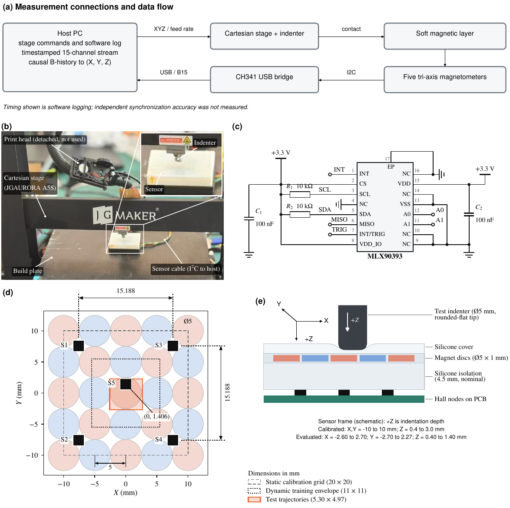

**图1。** 系统连接、三轴加载平台、触头及名义层叠结构；坐标范围为协议与采样覆盖，不是独立实测精度。

**表2。** 既有硬件及采集参数；设计值与实测/未知值分别说明。

| Item | Value |
| --- | --- |
| Magnetometers | $5\times$ MLX90393, tri-axis (15 channels) |
| Positions (mm) | S1 $(-7.594,\,7.594)$, S2 $(-7.594,\,-7.594)$, S3 $(7.594,\,7.594)$, S4 $(7.594,\,-7.594)$, S5 $(0,\,1.406)$ |
| Interface | I2C at 400 kHz through a CH341 USB bridge |
| Device settings | gain code 7, HALLCONF 0xC, RES 0, DIG_FILT 0, OSR 0, temperature compensation off |
| Conversion$^{\mathrm a}$ | 0.161 µT/LSB ($x$, $y$), 0.294 µT/LSB ($z$) |
| Frame timing | 20-ms period requested; mean rate 34–36 Hz, median interval 29.9 ms |
| Unloaded noise | standard deviation 5.0–10.2 µT per channel (median 5.7 µT; $z$ channels 8.6–10.2 µT); 27 µT in the 15-channel norm |
| Magnetic layer | 25 axially magnetized discs, 5-mm diameter, 1 mm thick, $5\times5$ grid at 5-mm pitch, alternating polarity; surface field 1800 G (0.18 T, supplier data), grade not specified [16] |
| Isolation layer | silicone, nominally 4.5 mm thick (design value, not a measured magnet-to-magnetometer gap) [16] |
| Elastomer | C0005 two-part platinum-cure silicone; supplier data: Shore C 5, tensile strength 1.20 MPa, tear strength 6.30 N/mm, elongation 900% [16] |
| Specimen | $46\times56$ mm footprint; readout board in a 3-D-printed holder [16] |
| Indenter | test records: rigid, 3-D printed; nominally 5-mm diameter, 3-mm flat, 1-mm edge radius. Calibration and training records: a different indenter (Section 2.1.4) |
| 动作 | Cartesian stage of a JGAURORA A5S 3-D printer |

#### 2.1.3 坐标、基线与参考

坐标原点使用各记录保存的传感器中心及接触Z参考，名义正Z表示压入。五节点各三轴构成15维磁观测，当前磁场、确认无载基线及其差分的每个分量单位均为µT。确认无载及状态重置按原程序规则处理，不凭未来轨迹重新选择基线。

参考位置由指令起点、目标与记录运动时间线性插值，在到达后保持至下一动作。该时间模型没有描述真实加减速、通信延迟或平台柔顺性，也没有事后拟合磁流与指令之间的时间偏移。浅压深不能直接视作实测接触深度；未知初始坐标保持未知，直到记录足以确定。

#### 2.1.4 数据集与用途

表3区分静态图谱、代理拟合/选择、真实修正训练/开发和冻结评价。静态图谱包含11×11个平面位置、14个0.4–3.0 mm深度，共1,694个接触条件。代理使用24条动态与3条静态源记录拟合，另外10条源记录选择模型。35条真实修正记录总动作时长43.7分钟，按完整记录分为32条训练和3条开发，未随机拆帧。

原主评价为源会话1、源会话2及目标磁层，每批六类复杂路径各两档0.7/1.3 mm/s，共36条；每批另有圆、法向压入和前后无载4条控制，总计48条。36条评价未参与最终候选拟合、归一化与检查点选择，但此前已被用于研究探索。两源会话约相隔30分钟并共享安装，不能计作第三器件。

历史标定/训练与评价的触头标签存在差异。目标磁层没有用于拟合或适配；其在线队列丢弃约四分之一输入，原生推理流包含这一采样条件。不能将目标与源的差异完全归为器件物理差异，也不把重新采集时间当作数据独立性的唯一标准。新增八条同工况记录的隔离和原在线一致性检查见第2.6节。

**表3。** 数据及其标定、拟合、开发和评价角色。

| Set | Device | Content | Role |
| --- | --- | --- | --- |
| Static atlas | Source | 1694 contacts: $11\times11$ grid, 2-mm pitch, 14 depths from 0.4 to 3.0 mm | static inverse map of H0 (frozen) |
| Surrogate records | Source | 24 dynamic and 3 static records for fitting, 10 for validation | forward surrogate (Section 2.2) |
| Refinement TRAIN | Source | 32 records: 15 circle, 7 compound $XY$–$Z$, 6 radial, 2 grid, 2 normal press | training of H1 and H2 |
| Refinement VAL | Source | 3 records: grid, radial, circle | learning-rate schedule, checkpoint selection |
| Test, source session 1 | Source | 12 complex trajectories and 4 controls | frozen evaluation |
| Test, source session 2 | Source | same paths, 30 min later, same mounting | repeatability |
| Test, target | 目标 | same paths | transfer without adaptation |

#### 2.1.5 背景表征方法

背景表征来自既有标定及控制数据，没有为器件表征新增采集。静态磁响应为保持段160 ms窗相对160 ms无载窗的中位差分。噪声按两源会话无载记录合并后各通道标准差估计，约5.3–9.8 µT。中心法向控制重复压入两次，加载在0.6、1.0、1.4 mm停驻0.75 s，卸载在0.8和0.6 mm停驻，每段最后0.3 s的磁范数用于比较。

理论噪声界由静态响应的局部有限差分雅可比及所设噪声模型计算，报告平面与深度的标准差下界。有限差分网格粗并不保证估计保守；这些理论量不是已达到的实测分辨率，也不证明完整因果估计器满足局部无偏或其他假设。

### 2.2 动态正向代理与仿真平台

#### 2.2.1 位置与历史耦合

令q为触头名义指令坐标，s为潜在历史状态，S为五节点观测算子。式(1)概括当前位置、历史和未建模扰动共同影响磁观测；式(2)的一阶形式区分位置与历史贡献。相同位置可能因到达过程不同而具有不同响应，把历史变化全部解释为位移可能形成方向误差、反转拖尾或分支选择问题。

若局部可容许历史不确定性在观测空间张成子空间H，排除它后的位置雅可比仍须保留三个独立方向，见式(3)。实际可分辨还要求最小奇异值与目标位移的乘积超过有效噪声。此为固定局部分支的解释性条件，不是整个工作域的全局唯一性定理，也不把代理的全部状态坐标解释为可独立辨识的物理自由度。

$$
\Delta\mathbf b_t=\mathcal{S}\{\mathbf{B}(\,\cdot\,;q_t,s_t)\}-\mathbf{b}_0+\boldsymbol{\epsilon}_t ,\tag{1}
$$

$$
\delta\mathbf{b}_t\simeq J_q\,\delta q_t+J_s\,\delta s_t+\delta\boldsymbol{\epsilon}_t ,\tag{2}
$$

$$
\mathop{\mathrm{rank}}\!\left(P_{\mathcal{H}^{\perp}}J_q\right)=3 .\tag{3}
$$

#### 2.2.2 空间特征

空间项含10个低阶多项式和100个三维高斯基函数。归一化采用X/6、Y/6和max(Z,0)/3；平面中心为−6、−3、0、3、6 mm，深度中心为0.6、1.4、2.2、3.0 mm，高斯宽度为(2.5,2.5,0.65) mm。全部110维特征乘以Z正部与0.2 mm尺度形成的压深因子，使名义抬离时静态增量为零，同时允许历史残余存在。0.2 mm为设计尺度，不是已测接触阈值或材料常数。

$$
r_j(q)=\exp\!\left[-\frac12\sum_{a\in\{X,Y,Z\}}\left(\frac{q_a-c_{j,a}}{\sigma_a}\right)^{2}\right]\tag{4}
$$

$$
\phi(q)=\frac{Z^{+}}{Z^{+}+0.2}\,\bigl[p(q),\,r_1(q),\ldots,r_{100}(q)\bigr]^{\mathsf T},\tag{5}
$$

#### 2.2.3 分轴历史状态

对横向先行与法向先行两条特征增量路径进行对称分配，式(6)两部分严格相加为总特征增量；纯法向动作不会产生横向激励，纯横向动作不会产生法向激励。每部分驱动0.3、1、4秒三个指数衰减状态，使用真实时间间隔。确认基线重置、未知坐标或超过0.5 s断档时清零。

停驻时增量为零，历史项衰减，长期返回固定静态映射；反向动作改变激励符号。静态项和暂态项因而具有分工，动态拟合不会任意改写已冻结的平衡底座。指数状态是现象学磁响应代理，不是独立测得的硅胶松弛常数或真实形变场。

$$
\begin{aligned}
\delta_{xy,t}&=\tfrac12\bigl[\phi(q'_t)-\phi(q_{t-1})+\phi(q_t)-\phi(q''_t)\bigr],\nonumber\\
\delta_{z,t}&=\phi(q_t)-\phi(q_{t-1})-\delta_{xy,t}.
\end{aligned}\tag{6}
$$

$$
h_{a,k,t}=\rho_{k,t}\,\bigl(h_{a,k,t-1}+\delta_{a,t}\bigr),\qquad \rho_{k,t}=e^{-\Delta t_t/\tau_k},\tag{7}
$$

$$
\widehat{\Delta\mathbf b}_t=C_0^{\mathsf T}\phi(q_t)+\sum_{k=1}^{3}\Bigl[C_{xy,k}^{\mathsf T}h_{xy,k,t}+C_{z,k}^{\mathsf T}h_{z,k,t}\Bigr].\tag{8}
$$

#### 2.2.4 拟合与模型选择

先拟合并冻结110×15静态系数，再以加权岭回归拟合660×15历史系数。特征尺度由源侧拟合数据的加权均方根确定，下限0.02；每条完整记录总权重相同，边界帧半权。模型类别、时间尺度集合和岭强度由10条源验证记录选择，目标磁层不参与。

候选的法向和网格验证误差须分别不超过静态参考的110%。静态映射类别均值NRMSE为25.9%，最优联合历史模型整体为21.9%，但网格42.2%超过1.10×37.8%≈41.6%的上限，故不合格。分轴模型取岭强度0.01，整体15.4%；径向34.8%→18.7%，网格37.8%→17.1%，复合32.3%→21.7%，法向7.8%→8.3%仍满足守卫。NRMSE为同计分帧、同通道预测误差RMS除以实测差分场RMS；该守卫是内部选模规则，不是硬件精度指标。

$$
\widehat C=\arg\min_C\sum_i w_i\bigl\|H_i^{\mathsf T}C-(\Delta\mathbf b_i-C_0^{\mathsf T}\phi_i)\bigr\|_2^{2}+\lambda\,\|D_\phi C\|_F^{2},\tag{9}
$$

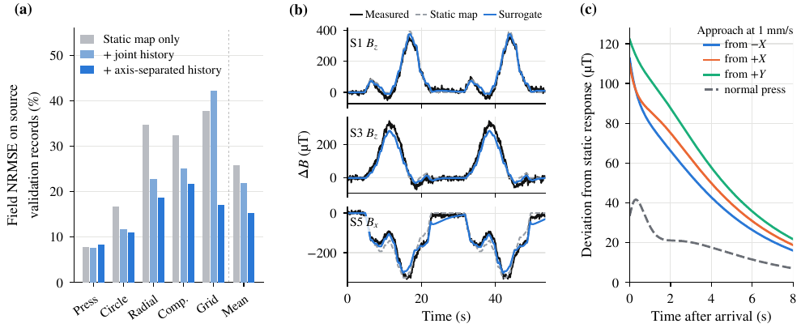

**图2。** 动态正向代理的验证、虚实重建差异及受控历史预测；预测状态不等于独立实测材料参数。

#### 2.2.5 代理用途与表征发现

式(10)在固定有限因果窗口和局部敏感性有界条件下给出解码误差上界。它不提供位置误差下界；磁场偏差可能处在解码器不敏感方向。未估计完整解码器的Lipschitz常数，不能由磁场NRMSE断言某种定位精度不可能实现。

在代理内部，从三条侧向及一条法向路径到达(0,0,1.4) mm时，可控制历史而保持终点。侧向到达后历史场偏离静态约110–122 µT，静态响应范数约649 µT、噪声范数约27 µT；法向从0.45压至1.4 mm偏离约34 µT。−X与+X到达响应之差在到达、1、4和8秒约为217、158、87、33 µT。这些是代理预测，不能直接当作实物独立验证。

交互仿真展示触头动作、五节点向量、15通道、生成轨迹、独立逆解保存结果、四节点预测另一节点及虚拟实验。向量不是磁力线或实测位移，输入路径不会冒充逆解输出。库含60条、六类自由三维动作；训练生成器包括贝塞尔、惯性随机游走、自由路点和多尺度路径，X/Y各±5 mm、Z为0.45–2.4 mm、速度0.5–2 mm/s、停驻不超过2.5 s，以10 Hz生成。界面示例不参与论文总体统计。

三个结构相同的60—32—3读出网络仅用32条虚拟路径训练，不使用静态图谱与完整链许可；未使用的输入维度置零。当前磁场、单0.3秒及0.3/1/4秒上下文在64条未见虚拟路径上三维误差为0.303、0.288、0.301 mm，几乎没有区分。冻结到真实源记录后，包含停驻的计分域中平面误差为0.947、1.029、0.914 mm，实测基线为0.431 mm，说明虚拟位置映射迁移不理想。但跳变50.4%→22.8%→9.9%，停驻波动0.177→0.123→0.098 mm，其他批也保留相同排序。仿真探索与真实记录检查共同形成线索：保留实测重建链，增加多尺度上下文，再仅用真实数据监督。该发现不能改写为只看仿真便选出最优设计后一次盲测全面成功。

$$
\bigl\|D(\widetilde{\mathbf b}_{\le t})-q_t\bigr\|\le\bigl\|D(\mathbf b_{\le t})-q_t\bigr\|+L_D\,\bigl\|\widetilde{\mathbf b}_{\le t}-\mathbf b_{\le t}\bigr\| .\tag{10}
$$

### 2.3 真实监督的因果历史修正

图3连接代理、原基线与修正模型。最终H1/H2从冻结H0初始化，仅用真实源记录训练，不迁移虚拟权重或虚拟坐标监督。主要记录未进入最终拟合和选模，但其先前研究暴露使评价仍为回顾性。

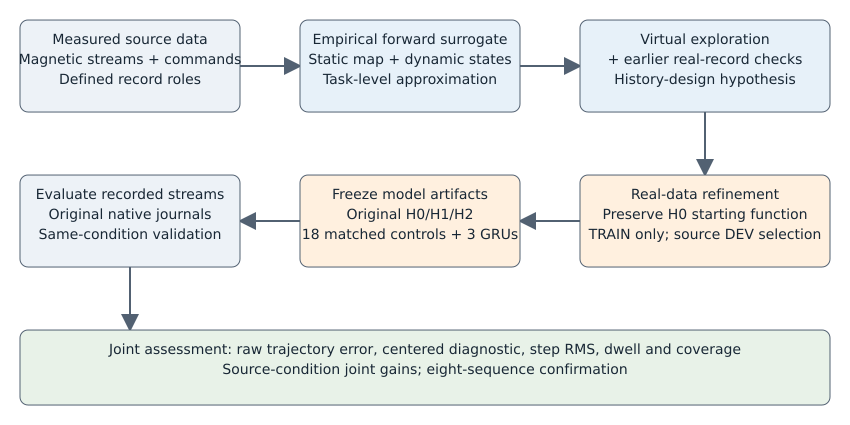

**图3。** 研究路径：实测建立代理，虚拟探索与先前真实记录检查形成表征线索，真实训练与DEV选模后冻结，再进行原生日志评价及八条同工况补充验证。

#### 2.3.1 原重建链H0

H0是已有完整在线因果链。历史XY与深度训练分别完成1,023和754轮，并按最低学习率平台规则停止，不是欠训练对照。

15维差分磁场按方向与幅值组成16维特征，幅值参考a0=539.5 µT。1,694个静态接触构成11×11×14图谱，采用三线性插值；反演先在1 mm平面候选网格和14深度搜索，再进行两步阻尼Gauss–Newton修正。二秩慢状态跟踪局部位置雅可比无法解释的残差，每0.1 s保留0.8，等效时间尺度约0.45 s，并在反演前扣除。若候选距前态超过1 mm，比较局部延续分支与原候选的磁场代价及位移惩罚。

53—64—64—2的tanh平面残差头接收候选坐标3维、修正磁特征16维、慢状态2维以及约0.1和0.4秒历史差各16维。独立深度模块在修正XY处沿Z搜索，结合连续性与先验；响应检测和工作域规则决定是否输出，拒绝帧不记零。历史在基线/流变化、非递增时钟或超过0.25 s断档时重置。

更早七条约10 Hz源记录的基线消融给出：仅图谱平面误差0.876 mm，加入慢状态0.689 mm，再加分支守卫仍0.689 mm，加入平面头0.254 mm，完整链0.258 mm且深度更好。新增工作因此是在充分训练、已经使用历史的系统上改进。

$$
\mathbf{f}_t=\Bigl[\,\Delta\mathbf b_t/\|\Delta\mathbf b_t\|,\ \tfrac12\ln\bigl(\|\Delta\mathbf b_t\|/a_0\bigr)\Bigr],\tag{11}
$$

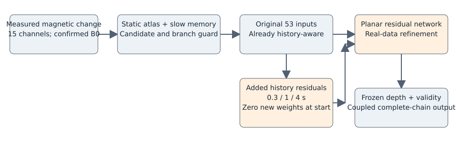

**图4。** 已有完整重建链与新增历史残差；灰色为冻结共用部分，橙色为新增输入及真实训练平面头。

#### 2.3.2 函数保持的历史扩展

按实际帧间隔维护0.3、1、4秒修正磁特征EMA，使用当前特征减EMA形成三组各16维残差。重置时EMA取当前值，新增残差为零。新增特征来自当前及过去测量，无需动作坐标作为该历史输入。

48维残差与原53维拼接，形成101—64—64—2网络，共10,818个参数。复制全部旧参数并将首层新增48行置零，原53维均值和尺度逐元素保留；新维标准化仅用TRAIN，尺度下限0.25。11,415个训练样本及完整链软件测试核对了初始化等价。后续真实训练不保证未见记录必然改善，开发集守卫允许保留原模型。只训练XY残差头，Z、许可和慢状态参数冻结，但Z与XY耦合仍需在完整链评价。

$$
m_{k,t}=\rho_{k,t}\,m_{k,t-1}+(1-\rho_{k,t})\,z_t,\qquad v_{k,t}=z_t-m_{k,t},\tag{12}
$$

$$
u_t=\bigl[u^{(0)}_t,\,v_{1,t},\,v_{2,t},\,v_{3,t}\bigr]\in\mathbb{R}^{101},\qquad \widehat q^{\,xy}_t=g^{xy}_t+N_\theta(u_t).\tag{13}
$$

#### 2.3.3 训练目标

目标为参考XY减候选g的残差，每轴截断至±3 mm。训练池含7,217个原动态帧、3,633个新增可靠停驻帧和565个静态锚点。停驻须名义压深至少0.45 mm、无运动和边界、停驻龄0.2–1.5 s，每4帧取1。H1以位置及锚点监督训练，三组损失质量为0.8、0.1、0.1，权重L2系数β=0.001，见式(14)。

H2在相同输入、数据与初始化上增加运动增量、停驻增量与额外锚点约束，各系数预设0.25，见式(15)。运动对须同记录、同命令段、相邻有效且间隔不超过0.25 s，两帧均满足深度及边界要求，共8,833对，其中3,439对为合格停驻。停驻对同时属于运动对集合。目标匹配参考运动增量，不是压制所有坐标变化；压缩真实运动幅度也会受罚。各新增项没有单独消融，比较的是目标包。

$$
\begin{aligned}
\mathcal{L}_1={}&0.8\,\mathbb{E}_{\mathcal D}\|r_\theta-y\|^{2}+0.1\,\mathbb{E}_{\mathcal W}\|r_\theta-y\|^{2}\nonumber\\
&+0.1\,\mathbb{E}_{\mathcal A}\|r_\theta\|^{2}+\frac{\beta}{2}\sum_l\|W_l\|_F^{2},
\end{aligned}\tag{14}
$$

$$
\begin{aligned}
\mathcal{L}_2={}&\mathcal{L}_1+0.25\,\mathbb{E}_{\mathcal P}\bigl\|\Delta\widehat q^{\,xy}-\Delta q^{xy}\bigr\|^{2}\nonumber\\
&+0.25\,\mathbb{E}_{\mathcal P_W}\bigl\|\Delta\widehat q^{\,xy}-\Delta q^{xy}\bigr\|^{2}+0.25\,\mathbb{E}_{\mathcal A}\|r_\theta\|^{2}.
\end{aligned}\tag{15}
$$

#### 2.3.4 优化与选模

原两组以双精度Adam、固定seed 7训练，名义批量256、每轮45次更新；初始学习率0.0002，开发目标连续50轮未相对改善0.0001则减半，最低0.000001，再平台50轮停止，最大2,000轮只作预算。H1/H2分别运行1,015/854轮，选择146/269轮，更新45,675/38,430次，均减学习率8次，见表4。

开发目标基于三条开发记录的平面头输出，不是每轮完整链回放：原始XY、0.1倍残差步长RMS、0.1倍合格停驻波动及0.1倍静态锚点残差RMS。资格要求平均XY不超过H0+0.005 mm，每条不超过H0+0.02 mm，锚点RMS不超过H0+0.02 mm；初始H0也可入选。选中开发目标由0.3792降至0.3681和0.3609 mm，末值为0.3748与0.3684 mm；合格轮约10.0%与3.2%。三条开发记录较少，H2各条XY由0.288/0.296/0.438变为0.297/0.294/0.420 mm，不能将开发总体改善当作每条改善。

硬件、图谱和基线来自配套工作[16]，本文不将固定指数特征或函数保持初始化当作新通用架构[15,33,39]。第2.5节新增匹配计算，专门回答扩大样本和继续优化的影响，与原两组历史训练分别报告。

**表4。** 原H1/H2训练协议与选中结果。

|  | H1 | H2 |
| --- | --- | --- |
| Objective | $\mathcal{L}_1$ (14) | $\mathcal{L}_2$ (15) |
| 训练样本 | 11,415 (Section 2.3.3) | 11,415 (Section 2.3.3) |
| Network | 101–64–64–2, $\tanh$, 10,818 parameters | 101–64–64–2, $\tanh$, 10,818 parameters |
| 初始化 | H0 weights; 48 new input rows zero | H0 weights; 48 new input rows zero |
| 优化器 | Adam, $\beta_1=0.9$, $\beta_2=0.999$, $\epsilon=10^{-8}$ | Adam, $\beta_1=0.9$, $\beta_2=0.999$, $\epsilon=10^{-8}$ |
| Batch size (nominal); updates per epoch | 256; 45 | 256; 45 |
| Learning rate | $2\times10^{-4}$, halved on plateau to $10^{-6}$ | $2\times10^{-4}$, halved on plateau to $10^{-6}$ |
| 种子与精度 | 7; 64-bit floating point | 7; 64-bit floating point |
| 完成轮数 | 1015 | 854 |
| 选中轮 | 146 | 269 |
| 参数更新 | 45,675 | 38,430 |
| 学习率下降次数 | 8 | 8 |
| 开发目标 (mm)$^{\mathrm a}$ | 0.3681 | 0.3609 |
| Anchor correction RMS (mm)$^{\mathrm b}$ | 0.137 | 0.081 |

#### 2.3.5 历史比较能够识别什么

充分训练旧基线与在扩大停驻池上匹配继续训练是不同问题。原研究完成前者而没有完成后者。原H1与H2共享结构、样本和初始化，改变的是目标包，并不能分别识别每个损失项。表5保留原比较因素，第2.5节描述新完成的对照，不将新证据改写成原设计时已经具备。

新增控制减少了数据和追加优化的混杂，但历史输入与容量仍同时改变；三个种子共享同一初始化，时间尺度不是已辨识材料参数。

**表5。** 原三模型比较因素；新增匹配训练见第2.5节。

| 因素 | H0 | H1 | H2 |
| --- | --- | --- | --- |
| Planar-head input dimension | 53 | 101 | 101 |
| Original dynamic samples | 7217 | 7217 | 7217 |
| Additional qualified-dwell samples | 0 | 3633 | 3633 |
| Static anchors | 565 | 565 | 565 |
| 初始化 for this study | frozen historical model | copied H0; new inputs zero | identical to H1 |
| Additional optimization in this study | none | matched refinement protocol | matched refinement protocol |
| Refinement objective | historical baseline | $\mathcal L_1$ | $\mathcal L_2$ |
| Training seeds evaluated | historical reference | 7 only | 7 only |

### 2.4 评价协议

#### 2.4.1 冻结因果回放

H0/H1/H2在最终完整链评价前冻结并记录哈希。使用原磁流、15维B0、原生时间与重置逐帧运行，不重采样、不事后时间配准、不额外过滤XYZ。在输入、基线、时间与状态生命周期相同时，这是与在线相同的因果推理程序，不是借助未来信息的另一种重建；执行等价不能使记录自动成为独立盲测，也不能使指令参考变成实测触点真值。

主评价记录曾用于仿真侧候选和虚拟读出探索，其表现影响尝试多尺度上下文的决定。最终三模型的参数、归一化和检查点不依赖这些评价记录，但方法选择已有研究者暴露，故仍是回顾性冻结评价。

#### 2.4.2 计分域与指标

原复杂路径计分帧要求属于路点运动、名义压深至少0.4 mm且三模型共同有效。各模型自身有效帧覆盖率另报，避免通过拒绝困难帧获得表面低误差。原始平面及三维误差为欧氏距离均值，Z用绝对误差，另报原始平面误差95百分位。

去平移先对完整序列的同计分误差拟合一个均值向量，再计算残差平面范数均值，见式(16)。这是事后诊断，不是可在线应用的校准。固定平移不改变残差相邻增量；原始P95则仍受平移影响。

相邻共同有效帧要求时间递增且间隔不超过0.25 s，残差增量范数超过0.2 mm的比例为跳变，见式(17)。同时报告不依赖阈值的残差步长RMS，作为更具代表性的稳定性效应量。停驻RMS对连续至少3帧、持续至少1 s的同命令停驻块分别去均值，先块再序列等权汇总；每源会话有48个停驻块。所有主均值以完整序列为单位，12条等权，不让长记录支配。

$$
E^{\mathrm c}_{xy}=\frac{1}{|\mathcal{I}|}\sum_{t\in\mathcal{I}}\bigl\|e^{xy}_t-\bar e\bigr\| .\tag{16}
$$

$$
J=\frac{100}{|\mathcal{Q}|}\sum_{t\in\mathcal{Q}}\mathbf{1}\{d_t>0.2\ \text{mm}\},\tag{17}
$$

#### 2.4.3 统计方法

同一序列内帧高度相关，两档速度共享路径几何，因此以六类路径作为簇，进行10,000次配对簇自助重采样和六簇均值精确符号置换[46–48]。共有64种符号组合，双侧最小p为2/64≈0.031；区间和未多重校正的p值均作描述性解释。两源会话和目标磁层分别统计。单原始种子和非随机设计几何不支持总体或跨种子推断；新增三训练顺序的变异含义在第2.5节单列。

#### 2.4.4 事后对照

输出滤波、阈值、时间及偏移分析均在主要结果已知后加入，明确标为事后分析。H0平面输出施加因果一阶EMA，采用实际时间，拒绝或超过0.25 s间断后重置，不读取参考位置，见式(18)。时间常数在原评价数据上从0.02扫至0.3 s，这有利于滤波对照。报告0.03 s匹配H2源侧步长RMS及0.05 s较强滤波，并将0.05 s施加于H2考察组合。

跳变阈值另扫0.05–0.4 mm，目标数据另限制20–45 ms相邻间隔。主要统计由独立实现复算；完整H1/H2也曾从冻结权重与原始流重执行并核对。新补充包进一步提供独立目录内的冻结输出便携复算，不将它称作新硬件实验或新一轮全部训练。

$$
\tilde q^{\,xy}_t=\tilde q^{\,xy}_{t-1}+\bigl(1-e^{-\Delta t_t/\tau}\bigr)\bigl(\widehat q^{\,xy}_t-\tilde q^{\,xy}_{t-1}\bigr),\tag{18}
$$

#### 2.4.5 生成式AI使用说明

Codex（OpenAI）与Claude（Anthropic）辅助代码编写、统计实现、图件和文字编辑。实验观测来自保存的磁流及平台指令，不是由生成模型编造。作者审查代码和输出，对全文承担责任。

### 2.5 匹配继续训练与时间尺度对照

六种设置分别使用7、17、27三个训练顺序种子：53维原基线在相同扩大样本池上继续位置训练，0.3、1、4秒三个单尺度组，以及多尺度位置和多尺度联合目标组，共18次CPU训练。所有组从同一冻结H0函数出发；种子改变训练顺序，不是独立随机初始化。未用时间块从有效输入中移除，单尺度与多尺度的容量也不同。

各组共享32条TRAIN、3条DEV及11,415样本，原53维归一化保持，新维仅TRAIN定标。双精度Adam、每轮45更新、初始0.0002、50轮平台减半至0.000001再平台50轮停止、开发综合目标和资格守卫一致；全部按规定平台规则闭合，2,000轮仅作预算上限。选模不读取原复杂评价或新增同工况验证。

位置与联合目标配置重跑CPU以匹配新增对照，原GPU单种子冻结模型继续作为历史结果单列。相同种子下样本顺序配对，选中训练年龄可因同一DEV规则不同。报告三训练顺序均值与样本标准差，不解释为独立初始化或器件总体不确定性。

18个模型在54项原三批完整原生日志回放前冻结，保留36复杂及12控制。每个对照使用成对共同有效帧，覆盖率另列。该设计检验相同额外数据与优化、所选单/多尺度及目标包；代表性GRU另见第2.7节。该特征对照矩阵未包含广泛时间常数组合缩放或逐损失项全因子消融。

### 2.6 同工况冻结模型补充验证

核查得到八条完整路点序列，使用原源磁层和圆角触头标签，名义指令速度为原轨迹评价使用的0.7与1.3 mm/s。逐记录标识及原始哈希与原XY/Z拟合、真实微调、开发和原主要评价清单核对，均无匹配。记录身份和两个既有冻结模型在首次新比较前固定；不新增训练，不按H2成绩选择记录或检查点。

从原生日志头至最后一条选定序列的完整推理操作前缀包含88,453组磁数据，以及必要先前状态、基线控制、阶段提示和全部起止/输出标记。H0、H2各完整回放一次。H2评价前，全部八条H0必须逐时间戳复现原在线输出有效性，有限XYZ数值在1e-10 mm内一致。不拟时移、平移、空间配准，不重采样或优化基线窗口。

首次新H0评分前固定基线可比性条件：原始XY均误不超过原24条源会话逐记录误差95百分位0.5301053910924818 mm，且覆盖率至少95%。这是明确的运行条件检查，不是错误数据定义。八条候选全部通过，因此条件组与全部固定记录完全相同，没有排除任何候选。H2结果不参与这一检查。

沿用原指令参考、运动阶段掩码、有限磁输入、0.2 mm残差跳变阈值及最大0.25 s相邻间隔。完整保留八条序列分母及11,769个主要参考帧，逐序列等权平均。各自有效输出误差与覆盖率配套报告，另给共同有效输出比较。普通指令停驻波动只作诊断，不替代专门多方向长保持或物理延迟实验。这是既有采集的回顾性评价，不是训练冻结后新增实物采集。

### 2.7 代表性残差GRU对照

采用Cho等提出的门控循环单元[50]，新增一个学习型时序对照：保留可训练的53→64→64→2 tanh读出，单层GRU输入为相同标准化53维因果特征及按0.1 s缩放的实际有效帧间隔，隐藏宽度16。无偏置16→2残差读出零初始化，使起点精确保持H0函数。GRU共11,234个参数，多尺度MLP为10,818，H0为7,746，属于近似而非严格等容量匹配。

每次查询只用此前4 s内最多64个已接受记录帧，窗口内GRU从零状态开始；无未来帧或重采样。无效输入、时间非递增、超过0.25 s间隔、基线/流改变及显式重置清除上下文；两条解码路径分别保存历史。先恢复完整有效帧前缀，再选择监督行。

沿用32条TRAIN、3条DEV、11,415监督样本、原归一化、联合约束包、双精度Adam、开发目标和资格守卫。训练顺序7、17、27共享初始化，每完整轮45次更新，同一学习率/平台规则决定停止，而非强行相同终止年龄。只由源DEV选中检查点，全部三个模型在首次GRU评价前冻结。资格检查覆盖起点H0函数一致、循环实现一致、因果填充及生命周期规则，保持原数值容差。

每模型保留原48条原生评价，包括36条主要复杂轨迹和12条控制；源、源重复及目标分开。冻结H0、同顺序公平H0及两个多尺度目标沿用同一覆盖、指令参考掩码和共有有效输出统计比较。GRU结构是在看过早期评价摘要后新增的固定审稿对照，不是新盲测或循环模型家族搜索。

## 3. 结果

### 3.1 器件背景表征

静态15通道响应范数中位数在0.4、1.0、3.0 mm为93、277、1,621 µT，121位置的10%—90%范围分别63–142、182–377、1,005–2,045 µT。中心±2 mm九点响应为115、346、2,033 µT。无载噪声范数中位约27 µT，单记录各通道标准差5.0–10.2 µT；最浅响应约为噪声三倍。1.0 mm响应随位置约100–556 µT，变化5.6倍。

81内部位置的平面CRB标准差中位在0.4、1.0、1.4、3.0 mm为0.36、0.13、0.08、0.02 mm；中心±4 mm前三者为0.33、0.12、0.07 mm。深度界0.007–0.026 mm，比平面界小约3–14倍。深度已知时0.6/0.8 mm平面界为0.22/0.15 mm，与配套研究另一试样和触头的0.136 mm为相近量级[16]。因估计对象和假设不同，不能由理论界与停驻RMS或平均轨迹误差的数值接近来分配误差来源，更不能宣称已达到分辨率。

源会话1中心法向加载0.6、1.0、1.4 mm响应为272、479、721 µT，同记录两次压入和30分钟后同安装重复在这些深度内相差不超过2.5%。卸载到0.6 mm时比加载高3%–11%，六次压入均如此，重复差最高7.8%。这是相同名义命令位置与不同历史下磁响应不同的实测观察，未隔离唯一材料机制。目标磁层各停驻响应比源低33%–38%，说明同一源图谱不能自动描述另一装配。

**图5。** 静态响应、空间响应图、假设模型下理论CRB标准差界及原控制法向响应；理论界不是实测分辨率。

### 3.2 源器件：轨迹误差与平稳性

表6、图6和表7报告逐序列等权结果及六几何簇配对统计。H2源会话1/2原始XY由0.436/0.452降至0.408/0.424 mm，约6.4%/6.3%；24条中23条改善，两会话各六类均改善。原始P95降低12.3%/12.6%，居中误差降低9.2%/9.3%；Z MAE由0.165/0.156到0.164/0.155 mm，三维均误降5.4%/5.5%。

残差步长RMS由0.173/0.176到0.094/0.097 mm，约降45%；停驻RMS由0.112/0.117到0.071/0.070 mm，降36.8%/40.6%。0.2 mm阈值跳变由23.2%/24.6%到3.1%/3.3%，三项波动指标在24条中全部降低。计分参考帧21,183和20,807，源1每模型拒绝11帧，源2分别11/13/13帧；收益不是大量拒绝换得。

H1得到大部分原始XY改善（4.9%/5.2%）和最小居中误差（降低11.8%/12.5%），步长RMS约降30%。H2相对H1进一步降低步长约21%、停驻约15%–17%；原始XY变化−1.6%/−1.2%（p=0.09/0.16），居中误差反增2.9%/3.6%（p=0.19/0.09）。目标包主要增加平稳性，没有单一模型所有量最好。两会话各指标约在6%内一致，但共享安装，只支持短期重复性。

**表6。** 原三批复杂序列等权结果；滤波行为事后对照。长度单位mm，居中仅作诊断。

| 会话 | 模型 | Accuracy / $E_{xy}$ | Accuracy / $E_{xy}$, 95th pct. | Accuracy / $E^{\mathrm c}_{xy}$ | Accuracy / $E_{xyz}$ | Accuracy / $Z$ MAE | Fluctuation / Step RMS | Fluctuation / Jump rate (%) | Fluctuation / Dwell RMS | 覆盖（%） |
| --- | --- | --- | --- | --- | --- | --- | --- | --- | --- | --- |
| 源1 | H0 | 0.436 | 0.715 | 0.215 | 0.480 | 0.165 | 0.173 | 23.23 | 0.112 | 99.90 |
| 源1 | H1 | 0.415 | 0.647 | 0.190 | 0.459 | 0.163 | 0.120 | 7.77 | 0.083 | 99.90 |
| 源1 | H2 | 0.408 | 0.627 | 0.195 | 0.454 | 0.164 | 0.094 | 3.13 | 0.071 | 99.90 |
| 源1 | H0+EMA0.03 | 0.432 | 0.694 | 0.205 | 0.476 | 0.165 | 0.094 | 2.82 | 0.080 | – |
| 源1 | H0+EMA0.05 | 0.433 | 0.692 | 0.206 | 0.477 | 0.165 | 0.064 | 0.43 | 0.068 | – |
| 源1 | H2+EMA0.05 | 0.410 | 0.620 | 0.199 | 0.455 | 0.164 | 0.037 | 0.06 | 0.054 | – |
| 源2 | H0 | 0.452 | 0.750 | 0.224 | 0.487 | 0.156 | 0.176 | 24.56 | 0.117 | 99.91 |
| 源2 | H1 | 0.429 | 0.674 | 0.196 | 0.464 | 0.153 | 0.123 | 8.21 | 0.083 | 99.89 |
| 源2 | H2 | 0.424 | 0.656 | 0.204 | 0.460 | 0.155 | 0.097 | 3.31 | 0.070 | 99.89 |
| 源2 | H0+EMA0.03 | 0.448 | 0.731 | 0.214 | 0.483 | 0.156 | 0.097 | 3.21 | 0.082 | – |
| 源2 | H0+EMA0.05 | 0.449 | 0.729 | 0.215 | 0.483 | 0.156 | 0.066 | 0.46 | 0.069 | – |
| 源2 | H2+EMA0.05 | 0.426 | 0.653 | 0.208 | 0.462 | 0.155 | 0.038 | 0.05 | 0.051 | – |
| 目标 | H0 | 0.521 | 0.982 | 0.478 | 0.565 | 0.172 | 0.256 | 46.32 | 0.160 | 98.49 |
| 目标 | H1 | 0.526 | 1.015 | 0.488 | 0.570 | 0.172 | 0.195 | 28.87 | 0.130 | 98.48 |
| 目标 | H2 | 0.512 | 0.985 | 0.484 | 0.557 | 0.170 | 0.161 | 18.54 | 0.113 | 98.47 |
| 目标 | H0+EMA0.03 | 0.514 | 0.971 | 0.472 | 0.558 | 0.172 | 0.174 | 22.48 | 0.131 | – |
| 目标 | H0+EMA0.05 | 0.514 | 0.974 | 0.474 | 0.559 | 0.172 | 0.132 | 11.45 | 0.115 | – |
| 目标 | H2+EMA0.05 | 0.515 | 0.994 | 0.489 | 0.560 | 0.170 | 0.089 | 3.36 | 0.093 | – |

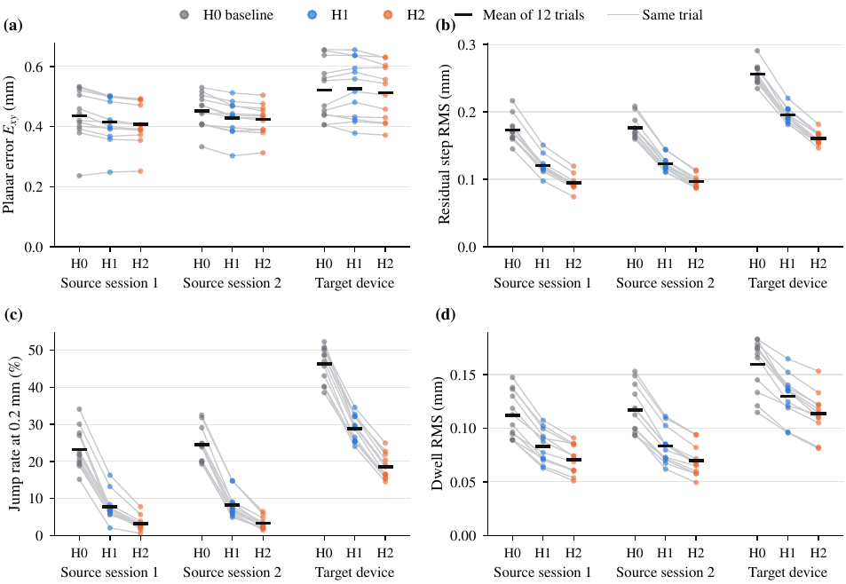

**图6。** 原三模型在两源会话和目标装配的逐序列原始XY、步长RMS、跳变和停驻波动。

**表7。** 按六类路径成簇的配对比较；差为H2减控制，负值有利H2，区间与p值作描述。

| 对照 | 指标 | 控制 | H2 | Change (%) | 95% CI of difference | $p$ | 改善序列 | 改善类别 |
| --- | --- | --- | --- | --- | --- | --- | --- | --- |
| H2 vs. H0; 源1 | $E_{xy}$ (mm) | 0.436 | 0.408 | $-6.4$ | $[-0.041,\,-0.014]$ | 0.031 | 11/12 | 6/6 |
| H2 vs. H0; 源1 | $E_{xy}$, 95th pct. (mm) | 0.715 | 0.627 | $-12.3$ | $[-0.117,\,-0.059]$ | 0.031 | 12/12 | 6/6 |
| H2 vs. H0; 源1 | $E^{\mathrm c}_{xy}$ (mm) | 0.215 | 0.195 | $-9.2$ | $[-0.027,\,-0.013]$ | 0.031 | 12/12 | 6/6 |
| H2 vs. H0; 源1 | 步长RMS（mm） | 0.173 | 0.094 | $-45.3$ | $[-0.086,\,-0.071]$ | 0.031 | 12/12 | 6/6 |
| H2 vs. H0; 源1 | Jump rate (%) | 23.23 | 3.13 | $-86.5$ | $[-23.02,\,-17.23]$ | 0.031 | 12/12 | 6/6 |
| H2 vs. H0; 源1 | 停驻RMS（mm） | 0.112 | 0.071 | $-36.8$ | $[-0.050,\,-0.033]$ | 0.031 | 12/12 | 6/6 |
| H2 vs. H0; 源2 | $E_{xy}$ (mm) | 0.452 | 0.424 | $-6.3$ | $[-0.041,\,-0.018]$ | 0.031 | 12/12 | 6/6 |
| H2 vs. H0; 源2 | $E_{xy}$, 95th pct. (mm) | 0.750 | 0.656 | $-12.6$ | $[-0.124,\,-0.066]$ | 0.031 | 12/12 | 6/6 |
| H2 vs. H0; 源2 | $E^{\mathrm c}_{xy}$ (mm) | 0.224 | 0.204 | $-9.3$ | $[-0.026,\,-0.016]$ | 0.031 | 12/12 | 6/6 |
| H2 vs. H0; 源2 | 步长RMS（mm） | 0.176 | 0.097 | $-45.1$ | $[-0.086,\,-0.074]$ | 0.031 | 12/12 | 6/6 |
| H2 vs. H0; 源2 | Jump rate (%) | 24.56 | 3.31 | $-86.5$ | $[-23.83,\,-18.70]$ | 0.031 | 12/12 | 6/6 |
| H2 vs. H0; 源2 | 停驻RMS（mm） | 0.117 | 0.070 | $-40.6$ | $[-0.055,\,-0.040]$ | 0.031 | 12/12 | 6/6 |
| H2 vs. H0; 目标 | $E_{xy}$ (mm) | 0.521 | 0.512 | $-1.7$ | $[-0.025,\,+0.008]$ | 0.344 | 8/12 | 4/6 |
| H2 vs. H0; 目标 | $E_{xy}$, 95th pct. (mm) | 0.982 | 0.985 | $+0.2$ | $[-0.032,\,+0.025]$ | 0.969 | 5/12 | 2/6 |
| H2 vs. H0; 目标 | $E^{\mathrm c}_{xy}$ (mm) | 0.478 | 0.484 | $+1.3$ | $[-0.014,\,+0.029]$ | 0.625 | 5/12 | 3/6 |
| H2 vs. H0; 目标 | 步长RMS（mm） | 0.256 | 0.161 | $-37.3$ | $[-0.102,\,-0.088]$ | 0.031 | 12/12 | 6/6 |
| H2 vs. H0; 目标 | Jump rate (%) | 46.32 | 18.54 | $-60.0$ | $[-29.80,\,-25.88]$ | 0.031 | 12/12 | 6/6 |
| H2 vs. H0; 目标 | 停驻RMS（mm） | 0.160 | 0.113 | $-28.9$ | $[-0.057,\,-0.037]$ | 0.031 | 12/12 | 6/6 |
| H2 vs. H0+EMA0.03$^{\dagger}$; 源1 | $E_{xy}$ (mm) | 0.432 | 0.408 | $-5.6$ | $[-0.038,\,-0.010]$ | 0.062 | 11/12 | 5/6 |
| H2 vs. H0+EMA0.03$^{\dagger}$; 源1 | $E_{xy}$, 95th pct. (mm) | 0.694 | 0.627 | $-9.7$ | $[-0.102,\,-0.035]$ | 0.031 | 11/12 | 6/6 |
| H2 vs. H0+EMA0.03$^{\dagger}$; 源1 | $E^{\mathrm c}_{xy}$ (mm) | 0.205 | 0.195 | $-4.8$ | $[-0.016,\,-0.003]$ | 0.062 | 10/12 | 5/6 |
| H2 vs. H0+EMA0.03$^{\dagger}$; 源1 | 步长RMS（mm） | 0.094 | 0.094 | $+1.0$ | $[-0.002,\,+0.004]$ | 0.500 | 3/12 | 1/6 |
| H2 vs. H0+EMA0.03$^{\dagger}$; 源1 | Jump rate (%) | 2.82 | 3.13 | $+10.9$ | $[-0.25,\,+0.80]$ | 0.344 | 4/12 | 2/6 |
| H2 vs. H0+EMA0.03$^{\dagger}$; 源1 | 停驻RMS（mm） | 0.080 | 0.071 | $-11.6$ | $[-0.013,\,-0.006]$ | 0.031 | 11/12 | 6/6 |
| H2 vs. H0+EMA0.03$^{\dagger}$; 源2 | $E_{xy}$ (mm) | 0.448 | 0.424 | $-5.5$ | $[-0.038,\,-0.015]$ | 0.031 | 12/12 | 6/6 |
| H2 vs. H0+EMA0.03$^{\dagger}$; 源2 | $E_{xy}$, 95th pct. (mm) | 0.731 | 0.656 | $-10.2$ | $[-0.116,\,-0.040]$ | 0.031 | 12/12 | 6/6 |
| H2 vs. H0+EMA0.03$^{\dagger}$; 源2 | $E^{\mathrm c}_{xy}$ (mm) | 0.214 | 0.204 | $-5.0$ | $[-0.015,\,-0.006]$ | 0.031 | 11/12 | 6/6 |
| H2 vs. H0+EMA0.03$^{\dagger}$; 源2 | 步长RMS（mm） | 0.097 | 0.097 | $+0.1$ | $[-0.002,\,+0.003]$ | 0.938 | 8/12 | 4/6 |
| H2 vs. H0+EMA0.03$^{\dagger}$; 源2 | Jump rate (%) | 3.21 | 3.31 | $+3.3$ | $[-0.61,\,+0.80]$ | 0.781 | 5/12 | 2/6 |
| H2 vs. H0+EMA0.03$^{\dagger}$; 源2 | 停驻RMS（mm） | 0.082 | 0.070 | $-15.6$ | $[-0.017,\,-0.010]$ | 0.031 | 12/12 | 6/6 |
| H2 vs. H0+EMA0.03$^{\dagger}$; 目标 | $E_{xy}$ (mm) | 0.514 | 0.512 | $-0.3$ | $[-0.019,\,+0.016]$ | 0.906 | 6/12 | 3/6 |
| H2 vs. H0+EMA0.03$^{\dagger}$; 目标 | $E_{xy}$, 95th pct. (mm) | 0.971 | 0.985 | $+1.4$ | $[-0.020,\,+0.042]$ | 0.438 | 5/12 | 1/6 |
| H2 vs. H0+EMA0.03$^{\dagger}$; 目标 | $E^{\mathrm c}_{xy}$ (mm) | 0.472 | 0.484 | $+2.5$ | $[-0.008,\,+0.034]$ | 0.344 | 4/12 | 2/6 |
| H2 vs. H0+EMA0.03$^{\dagger}$; 目标 | 步长RMS（mm） | 0.174 | 0.161 | $-7.5$ | $[-0.021,\,-0.003]$ | 0.062 | 10/12 | 5/6 |
| H2 vs. H0+EMA0.03$^{\dagger}$; 目标 | Jump rate (%) | 22.48 | 18.54 | $-17.5$ | $[-6.14,\,-0.91]$ | 0.062 | 10/12 | 5/6 |
| H2 vs. H0+EMA0.03$^{\dagger}$; 目标 | 停驻RMS（mm） | 0.131 | 0.113 | $-13.7$ | $[-0.029,\,-0.008]$ | 0.031 | 10/12 | 6/6 |

### 3.3 收益是否超出输出平滑

低通输出滤波也能降低跳变、步长和停驻波动，因此图7联合比较原始XY与残差步长RMS。源域修正模型在所检滤波曲线之下，目标域则无同等误差优势；不能将这一有限扫描推广为任何平滑程度下普遍更优。

30 ms滤波使H0步长RMS达到0.094/0.097 mm，与H2相当，跳变2.8%/3.2%对3.1%/3.3%，差异不明确。50 ms更平滑，步长0.064/0.066 mm、跳变0.4%/0.5%，停驻0.068/0.069 mm与H2的0.071/0.070相近。H2稳定性数字本身不能证明短滤波做不到。

但原源域的误差改善未被滤波重现。H0均误最多改善约0.9%，至0.432/0.448 mm；0.3秒滤波误差升至约0.47/0.49 mm。匹配平稳程度的30 ms滤波下，H2原始均误低5.6%/5.5%，P95低9.7%/10.2%，居中误差低4.8%/5.0%，停驻低11.6%/15.6%；对应配对描述统计见表7，不能超越六簇样本范围解释。

H2再加50 ms滤波，步长为0.037/0.038 mm、跳变低于0.1%、停驻0.054/0.051 mm；均误增加约0.4%至0.410/0.426 mm，居中增加2.3%/2.1%，P95未增加。该原比较没有独立测出更高速度下的误差—延迟关系。

原H0在24条源记录的均值误差向量X和Y均为正，X约0.03–0.19、Y约0.20–0.50 mm，总均值(0.13,0.38) mm。各序列偏移范数均值0.398/0.412 mm，H2为0.373/0.384 mm。恒定偏移不会被输出滤波消除，原始均误收益中含偏移变化；只能将去平移列当作诊断，原P95仍含偏移影响。

**图7。** 原始XY与残差步长的事后输出滤波对照；滤波时间常数在原评价记录上扫描。

### 3.4 跳变阈值与帧时间敏感性

模型排序在所检阈值上保持，但比例大小随阈值变化：源1 H2对H0在0.1 mm约降59%，0.2 mm约87%，0.3 mm超过90%。原阈值位于基线增量分布尾部，约45%的步长下降可造成更大的超阈值比例下降。因此不将“86.5%更少跳变”当作脱离阈值的模型属性，步长RMS更具代表性。

目标流存在较长间隔，将相邻对限制20–45 ms，各模型跳变变化不足1个百分点。该核对排除了计分跨长间隔的主要解释，却没有消除模型本身接收丢帧流的影响；并未重新构造从未丢失的完整输入流。表12与图12保留该事后分析。

### 3.5 目标磁层装配

目标磁层没有参与标定、代理拟合、训练或选模，连静态图谱也来自源装配；同时模型只接收约四分之三输入，因此器件与时序差异混杂。原H0平面误差0.521 mm、步长0.256 mm、跳变46.3%、覆盖约98.5%；居中0.478 mm，误差不能主要解释为一个固定平移。

H2步长、跳变、停驻分别降低37.3%、60.0%、28.9%，12条均降低波动。原始均误0.521→0.512 mm（−1.7%，区间[−0.025,+0.008] mm，p=0.34，8/12条改善），P95约+0.2%，居中+1.3%（p=0.63）。H1三个误差量略差。

30 ms滤波H0可达0.514 mm，与H2差约−0.3%（p=0.91）；50 ms滤波H0步长0.132 mm比H2的0.161更小，误差与停驻相近。因此没有目标域超出平滑的平均误差收益。H2逐条误差变化仍有−0.049至+0.036 mm，而30 ms滤波为−0.014至−0.004 mm，均值误差向量平均移0.08 mm；说明映射有所改变，但平均收益与损失抵消，不能认定唯一失配机制。

### 3.6 控制实验序列

每会话一条熟悉圆和一条法向压入仅作退化检查，不作总体估计。源圆H2相对H0的XY为0.400→0.356和0.450→0.408 mm；源法向为0.323→0.341和0.346→0.413 mm，原始误差变差但居中0.139→0.090、0.128→0.107 mm。目标圆0.769→0.806 mm，法向0.326→0.296 mm，方向相反；六条控制的步长RMS均改善，见表11。

原三模型在无载记录均没有输出。撤起阶段且不给定抬离指令提示时，源会话1的7,581帧中H0/H1/H2分别输出9/10/9帧，源2的7,704帧及目标6,104帧中均没有输出。冻结权重与保存流的重新执行、时钟、输入和B0核验支持原生日志下执行一致；并不意味着任意简化回放都等同旧在线状态。

### 3.7 代表性实验序列

图8与图9展示源两会话中同为1.3 mm/s的多尺度曲线和深度反转螺旋。这些图从冻结结果事后选择，不能替代全部序列统计。原始坐标与时间直接绘出，缺输出断开，不平移、缩放、插值或平滑美化。

图10补充源1原始XY改善最大（0.7 mm/s深度反转螺旋）和唯一变差（0.7 mm/s贝塞尔）的两条极端序列；只画计分帧，参考为命令推算，路径两次执行间保留间断。前者H2更平稳且大部分时间误差更低，后者主要区别为波动，H2均误约高0.015 mm。各图共同偏移仍可见，不以好看样本代表总体。

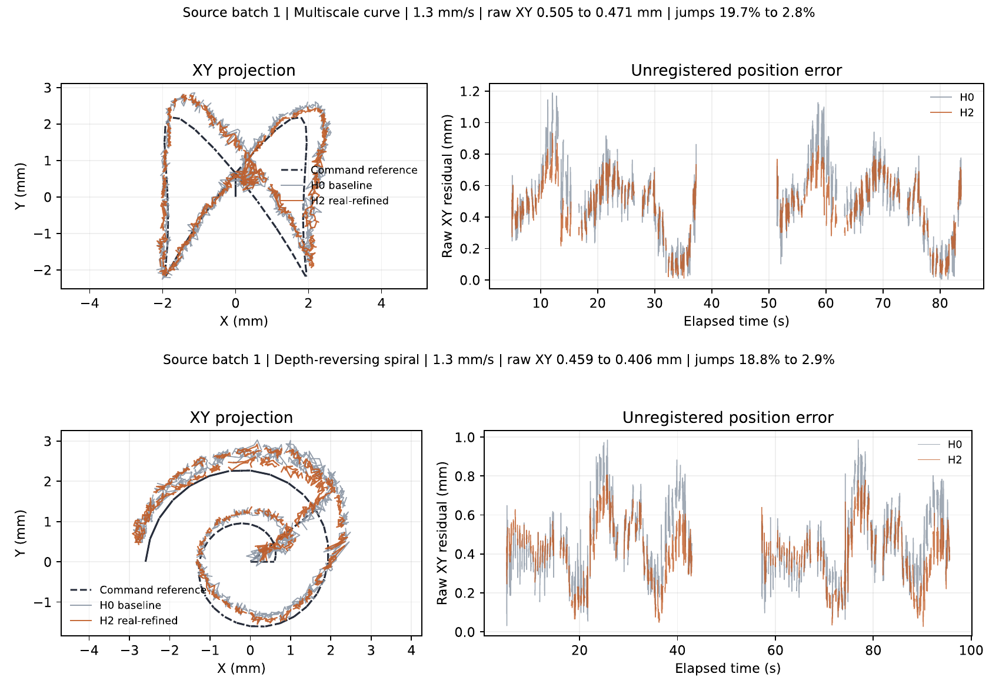

**图8。** 源会话1、1.3 mm/s的多尺度与反转螺旋示例：原始XY轨迹及随时间误差，不作配准或输出平滑。

### 3.8 匹配对照：额外训练与历史扩展的作用

表8及补充图S1将归因问题具体化。源1公平H0的原始XY、步长RMS为0.458±0.003和0.170±0.002 mm，多尺度位置组为0.415±0.017和0.122±0.008 mm，联合组为0.407±0.023和0.100±0.010 mm。相同新增停驻样本和继续优化未重现大幅稳定性收益，而原源条件内仍可同时改善原始轨迹误差和稳定性。

单0.3秒在三个单尺度中最稳定，但多尺度位置组的步长和跳变更低；原源重复会话也保留该排序。这支持所检组合，不是最优性定理或材料常数识别。源1位置组居中0.192 mm略优于联合组0.195 mm，联合组更平稳，不能拼接两模型最佳数值。

源2公平H0、位置组和联合组原始XY为0.474/0.429/0.423 mm，步长0.174/0.124/0.103 mm；同安装重复不增加独立器件数。目标对应原始XY为0.530/0.524/0.513 mm，步长0.252/0.197/0.169 mm，两个多尺度居中0.488/0.484 mm未优于冻结H0的0.478 mm。完整三顺序变异见附录C。

源1成对共同帧中，多尺度位置对公平H0的三顺序均在12条全部降低原始误差，均差−0.0451/−0.0574/−0.0284 mm；联合目标再降步长−0.0259/−0.0206/−0.0182 mm。目标位置效果更弱，一顺序有微小原始误差退化。这些是有限配对观察，不能解释为独立初始化显著性。

**表8。** 源会话1匹配继续训练。±为三训练顺序间样本标准差，共同起点；自身有效帧摘要与成对共有帧比较分别报告。

| 模型 | 原始XY（mm） | 去平移XY诊断（mm） | 步长RMS（mm） | 跳变（%） | 停驻RMS（mm） | 覆盖（%） |
| --- | --- | --- | --- | --- | --- | --- |
| 冻结基线 | 0.436 | 0.215 | 0.173 | 23.23 | 0.112 | 99.90 |
| 公平补训基线 | 0.458 ± 0.003 | 0.211 ± 0.002 | 0.170 ± 0.002 | 22.44 ± 0.75 | 0.110 ± 0.001 | 99.90 |
| 单尺度0.3秒 | 0.439 ± 0.006 | 0.203 ± 0.003 | 0.136 ± 0.005 | 11.88 ± 1.53 | 0.092 ± 0.002 | 99.90 |
| 单尺度1秒 | 0.437 ± 0.010 | 0.205 ± 0.003 | 0.158 ± 0.003 | 18.60 ± 0.73 | 0.102 ± 0.001 | 99.90 |
| 单尺度4秒 | 0.433 ± 0.007 | 0.209 ± 0.004 | 0.162 ± 0.003 | 19.77 ± 1.04 | 0.104 ± 0.002 | 99.90 |
| 多尺度位置目标 | 0.415 ± 0.017 | 0.192 ± 0.005 | 0.122 ± 0.008 | 8.17 ± 2.02 | 0.084 ± 0.004 | 99.90 |
| 多尺度联合目标 | 0.407 ± 0.023 | 0.195 ± 0.006 | 0.100 ± 0.010 | 4.08 ± 1.72 | 0.073 ± 0.005 | 99.90 |

### 3.9 冻结修正模型的同工况验证

全部八条H0通过原在线时间戳、有效性及XYZ一致性核验；原始XY误差为0.398–0.505 mm，与原源评价处于相近范围。全部八条固定候选保留。表9比较原选定冻结H0与H2，没有在这些记录上新增训练或选模。

**表9。** 全部八条固定同工况序列；逐序列等权平均。去平移XY为逐序列常量平移诊断；覆盖为逐序列覆盖均值，不给缺失输出填零误差。

| 模型 | 原始XY（mm） | 去平移XY诊断（mm） | 步长RMS（mm） | 跳变（%） | 停驻RMS（mm） | 覆盖（%） |
| --- | --- | --- | --- | --- | --- | --- |
| 冻结基线 | 0.456 | 0.221 | 0.181 | 25.76 | 0.124 | 99.76 |
| 冻结多尺度联合目标 | 0.431 | 0.202 | 0.097 | 3.38 | 0.075 | 99.76 |

原始平面差异均值降低0.0255 mm，约5.6%；残差步长RMS约降低46.5%，跳变降低22.38个百分点，停驻波动约降低39.6%。共同有效输出上，八条序列的原始XY、去平移诊断、残差步长RMS及跳变比例全部改善。这支持匹配记录工况内误差与稳定性共同改善，不把指令参考改称独立实测位置。

两个模型分别在11,769个主要参考帧中输出11,750个有效结果；有效帧身份略有差别，故各自与共有输出统计分别保留。原指令时间、完整因果上下文和冻结输出纳入复现资料。该比较不建立任意新动作、安装或器件泛化，也不把高频帧视作独立实验。

### 3.10 代表性时序模型比较

原正式评价的144项GRU—序列回放全部完成，既有控制统计在1e-12内复现。表S3列出三个训练顺序的均值与样本标准差，补充图S4在不合并装配的条件下比较GRU与匹配MLP。GRU在源会话1、源会话2及目标装配的原始XY分别为0.444 ± 0.008、0.460 ± 0.008、0.523 ± 0.005 mm；源会话1残差步长RMS为0.170 ± 0.003 mm，跳变22.12 ± 1.06%。参考与评分规则和前述对照相同。

三组实际完成951、760、670轮，DEV分别选择第5、0、1轮（表S4）。第0轮保留基线等价初始化，没有因评价成绩而排除或替换。完整TRAIN和DEV轨迹见补充图S5。训练运行结束不等于采用最终轮，三个训练顺序也不代表独立初始化稳健性。

该比较针对相同数据、初始化和DEV规则下一个有限上下文残差GRU，不建立GRU/LSTM结构、无限历史、优化设置或容量的全局最优。另八条同工况记录仅评价原冻结H0/H2，没有用于GRU训练、选模或表S3结果。

## 4. 讨论

### 4.1 整套修正能够支持的结论

原源会话支持指令参考轨迹误差与时间稳定性共同改善。公平继续训练表明，大幅稳定性收益不能仅由相同样本扩充和追加优化重现；单尺度控制支持所检多尺度组合的稳定性价值，位置目标与联合目标比较将更低步长和停驻波动关联于附加约束组合。容量和上下文仍同时变化，各损失项未独立隔离。

新增八条同工况记录用原冻结模型支持相同的共同改善：原始平面误差0.456→0.431 mm，残差步长RMS 0.181→0.097 mm；共有有效输出上每条序列两项均改善。完整原在线日志及基线复现使执行可比性的证据强于单纯元数据标签。范围仍是记录工况，不上升为普遍泛化。

可能机制包括非线性位置映射前利用平均磁信息，以及历史残差表示到达当前状态的过程；两者未唯一分离。仅扰动当前特征的DEV条件雅可比范数为1.83、1.88、1.91 mm，不是端到端敏感性，因为历史残差也包含当前特征。事后输出滤波重现多数低速平稳收益；匹配平稳程度下的源误差优势仍不建立物理延迟更优。

### 4.2 稳定性不等同于准确性

式(19)对平方误差给出偏移—散布关系，不直接分解本文欧氏距离均值。固定偏移不改变残差相邻增量，也被停驻块去均值消除，因此平稳不等于位置准确。

原两源批H0均值误差向量约(0.13,0.38) mm，24条同号。更早、尚未更换触头与重新安装的七条记录，Y均偏在−0.06到+0.09、X在−0.06到+0.17 mm，平均平面误差约0.25 mm；后来的圆和法向控制也有相似偏移，故并非只在新路径出现。历史圆/法向均偏约(0.07,0.01)/(0,−0.06) mm，评价时为(0.09,0.33)/(0.20,0.23) mm。记录包含磁层交换、源再次安装和触头更换，但不能据此认定某项已经造成0.4 mm偏移。触头几何、安装参考、基线及模型响应均可能参与，仍须独立计量分离。

同安装的两次重复不能提供跨安装偏移分布。会话开始配准是可另行验证的候选补救，居中约0.2 mm不能说明实际部署配准一定达到该精度。原始结果没有应用这种校准。H2在源域偏移范数0.398→0.373 mm的变化含有原始均误收益，不能确认是更好建模还是有利偏移方向。居中和原始P95各自有用，后者仍受偏移影响，二者都不能解决定位及同步参考未测问题。

目标磁层偏移范数约0.23 mm而居中约0.48 mm，不符合单一固定平移主导的误差形态；与源图谱跨装配失配相容，但不是唯一物理原因的识别。

$$
\mathbb{E}\|e\|^{2}=\|\mathbb{E}\,e\|^{2}+\mathop{\mathrm{tr}}\operatorname{Cov}(e) .\tag{19}
$$

### 4.3 仿真的贡献与限制

附录表13保留与设计依据相关的虚拟监督结果及负结果。100–1,000条虚拟路径可使虚拟误差明显下降，却未在所检真实域形成可靠收益：较早七条目标记录中曾有改善，但1,000条候选在12条新目标路径上误差约增40%。困难路径选择、去掉注入噪声或过滤虚拟场没有解决该问题；去噪反而将真实跳变约19.9%变25.7%，与输入噪声正则化可能作用相容[49]。动作分类器虚拟macro-F1约0.45→0.62，真实反而变差。代理预言的非单调松弛未在六条真实保持中得到合格峰值验证，并伴有无载漂移；这些是早期探索，不是最终H1/H2专门方向补偿验证。

有用线索是：代理预测侧向历史影响较大、持续数秒，虚拟读出在真实记录上显示多尺度上下文具有稳定性价值。这些观察指导了随后真实监督设计，并在原源域得到支持，在同工况补充验证中进一步检验。新增单尺度和匹配计算检验已实现的方法，没有比较等预算“用/不用仿真”的设计流程，也不能证明仿真不可替代或时间尺度唯一最优。

磁场NRMSE约25%的虚实差异不能经由公式10的上界反推出0.4 mm定位必然不可能。本文报告的是所试迁移程序的实证失败，以及仿真线索经真实训练产生的有限有效性。

### 4.4 对传感设计的启示

在假设模型下，浅压深的理论平面噪声界较差（0.4 mm深度约0.36 mm，1.4 mm约0.08 mm），但不代表具体解码器已达到或达不到某精度。增大横向梯度与噪声之比可能有利；缩小磁体—节点间距或增强磁体也改变力学条件，本文未测试，不能仅凭响应幅度提出已验证结构优化。

加载/卸载3%–11%的场差及代理预测侧向历史提示进一步研究材料历史作用。降低材料松弛与改进读出可互补，但代理时间尺度不是实测材料参数。

名义相同设计的两装配响应相差33%–38%，源图谱的准确性未直接迁移。磁牌号和真实厚度未知，不能唯一归因；结果支持进一步测量制造参数并研究每装配短标定或配准[16]，不等于当前已完成该验证。

### 4.5 局限性

参考与物理精度：全部误差相对保存的指令及指定时间模型；未独立计量触点位置和同步、未新增一致安装复测或重装配表征。约0.028 mm指令参考误差下降不是经标定的28微米物理定位改善，去平移诊断不改变原始输出。

记录工况与研究暴露：原复杂轨迹约5×5 mm、名义深度0.4–1.4 mm、速度0.7和1.3 mm/s。新增八条匹配原源磁层、触头标签、动作和名义速度，全部通过固定可比性检查。原在线一致证明软件执行相容，不独立证明机械安装或真实运动未变。八条排除于已记录拟合和选模角色，但不保证此前研究完全盲；原评价参与过早期表征探索。不建立任意触头、多接触、倾斜或滚动性能。

器件与随机性：一套源装配训练，另一套装配冻结检验；原两源会话共享安装。历史拟合与原评价触头不同，安装与参考作用未唯一分离。三次训练顺序共享初始化，不代表独立初始化或器件总体稳健性。

归因与统计：公平补训和指定单尺度处理特定混杂，容量仍不同，联合目标仍是约束组合。未作更广时间尺度搜索、显式迟滞算子或等预算有/无仿真设计流程对照。仿真提供有用方向，不证明必要性或唯一材料常数。原六个路径簇仅64种符号翻转，原区间与未多重校正检验作描述，帧不视为独立实验。

硬件与延迟：磁牌号、制造层尺寸与触头几何未独立测量；部分早期比较使用抽稀流，主原生目标流保留队列丢帧。原法向和目标圆退化继续报告。专门多方向到达相同位置/压深后长保持、超出当前0.7/1.3 mm/s工况的更快运动采集、独立反转时刻和可靠物理延迟测量仍缺失，普通停驻及命令反转不能替代。

## 5. 结论

经验动态代理支持受控虚拟探索，为已有磁触觉重建链的因果历史修正提供方向。迁移的是表征设计，不是虚拟监督或虚拟预训练权重；模型用真实源数据训练，函数保持初始化保留已有历史基线的起点。

原两源会话的选中冻结联合模型将指令参考平面误差0.436→0.408 mm及0.452→0.424 mm，残差步长RMS约降低45%。公平扩大样本继续训练未重现大幅稳定性收益；所检多尺度比指定单尺度更稳定，联合目标进一步减少波动，但不证明全局最优时间常数或独立损失机制。

另八条同工况序列全部保留并核对原在线执行，以相同冻结修正模型支持共同改善：原始XY 0.456→0.431 mm，步长RMS 0.181→0.097 mm，跳变25.76%→3.38%，平均覆盖约99.76%。共有输出上八条的原始误差及步长均改善，保留了本文在所检工况内指令参考轨迹复现与稳定性共同提升的核心结论。

代表性GRU在相同数据及DEV规则下进一步支持所检多尺度设计，但不建立对整个循环模型家族的普遍优势。

贡献来自具体仿真辅助设计、真实训练及受控验证，而非流程完整本身。回顾性暴露、装配数量有限、共同初始化、未测物理不确定性及专门方向保持/延迟缺失限制更强解释。

## 附录A. 逐序列结果、控制记录与补充示例

表10给出36条复杂路径的逐序列结果，表11给出圆和法向控制。图9为源会话2对应路径，图10包括源1最佳改善与唯一原始XY退化序列。全部序列保留，不因展示选择改变统计分母。

**表10。** 36条复杂序列完整逐条结果，长度mm，跳变阈值0.2 mm。

| 会话 | 路径类别 | 速度 / (mm/s) | 帧数 | $E_{xy}$ / H0 | $E_{xy}$ / H1 | $E_{xy}$ / H2 | $E^{\mathrm c}_{xy}$ / H0 | $E^{\mathrm c}_{xy}$ / H1 | $E^{\mathrm c}_{xy}$ / H2 | Jump rate / H0 | Jump rate / H1 | Jump rate / H2 | Dwell RMS / H0 | Dwell RMS / H1 | Dwell RMS / H2 |
| --- | --- | --- | --- | --- | --- | --- | --- | --- | --- | --- | --- | --- | --- | --- | --- |
| 源1 | 三维贝塞尔 | 0.7 | 1473 | 0.236 | 0.248 | 0.251 | 0.145 | 0.142 | 0.141 | 15.1 | 2.0 | 0.6 | 0.089 | 0.063 | 0.051 |
| 源1 | 三维贝塞尔 | 1.3 | 835 | 0.392 | 0.368 | 0.372 | 0.199 | 0.182 | 0.192 | 21.6 | 7.1 | 2.4 | 0.118 | 0.087 | 0.074 |
| 源1 | 惯性转向 | 0.7 | 1615 | 0.529 | 0.498 | 0.487 | 0.188 | 0.165 | 0.154 | 30.1 | 13.2 | 5.7 | 0.138 | 0.099 | 0.084 |
| 源1 | 惯性转向 | 1.3 | 838 | 0.533 | 0.502 | 0.491 | 0.207 | 0.191 | 0.185 | 34.1 | 16.3 | 7.7 | 0.147 | 0.107 | 0.091 |
| 源1 | 停驻返回 | 0.7 | 2428 | 0.401 | 0.395 | 0.387 | 0.180 | 0.143 | 0.141 | 27.0 | 6.4 | 1.9 | 0.130 | 0.092 | 0.074 |
| 源1 | 停驻返回 | 1.3 | 1308 | 0.420 | 0.415 | 0.406 | 0.206 | 0.172 | 0.177 | 27.7 | 7.6 | 1.6 | 0.136 | 0.102 | 0.085 |
| 源1 | 多尺度曲线 | 0.7 | 2181 | 0.521 | 0.500 | 0.492 | 0.239 | 0.216 | 0.227 | 19.4 | 5.8 | 2.5 | 0.089 | 0.065 | 0.054 |
| 源1 | 多尺度曲线 | 1.3 | 1172 | 0.505 | 0.483 | 0.471 | 0.264 | 0.227 | 0.245 | 19.7 | 7.0 | 2.8 | 0.103 | 0.072 | 0.060 |
| 源1 | 深度反转螺旋 | 0.7 | 2250 | 0.444 | 0.401 | 0.389 | 0.244 | 0.221 | 0.230 | 20.6 | 6.5 | 2.5 | 0.096 | 0.070 | 0.061 |
| 源1 | 深度反转螺旋 | 1.3 | 1220 | 0.459 | 0.422 | 0.406 | 0.261 | 0.232 | 0.238 | 18.8 | 5.6 | 2.9 | 0.095 | 0.077 | 0.069 |
| 源1 | 三叶复合轨迹 | 0.7 | 3749 | 0.379 | 0.358 | 0.354 | 0.215 | 0.188 | 0.200 | 22.7 | 7.5 | 3.2 | 0.089 | 0.072 | 0.061 |
| 源1 | 三叶复合轨迹 | 1.3 | 2103 | 0.414 | 0.391 | 0.393 | 0.230 | 0.195 | 0.208 | 21.9 | 8.3 | 3.8 | 0.113 | 0.091 | 0.086 |
| 源2 | 三维贝塞尔 | 0.7 | 1496 | 0.333 | 0.303 | 0.313 | 0.178 | 0.155 | 0.160 | 24.3 | 7.1 | 2.2 | 0.118 | 0.085 | 0.068 |
| 源2 | 三维贝塞尔 | 1.3 | 783 | 0.409 | 0.386 | 0.389 | 0.202 | 0.182 | 0.192 | 24.2 | 7.7 | 3.6 | 0.119 | 0.085 | 0.071 |
| 源2 | 惯性转向 | 0.7 | 1550 | 0.504 | 0.484 | 0.476 | 0.203 | 0.182 | 0.174 | 32.5 | 14.7 | 6.4 | 0.153 | 0.111 | 0.094 |
| 源2 | 惯性转向 | 1.3 | 823 | 0.530 | 0.512 | 0.504 | 0.203 | 0.188 | 0.181 | 31.8 | 14.8 | 5.8 | 0.149 | 0.109 | 0.094 |
| 源2 | 停驻返回 | 0.7 | 2382 | 0.406 | 0.397 | 0.389 | 0.183 | 0.148 | 0.151 | 23.9 | 6.0 | 1.4 | 0.132 | 0.085 | 0.066 |
| 源2 | 停驻返回 | 1.3 | 1284 | 0.443 | 0.443 | 0.439 | 0.215 | 0.179 | 0.184 | 29.1 | 8.8 | 2.9 | 0.141 | 0.102 | 0.082 |
| 源2 | 多尺度曲线 | 0.7 | 2135 | 0.470 | 0.437 | 0.435 | 0.260 | 0.233 | 0.248 | 19.3 | 5.3 | 2.0 | 0.096 | 0.062 | 0.049 |
| 源2 | 多尺度曲线 | 1.3 | 1164 | 0.490 | 0.468 | 0.461 | 0.277 | 0.240 | 0.258 | 19.8 | 4.9 | 1.9 | 0.100 | 0.072 | 0.060 |
| 源2 | 深度反转螺旋 | 0.7 | 2231 | 0.470 | 0.432 | 0.420 | 0.245 | 0.224 | 0.235 | 20.1 | 6.6 | 3.0 | 0.099 | 0.070 | 0.058 |
| 源2 | 深度反转螺旋 | 1.3 | 1199 | 0.517 | 0.470 | 0.452 | 0.283 | 0.249 | 0.255 | 20.1 | 6.3 | 2.6 | 0.093 | 0.073 | 0.065 |
| 源2 | 三叶复合轨迹 | 0.7 | 3723 | 0.407 | 0.384 | 0.380 | 0.215 | 0.185 | 0.199 | 24.7 | 7.2 | 3.1 | 0.093 | 0.067 | 0.057 |
| 源2 | 三叶复合轨迹 | 1.3 | 2024 | 0.448 | 0.431 | 0.428 | 0.229 | 0.193 | 0.204 | 24.9 | 9.1 | 4.7 | 0.112 | 0.080 | 0.069 |
| 目标 | 三维贝塞尔 | 0.7 | 1474 | 0.406 | 0.417 | 0.410 | 0.372 | 0.391 | 0.386 | 45.7 | 25.4 | 15.5 | 0.169 | 0.136 | 0.118 |
| 目标 | 三维贝塞尔 | 1.3 | 642 | 0.437 | 0.432 | 0.430 | 0.395 | 0.401 | 0.400 | 52.3 | 29.5 | 18.5 | 0.173 | 0.140 | 0.121 |
| 目标 | 惯性转向 | 0.7 | 883 | 0.469 | 0.517 | 0.505 | 0.427 | 0.444 | 0.423 | 40.3 | 25.5 | 16.5 | 0.175 | 0.138 | 0.122 |
| 目标 | 惯性转向 | 1.3 | 500 | 0.453 | 0.481 | 0.458 | 0.436 | 0.458 | 0.437 | 50.8 | 34.6 | 24.9 | 0.166 | 0.124 | 0.109 |
| 目标 | 停驻返回 | 0.7 | 1351 | 0.406 | 0.378 | 0.371 | 0.387 | 0.359 | 0.364 | 47.0 | 28.8 | 16.5 | 0.183 | 0.135 | 0.114 |
| 目标 | 停驻返回 | 1.3 | 727 | 0.441 | 0.423 | 0.412 | 0.431 | 0.401 | 0.400 | 50.5 | 32.1 | 22.7 | 0.175 | 0.135 | 0.110 |
| 目标 | 多尺度曲线 | 0.7 | 1264 | 0.653 | 0.636 | 0.604 | 0.596 | 0.585 | 0.568 | 38.6 | 25.3 | 16.5 | 0.115 | 0.096 | 0.081 |
| 目标 | 多尺度曲线 | 1.3 | 649 | 0.656 | 0.655 | 0.629 | 0.586 | 0.583 | 0.577 | 43.1 | 26.5 | 15.4 | 0.121 | 0.096 | 0.082 |
| 目标 | 深度反转螺旋 | 0.7 | 1287 | 0.577 | 0.595 | 0.596 | 0.506 | 0.545 | 0.573 | 40.1 | 24.0 | 14.5 | 0.145 | 0.119 | 0.105 |
| 目标 | 深度反转螺旋 | 1.3 | 692 | 0.638 | 0.637 | 0.631 | 0.563 | 0.590 | 0.606 | 48.8 | 29.8 | 19.2 | 0.133 | 0.121 | 0.113 |
| 目标 | 三叶复合轨迹 | 0.7 | 2109 | 0.561 | 0.581 | 0.557 | 0.510 | 0.542 | 0.535 | 48.6 | 32.2 | 20.3 | 0.178 | 0.152 | 0.133 |
| 目标 | 三叶复合轨迹 | 1.3 | 1308 | 0.553 | 0.558 | 0.543 | 0.526 | 0.553 | 0.542 | 50.0 | 32.7 | 21.9 | 0.183 | 0.165 | 0.153 |

**表11。** 圆与法向熟悉动作控制；每种每批一条，仅作退化检查。

| 会话 | 动作 | 帧数 | $E_{xy}$ / H0 | $E_{xy}$ / H1 | $E_{xy}$ / H2 | $E_{xyz}$ / H0 | $E_{xyz}$ / H1 | $E_{xyz}$ / H2 | Step RMS / H0 | Step RMS / H1 | Step RMS / H2 |
| --- | --- | --- | --- | --- | --- | --- | --- | --- | --- | --- | --- |
| 源1 | 圆 | 1168 | 0.400 | 0.352 | 0.356 | 0.475 | 0.431 | 0.436 | 0.143 | 0.095 | 0.074 |
| 源1 | 法向压入 | 100 | 0.323 | 0.323 | 0.341 | 0.361 | 0.361 | 0.378 | 0.206 | 0.131 | 0.100 |
| 源2 | 圆 | 1165 | 0.450 | 0.404 | 0.408 | 0.515 | 0.472 | 0.478 | 0.150 | 0.101 | 0.079 |
| 源2 | 法向压入 | 99 | 0.346 | 0.391 | 0.413 | 0.381 | 0.425 | 0.446 | 0.185 | 0.130 | 0.099 |
| 目标 | 圆 | 642 | 0.769 | 0.779 | 0.806 | 0.786 | 0.798 | 0.823 | 0.212 | 0.154 | 0.126 |
| 目标 | 法向压入 | 92 | 0.326 | 0.336 | 0.296 | 0.379 | 0.391 | 0.359 | 0.257 | 0.241 | 0.213 |

**图9。** 源会话2对应两条1.3 mm/s路径，布局与图8一致。

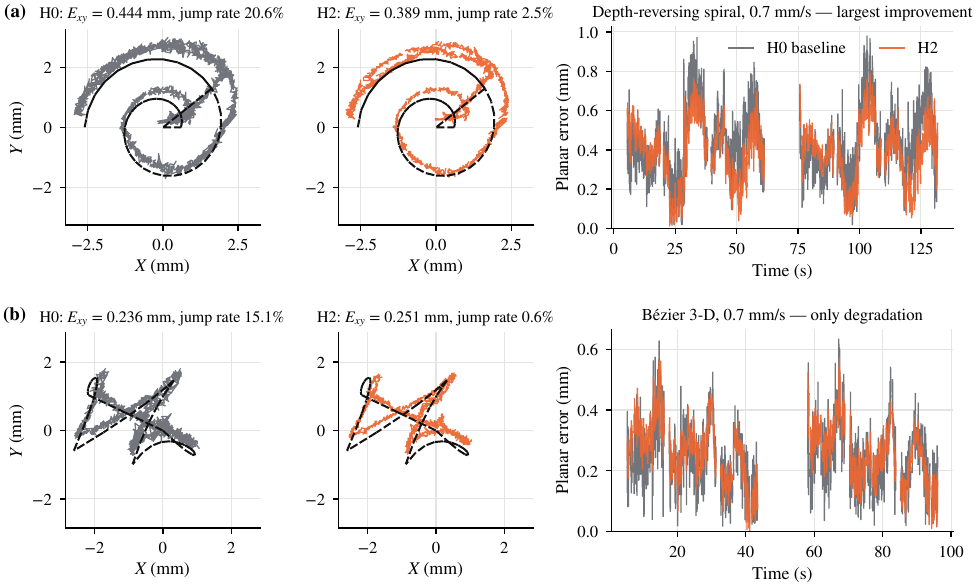

**图10。** 源会话1原始XY改善最大及唯一退化序列，保留不利结果，不用于取代总体统计。

## 附录B. 学习曲线、阈值敏感性、仿真候选与平台

图11为原两组开发目标和学习率，表12与图12为事后阈值及帧间隔核对，表13为与方法设计和适用边界有关的仿真候选及负结果，图13展示浏览器仿真。表13箭头按列中候选顺序对应，不把不同模型最好值拼接；六条保持是历史探索结果，未作为原投稿逐帧重算数据之一；虚拟直接读出的计分包含停驻，与主移动域略有不同。

**图11。** 原两组训练的开发目标与学习率，标记为DEV选择的检查点，虚线为H0。

**表12。** 不同阈值及20–45 ms间隔匹配下的跳变比例，属于事后分析。

| 会话 | 模型 | Threshold (mm) / 0.1 | Threshold (mm) / 0.2 | Threshold (mm) / 0.3 | Interval-matched, / 0.2 mm |
| --- | --- | --- | --- | --- | --- |
| 源1 | H0 | 65.2 | 23.2 | 6.2 | 23.5 |
|  | H1 | 42.6 | 7.8 | 1.4 | 7.9 |
|  | H2 | 26.5 | 3.1 | 0.5 | 3.2 |
| 源2 | H0 | 66.1 | 24.6 | 6.9 | 24.6 |
|  | H1 | 44.2 | 8.2 | 1.4 | 8.2 |
|  | H2 | 28.1 | 3.3 | 0.5 | 3.3 |
| 目标 | H0 | 80.5 | 46.3 | 22.7 | 47.0 |
|  | H1 | 67.7 | 28.9 | 10.6 | 28.7 |
|  | H2 | 55.9 | 18.5 | 5.4 | 17.9 |

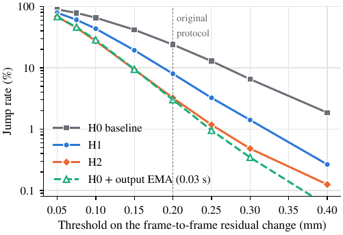

**图12。** 原两源会话均值的跳变阈值敏感性；虚线为原0.2 mm阈值。

**表13。** 与设计依据相关的仿真监督候选及真实结果，均为回顾性评价。

| 候选 | 训练数据 | 仿真结果 | 真实结果 | 结果 |
| --- | --- | --- | --- | --- |
| Planar head retrained with virtual paths | real source records mixed with 100, 500 or 1000 virtual paths | $E_{xy}$ on 64 virtual test paths: 0.423 $\rightarrow$ 0.244, 0.233, 0.226 mm | seven earlier records per device (about 10 Hz): source 0.258 $\rightarrow$ 0.303, 0.299, 0.340 mm; target 0.738 $\rightarrow$ 0.678, 0.652, 0.630 mm. Test trajectories (1000 paths): source 0.436 $\rightarrow$ 0.636 mm; target 0.521 $\rightarrow$ 0.728 mm | 未支持普遍收益 |
| Choice of virtual paths | real records with 64 common paths, plus 64 random, or plus the 64 hardest | 0.441 $\rightarrow$ 0.253, 0.250, 0.233 mm; hard-case criterion not met | source session 1: $E_{xy}$ 0.588, 0.575, 0.637 mm (H0: 0.436); jump rate 21.2, 19.9, 21.6% (H0: 23.2%) | 未支持普遍收益 |
| Preparation of virtual fields | as above (128 paths); injected noise removed, or causal low-pass at 0.1 s | 0.230 $\rightarrow$ 0.223, 0.219 mm | source session 1: $E_{xy}$ 0.581, 0.570 mm; jump rate 25.7, 24.2% | 未支持普遍收益 |
| Direct readouts with temporal context (Section 2.2.5) | 32 virtual paths only; context: none, 0.3 s, or 0.3, 1 and 4 s | $E_{xyz}$ 0.303, 0.288, 0.301 mm | source session 1$^{\mathrm b}$: $E_{xy}$ 0.947, 1.029, 0.914 mm (H0: 0.431); jump rate 50.4, 22.8, 9.9% (H0: 22.5%) | 位置迁移不佳；采用上下文线索 |
| Depth head retrained with virtual paths | real source records mixed with 100, 500 or 1000 virtual paths | – | validation objective 1–5% lower, but the radial family regressed beyond its guard in every epoch; not released | 未支持普遍收益 |
| Action classifier with causal context | 128 virtual paths only | macro-F1 0.453 $\rightarrow$ 0.616 | source session 1: 0.373 $\rightarrow$ 0.320; target: 0.358 $\rightarrow$ 0.351 | 未支持普遍收益 |
| Nonmonotonic relaxation during dwell | – (prediction of the surrogate) | predicted for 16 of 576 virtual end points | not observed in six real holds$^{\mathrm a}$ | 未支持普遍收益 |
| Multi-timescale history added to the real-trained head, real supervision (this paper) | 32 real source records; no virtual data | – | source: more accurate and smoother than H0, more accurate than filtered H0; target: smoother, not more accurate | 源条件内有效 |

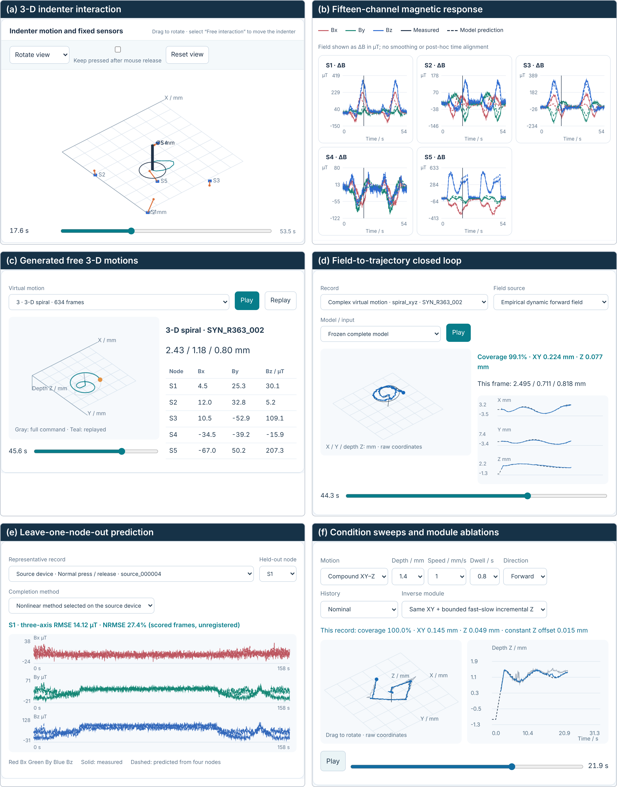

**图13。** 冻结代理驱动的浏览器平台：主视图、15通道、生成动作、独立逆解保存结果、节点补全和虚拟实验。

## 附录C. 匹配控制补充

表S1和S2分列同安装源重复与目标装配，不合并域；±为同一初始化下三训练顺序的样本标准差。完整逐记录、成对共有帧、训练轨迹及数据角色在版本化资料中保存。补充图S1联合展示原始XY与步长，S2为开发目标，S3为训练目标；不把不同目标数值直接作同一损失排名。

**表S1。** 源会话2匹配控制；不增加独立安装或器件数。

| 模型 | 原始XY（mm） | 去平移XY诊断（mm） | 步长RMS（mm） | 跳变（%） | 停驻RMS（mm） | 覆盖（%） |
| --- | --- | --- | --- | --- | --- | --- |
| 冻结基线 | 0.452 | 0.224 | 0.176 | 24.56 | 0.117 | 99.91 |
| 公平补训基线 | 0.474 ± 0.003 | 0.220 ± 0.002 | 0.174 ± 0.002 | 23.83 ± 0.66 | 0.116 ± 0.001 | 99.92 |
| 单尺度0.3秒 | 0.457 ± 0.006 | 0.213 ± 0.003 | 0.139 ± 0.006 | 12.47 ± 1.49 | 0.093 ± 0.003 | 99.90 |
| 单尺度1秒 | 0.454 ± 0.010 | 0.215 ± 0.003 | 0.161 ± 0.003 | 19.48 ± 0.84 | 0.106 ± 0.002 | 99.90 |
| 单尺度4秒 | 0.448 ± 0.007 | 0.218 ± 0.003 | 0.165 ± 0.003 | 20.77 ± 1.02 | 0.108 ± 0.002 | 99.90 |
| 多尺度位置目标 | 0.429 ± 0.018 | 0.199 ± 0.005 | 0.124 ± 0.008 | 8.67 ± 2.04 | 0.084 ± 0.004 | 99.89 |
| 多尺度联合目标 | 0.423 ± 0.024 | 0.203 ± 0.006 | 0.103 ± 0.011 | 4.39 ± 1.98 | 0.072 ± 0.006 | 99.89 |

**表S2。** 目标磁层匹配控制，保留误差退化。

| 模型 | 原始XY（mm） | 去平移XY诊断（mm） | 步长RMS（mm） | 跳变（%） | 停驻RMS（mm） | 覆盖（%） |
| --- | --- | --- | --- | --- | --- | --- |
| 冻结基线 | 0.521 | 0.478 | 0.256 | 46.33 | 0.160 | 98.49 |
| 公平补训基线 | 0.530 ± 0.005 | 0.482 ± 0.004 | 0.252 ± 0.004 | 45.04 ± 0.82 | 0.157 ± 0.001 | 98.49 |
| 单尺度0.3秒 | 0.537 ± 0.010 | 0.497 ± 0.009 | 0.214 ± 0.008 | 34.19 ± 2.17 | 0.139 ± 0.004 | 98.49 |
| 单尺度1秒 | 0.521 ± 0.003 | 0.473 ± 0.002 | 0.236 ± 0.004 | 40.71 ± 1.06 | 0.147 ± 0.002 | 98.49 |
| 单尺度4秒 | 0.519 ± 0.005 | 0.476 ± 0.003 | 0.238 ± 0.006 | 41.57 ± 1.59 | 0.147 ± 0.004 | 98.49 |
| 多尺度位置目标 | 0.524 ± 0.003 | 0.488 ± 0.004 | 0.197 ± 0.012 | 29.23 ± 3.21 | 0.131 ± 0.005 | 98.48 |
| 多尺度联合目标 | 0.513 ± 0.006 | 0.484 ± 0.003 | 0.169 ± 0.016 | 21.06 ± 4.69 | 0.117 ± 0.008 | 98.47 |

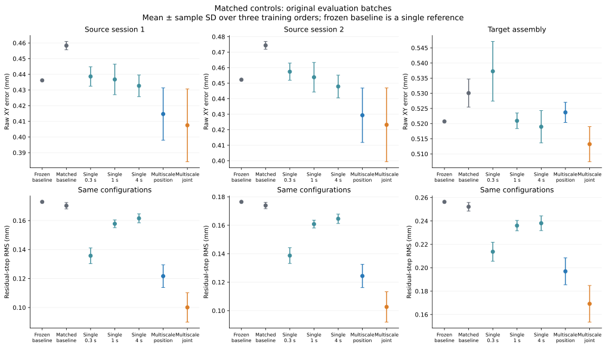

**补充图S1。** 原三批匹配对照，均值±三训练顺序标准差，冻结基线单独标识；同时展示原始误差与步长。

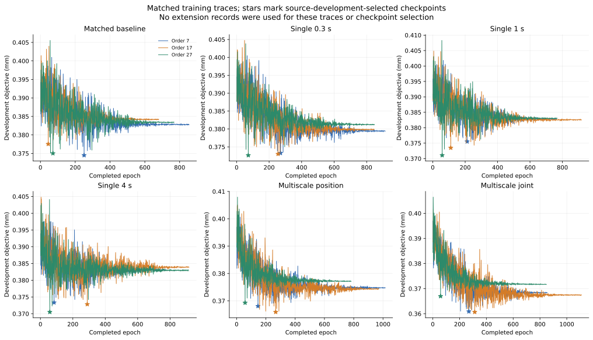

**补充图S2。** 18次匹配训练的DEV目标随真实完成轮数变化；星号标记DEV选择，无新增同工况评价数据参与选模。

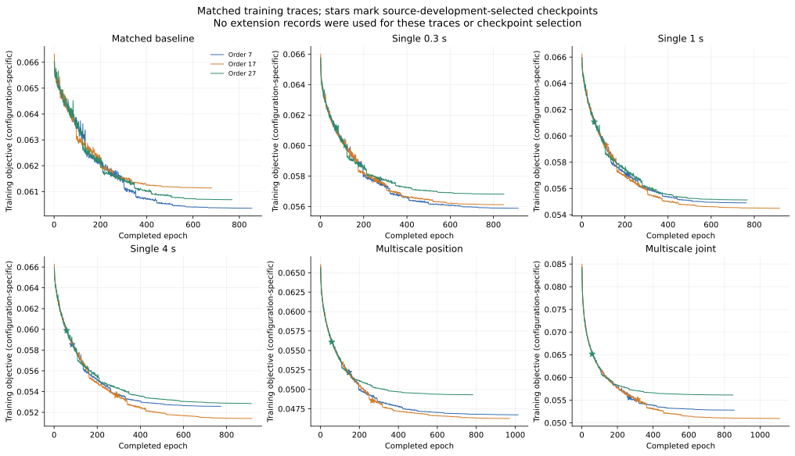

**补充图S3。** 相同18次运行的训练目标；不同配置目标量纲/组成不直接排名，星号为DEV选择。

**表S3。** 原三个正式评价域的代表性GRU。±为同一初始化下三个训练顺序的样本标准差，各域按12条复杂序列等权；去平移XY仅诊断。

| 域 | 原始XY（mm） | 去平移XY诊断（mm） | 步长RMS（mm） | 跳变（%） | 停驻RMS（mm） | 覆盖（%） |
|---|---:|---:|---:|---:|---:|---:|
| 源会话1 | 0.444 ± 0.008 | 0.214 ± 0.001 | 0.170 ± 0.003 | 22.12 ± 1.06 | 0.110 ± 0.002 | 99.90 ± 0.00 |
| 源会话2 | 0.460 ± 0.008 | 0.223 ± 0.002 | 0.173 ± 0.003 | 23.59 ± 0.98 | 0.115 ± 0.002 | 99.91 ± 0.01 |
| 目标装配 | 0.523 ± 0.005 | 0.477 ± 0.003 | 0.252 ± 0.004 | 45.16 ± 1.12 | 0.157 ± 0.003 | 98.49 ± 0.00 |

**表S4。** GRU实际训练年龄及源DEV选中检查点；选模早于GRU评价，顺序种子共享初始化。

| 顺序种子 | 完整轮数 | 更新数 | 选中轮 | 选中DEV目标 |
|---|---:|---:|---:|---:|
| 7 | 951 | 42795 | 5 | 0.372912087 |
| 17 | 760 | 34200 | 0 | 0.379230810 |
| 27 | 670 | 30150 | 1 | 0.375999878 |

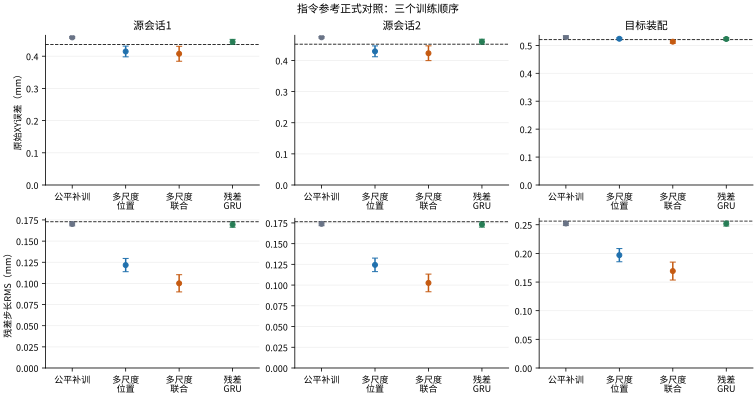

**补充图S4。** 相同数据的代表性GRU及匹配MLP控制，点与误差条为同一初始化下三个训练顺序的均值和样本标准差；虚线为原冻结基线。装配分开，横轴为离散配置。

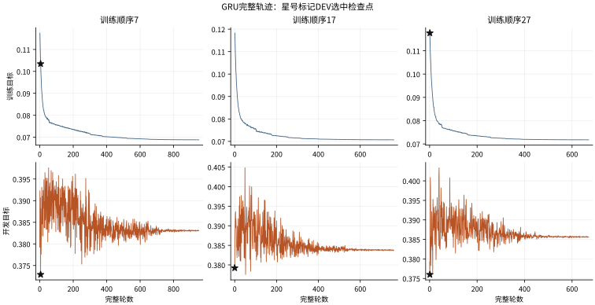

**补充图S5。** 三个GRU运行的完整训练和DEV轨迹，按各自实际年龄；星号为DEV选中点，包含一组基线等价第0轮。不是评价损失或独立初始化。

## 补充材料

[当前补充目录](https://github.com/googo2025/MagTouch-Dynamic-Simulation/tree/main/supplements/micromachines_revision_20261024_formal_v2)提供完整中英文论文、图件、正式结果表、协议与模型元数据、选中权重和可执行统计入口。[正式验证v2补充包](https://github.com/googo2025/MagTouch-Dynamic-Simulation/releases/tag/micromachines-revision-20261024-formal-v2)包含原48条正式序列的GRU比较冻结输出、八条同工况原始磁观测与命令、完整原推理操作前缀及H0/H2输出。[早期复现包](https://github.com/googo2025/MagTouch-Dynamic-Simulation/releases/tag/micromachines-revision-20261024-reproducibility)提供原正式传感日志、真实微调原始数据和原主要表格复算路线。版本包附逐文件清单、SHA-256及完成核验回执。

## 作者贡献

概念提出、方法和正式分析：L.Q.；软件：F.G.；验证：J.L.；实验调查：L.Q.和J.L.；初稿：L.Q.；审阅与编辑：F.G.。作者信息沿用投稿终稿，作者对全文负责。

## 经费支持

本研究由江苏省“青蓝工程”支持，文件为Su Teacher's Letter [2024] No. 2；该信息沿用投稿稿。

## 伦理审查声明

不适用。

## 知情同意声明

不适用。

## 数据可用性声明

科研代码、论文与结果说明见[MagTouch-Dynamic-Simulation](https://github.com/googo2025/MagTouch-Dynamic-Simulation)。[正式验证v2版本包](https://github.com/googo2025/MagTouch-Dynamic-Simulation/releases/tag/micromachines-revision-20261024-formal-v2)提供原域比较冻结输出、三个选中GRU模型及完整训练/开发轨迹、全部八条新增原始序列、完整原生操作前缀、H0/H2输出与固定评价元数据，可独立复算正式GRU和同工况比较的冻结输出统计。[早期公开原始数据及代码包](https://github.com/googo2025/MagTouch-Dynamic-Simulation/releases/tag/micromachines-revision-20261024-reproducibility)提供原生传感日志、指令时间、原真实微调TRAIN/DEV角色和原主要表格入口。表号按版本区分，当前表9及GRU增补使用v2。

公开v2副本只用Python和NumPy即可在绝对容差1e-12内复算正式GRU及同工况的全部逐记录指标、各自覆盖、共有有效输出、训练顺序均值/标准差。前一发布核验原表504行、5,976数值单元在报告精度下一致，并包含原源/目标主要表统计。归档及每个成员均经SHA-256核对。公开元数据移除机器用户名、私网及本地账号标识，保留原始/公开哈希映射；数值观测、时间戳及模型数组保持，目标队列丢帧仍属于原生协议。复现声明针对所列冻结输出表格和所供原始数据/代码来源，不声称重新执行全部历史训练或新增实物测量。

## 致谢

Codex（OpenAI）和Claude（Anthropic）辅助项目编码、分析实现和文字编辑。作者审阅、修改并对出版内容负责；实验观测来自保存的磁流及平台指令。

## 利益冲突

作者声明无利益冲突。资助方未参与研究设计、数据采集/分析/解释、论文写作或发表决定。

## 参考文献

[1] Dahiya, R.S.; Metta, G.; Valle, M.; Sandini, G. Tactile sensing—From humans to humanoids. *IEEE Trans. Robot.* **2010**, *26*, 1–20. <https://doi.org/10.1109/TRO.2009.2033627>.

[2] Kappassov, Z.; Corrales, J.A.; Perdereau, V. Tactile sensing in dexterous robot hands—Review. *Robot. Auton. Syst.* **2015**, *74*, 195–220. <https://doi.org/10.1016/j.robot.2015.07.015>.

[3] Li, Q.; Kroemer, O.; Su, Z.; Veiga, F.F.; Kaboli, M.; Ritter, H.J. A review of tactile information: Perception and action through touch. *IEEE Trans. Robot.* **2020**, *36*, 1619–1634. <https://doi.org/10.1109/TRO.2020.3003230>.

[4] Jamone, L.; Natale, L.; Metta, G.; Sandini, G. Highly sensitive soft tactile sensors for an anthropomorphic robotic hand. *IEEE Sensors J.* **2015**, *15*, 4226–4233. <https://doi.org/10.1109/JSEN.2015.2417759>.

[5] Tomo, T.P.; Somlor, S.; Schmitz, A.; Jamone, L.; Huang, W.; Kristanto, H.; Sugano, S. Design and characterization of a three-axis Hall effect-based soft skin sensor. *Sensors* **2016**, *16*, 491. <https://doi.org/10.3390/s16040491>.

[6] Tomo, T.P.; Regoli, M.; Schmitz, A.; et al. A new silicone structure for uSkin—A soft, distributed, digital 3-axis skin sensor and its integration on the humanoid robot iCub. *IEEE Robot. Autom. Lett.* **2018**, *3*, 2584–2591.

[7] Wang, H.; de Boer, G.; Kow, J.; et al. Design methodology for magnetic field-based soft tri-axis tactile sensors. *Sensors* **2016**, *16*, 1356. <https://doi.org/10.3390/s16091356>.

[8] Bhirangi, R.; Hellebrekers, T.; Majidi, C.; Gupta, A. ReSkin: Versatile, replaceable, lasting tactile skins. In Proceedings of the 5th Conf. Robot Learn. (CoRL), 2022, Vol. 164, *Proc. Mach. Learn. Res.*, pp. 587–597.

[9] Bhirangi, R.; Pattabiraman, V.; Erciyes, E.; Cao, Y.; Hellebrekers, T.; Pinto, L. AnySkin: Plug-and-play skin sensing for robotic touch. arXiv:2409.08276, 2024.

[10] Hellebrekers, T.; Kroemer, O.; Majidi, C. Soft magnetic skin for continuous deformation sensing. *Adv. Intell. Syst.* **2019**, *1*, 1900025. <https://doi.org/10.1002/aisy.201900025>.

[11] Hellebrekers, T.; Chang, N.; Chin, K.; Ford, M.J.; Kroemer, O.; Majidi, C. Soft magnetic tactile skin for continuous force and location estimation using neural networks. *IEEE Robot. Autom. Lett.* **2020**, *5*, 3892–3898. <https://doi.org/10.1109/LRA.2020.2983707>.

[12] Yan, Y.; Hu, Z.; Yang, Z.; Yuan, W.; Song, C.; Pan, J.; Shen, Y. Soft magnetic skin for super-resolution tactile sensing with force self-decoupling. *Sci. Robot.* **2021**, *6*, eabc8801. <https://doi.org/10.1126/scirobotics.abc8801>.

[13] Sun, H.; Martius, G. Guiding the design of superresolution tactile skins with taxel value isolines theory. *Sci. Robot.* **2022**, *7*, eabm0608. <https://doi.org/10.1126/scirobotics.abm0608>.

[14] Hu, H.; Zhang, C.; Lai, X.; Dai, H.; Pan, C.; Sun, H.; Tang, D.; Hu, Z.; Fu, J.; Li, T.; et al. Large-area magnetic skin for multi-point and multi-scale tactile sensing with super-resolution. *npj Flex. Electron.* **2024**, *8*, 42. <https://doi.org/10.1038/s41528-024-00325-z>.

[15] Christensen, R.M. *Theory of Viscoelasticity: An Introduction*, 2nd ed.; Academic Press: New York, NY, USA, 1982.

[16] Qian, L.; Li, J.; Guo, F. Magnetic spatial encoding and command-referenced three-dimensional contact trajectory reconstruction with a five-node soft magnetic tactile interface. *Sens. Actuators A Phys.* **2026**. submitted.

[17] Aquilina, K.; Barton, D.A.W.; Lepora, N.F. Shear-invariant sliding contact perception with a soft tactile sensor. In Proceedings of the IEEE Int. Conf. Robot. Autom. (ICRA), 2019.

[18] Wang, S.; Lambeta, M.; Chou, P.W.; Calandra, R. TACTO: A fast, flexible, and open-source simulator for high-resolution vision-based tactile sensors. *IEEE Robot. Autom. Lett.* **2022**, *7*, 3930–3937. <https://doi.org/10.1109/LRA.2022.3146945>.

[19] Si, Z.; Yuan, W. Taxim: An example-based simulation model for GelSight tactile sensors. *IEEE Robot. Autom. Lett.* **2022**, *7*, 2361–2368.

[20] Narang, Y.; Sundaralingam, B.; Macklin, M.; Mousavian, A.; Fox, D. Sim-to-real for robotic tactile sensing via physics-based simulation and learned latent projections. In Proceedings of the IEEE Int. Conf. Robot. Autom. (ICRA), 2021, pp. 6444–6451.

[21] Sferrazza, C.; D’Andrea, R. Sim-to-real for high-resolution optical tactile sensing: From images to three-dimensional contact force distributions. *Soft Robot.* **2022**, *9*, 926–937. <https://doi.org/10.1089/soro.2020.0213>.

[22] Church, A.; Lloyd, J.; Hadsell, R.; Lepora, N.F. Tactile sim-to-real policy transfer via real-to-sim image translation. In Proceedings of the 5th Conf. Robot Learn. (CoRL), 2022, Vol. 164, *Proc. Mach. Learn. Res.*, pp. 1645–1654.

[23] de Boer, G.; Raske, N.; Wang, H.; Kow, J.; Alazmani, A.; Ghajari, M.; Culmer, P.; Hewson, R. Design optimisation of a magnetic field based soft tactile sensor. *Sensors* **2017**, *17*, 2539. <https://doi.org/10.3390/s17112539>.

[24] Lin, X.; Lin, G.; Liu, R.; Wang, A.; Lou, Y. MPM-based simulation and bounded-error compression of material points for magnetic tactile sensors. *Front. Robot. AI* **2026**, *13*, 1817251. <https://doi.org/10.3389/frobt.2026.1817251>.

[25] Han, B.; Joshi, A.; Deng, J. Zero-shot Sim2Real transfer for magnet-based tactile sensor on insertion tasks. arXiv:2505.02915, 2025.

[26] Yin, J.; Qi, H.; Malik, J.; Pikul, J.; Yim, M.; Hellebrekers, T. Learning in-hand translation using tactile skin with shear and normal force sensing. arXiv:2407.07885, 2024.

[27] Mohammadi, A.; Xu, Y.; Tan, Y.; Choong, P.; Oetomo, D. Magnetic-based soft tactile sensors with deformable continuous force transfer medium for resolving contact locations in robotic grasping and manipulation. *Sensors* **2019**, *19*, 4925. <https://doi.org/10.3390/s19224925>.

[28] Yang, X.; Li, B.; Yang, L.; Shen, H. Robust estimation of contact force and location for magnetic-field-based soft tactile sensor considering magnetic source inconsistency. *Sensors* **2021**, *21*, 5388. <https://doi.org/10.3390/s21165388>.

[29] Sánchez-Durán, J.A.; Oballe-Peinado, Ó.; Castellanos-Ramos, J.; Vidal-Verdú, F. Hysteresis correction of tactile sensor response with a generalized Prandtl–Ishlinskii model. *Microsyst. Technol.* **2012**, *18*, 1127–1138. <https://doi.org/10.1007/s00542-012-1455-7>.

[30] Hochreiter, S.; Schmidhuber, J. Long short-term memory. *Neural Comput.* **1997**, *9*, 1735–1780. <https://doi.org/10.1162/neco.1997.9.8.1735>.

[31] Han, S.; Kim, T.; Kim, D.; Park, Y.L.; Jo, S. Use of deep learning for characterization of microfluidic soft sensors. *IEEE Robot. Autom. Lett.* **2018**, *3*, 873–880. <https://doi.org/10.1109/LRA.2018.2792684>.

[32] Thuruthel, T.G.; Shih, B.; Laschi, C.; Tolley, M.T. Soft robot perception using embedded soft sensors and recurrent neural networks. *Sci. Robot.* **2019**, *4*, eaav1488. <https://doi.org/10.1126/scirobotics.aav1488>.

[33] Ljung, L. *System Identification: Theory for the User*, 2nd ed.; Prentice Hall: Upper Saddle River, NJ, USA, 1999.

[34] Kalman, R.E. A new approach to linear filtering and prediction problems. *J. Basic Eng.* **1960**, *82*, 35–45. <https://doi.org/10.1115/1.3662552>.

[35] Casiez, G.; Roussel, N.; Vogel, D. 1  filter: A simple speed-based low-pass filter for noisy input in interactive systems. In Proceedings of the SIGCHI Conf. Human Factors Comput. Syst. (CHI), 2012, pp. 2527–2530. <https://doi.org/10.1145/2207676.2208639>.

[36] Tobin, J.; Fong, R.; Ray, A.; Schneider, J.; Zaremba, W.; Abbeel, P. Domain randomization for transferring deep neural networks from simulation to the real world. In Proceedings of the IEEE/RSJ Int. Conf. Intell. Robots Syst. (IROS), 2017, pp. 23–30. <https://doi.org/10.1109/IROS.2017.8202133>.

[37] Peng, X.B.; Andrychowicz, M.; Zaremba, W.; Abbeel, P. Sim-to-real transfer of robotic control with dynamics randomization. In Proceedings of the IEEE Int. Conf. Robot. Autom. (ICRA), 2018, pp. 3803–3810. <https://doi.org/10.1109/ICRA.2018.8460528>.

[38] Zhao, W.; Queralta, J.P.; Westerlund, T. Sim-to-real transfer in deep reinforcement learning for robotics: A survey. In Proceedings of the IEEE Symp. Ser. Comput. Intell. (SSCI), 2020, pp. 737–744. <https://doi.org/10.1109/SSCI47803.2020.9308468>.

[39] Chen, T.; Goodfellow, I.; Shlens, J. Net2Net: Accelerating learning via knowledge transfer. In Proceedings of the Int. Conf. Learn. Represent. (ICLR), 2016.

[40] Melexis NV. MLX90393 Triaxis magnetic node, datasheet. Rev. 012, 2025. Available online: <https://www.melexis.com/en/product/MLX90393> (accessed on 6 October 2026).

[41] Kay, S.M. *Fundamentals of Statistical Signal Processing, Volume I: Estimation Theory*; Prentice Hall: Englewood Cliffs, NJ, USA, 1993.

[42] Broomhead, D.S.; Lowe, D. Multivariable functional interpolation and adaptive networks. *Complex Syst.* **1988**, *2*, 321–355.

[43] Hoerl, A.E.; Kennard, R.W. Ridge regression: Biased estimation for nonorthogonal problems. *Technometrics* **1970**, *12*, 55–67. <https://doi.org/10.1080/00401706.1970.10488634>.

[44] Kingma, D.P.; Ba, J. Adam: A method for stochastic optimization. In Proceedings of the Int. Conf. Learn. Represent. (ICLR), 2015.

[45] Prechelt, L. Early stopping—But when? In *Neural Networks: Tricks of the Trade*; Springer: Berlin, Germany, 1998; Vol. 1524, *Lecture Notes in Computer Science*, pp. 55–69. <https://doi.org/10.1007/3-540-49430-8_3>.

[46] Efron, B.; Tibshirani, R.J. *An Introduction to the Bootstrap*; Chapman & Hall: New York, NY, USA, 1993.

[47] Cameron, A.C.; Gelbach, J.B.; Miller, D.L. Bootstrap-based improvements for inference with clustered errors. *Rev. Econ. Stat.* **2008**, *90*, 414–427. <https://doi.org/10.1162/rest.90.3.414>.

[48] Nichols, T.E.; Holmes, A.P. Nonparametric permutation tests for functional neuroimaging: A primer with examples. *Hum. Brain Mapp.* **2002**, *15*, 1–25. <https://doi.org/10.1002/hbm.1058>.

[49] Bishop, C.M. Training with noise is equivalent to Tikhonov regularization. *Neural Comput.* **1995**, *7*, 108–116. <https://doi.org/10.1162/neco.1995.7.1.108>.

[50] Cho, K.; van Merriënboer, B.; Gulcehre, C.; Bahdanau, D.; Bougares, F.; Schwenk, H.; Bengio, Y. Learning Phrase Representations using RNN Encoder–Decoder for Statistical Machine Translation. In Proceedings of the 2014 Conference on Empirical Methods in Natural Language Processing (EMNLP), Doha, Qatar, 2014, pp. 1724–1734. <https://doi.org/10.3115/v1/D14-1179>.
